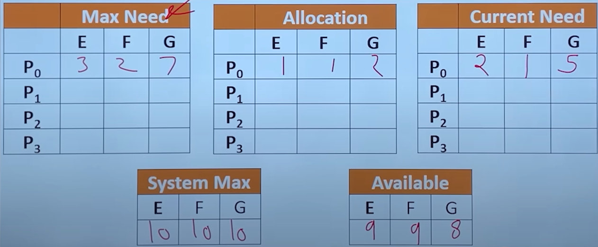
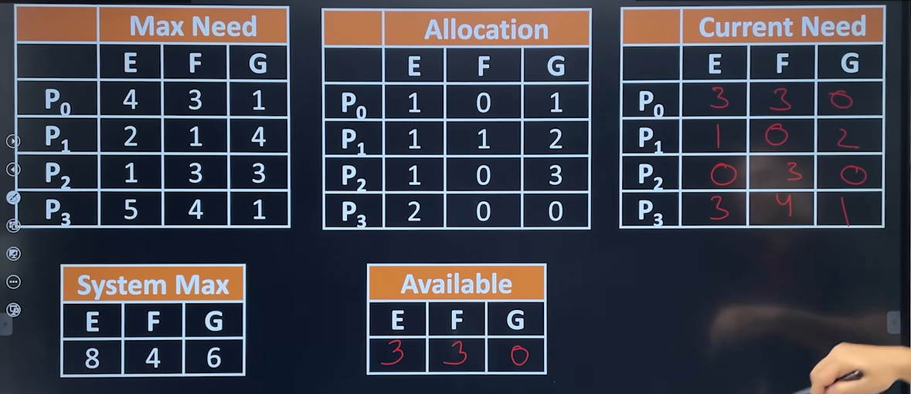
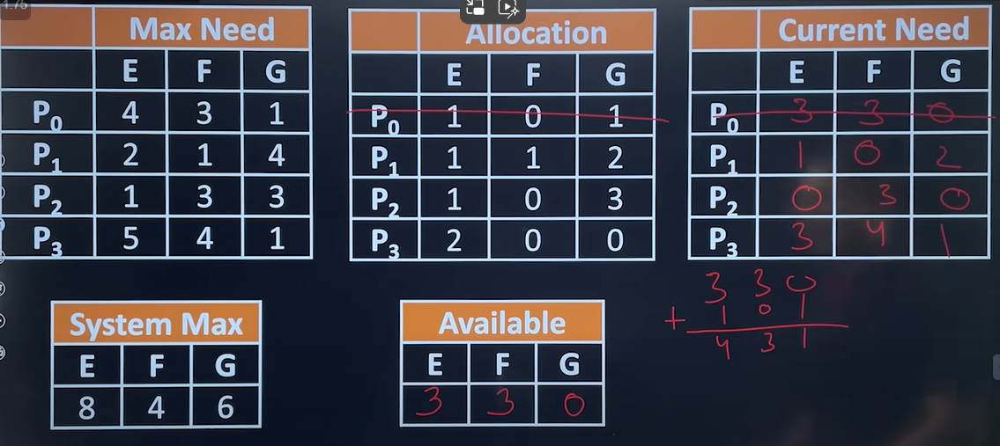
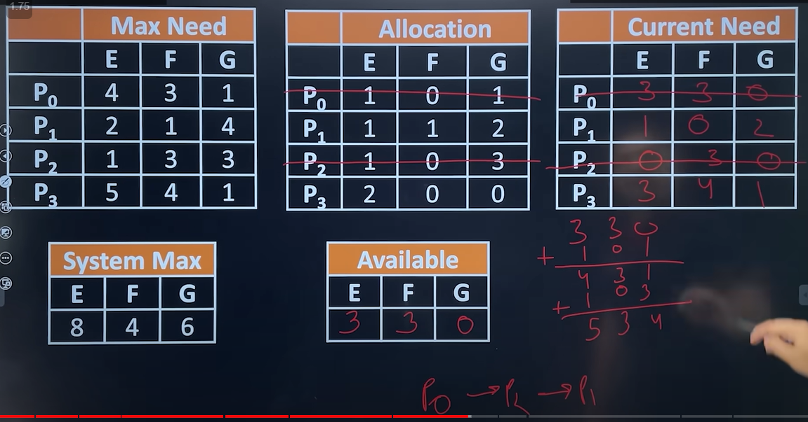
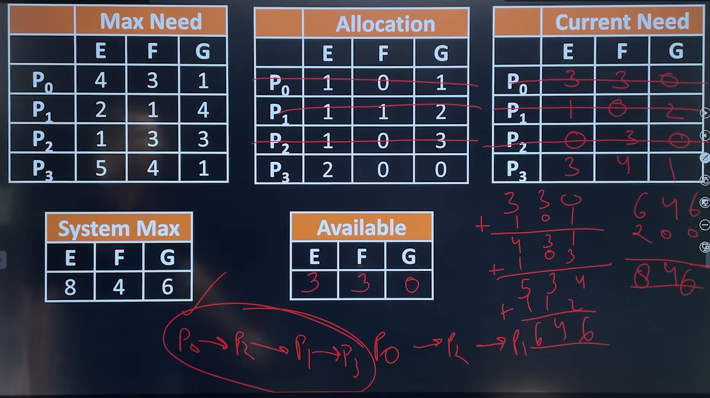
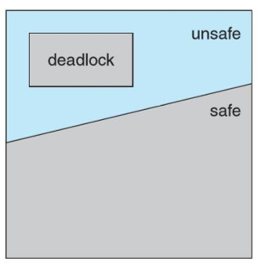

# 4.7.3 Avoidance

**Avoidance**

  - So, in order to avoid deadlock in run time, System try to maintain some books like a banker, whenever someone ask for a loan(resource), it is granted only when the books allow.

  - To avoiding deadlocks we require additional information about how resources are to be requested. which resources a process will request during its lifetime.

  - With this additional knowledge, the operating system can decide for each request whether process should wait or not.

EXAMPLE:

P0 ko run kar liya, toh uski allocated resources free ho gye:

P2 ko run kardiya and uske bhi resources wapas le liye

P0 --> P2 --> P1 ---> P3 is a safe sequence

  - Safe sequence: some sequence in which we can satisfies demand of every process without going into deadlock, if yes, this sequence is called safe sequence.

  - Safe Sate: If their exist at least one possible safe sequence.

  - Unsafe Sate: If their exist no possible safe sequence.

