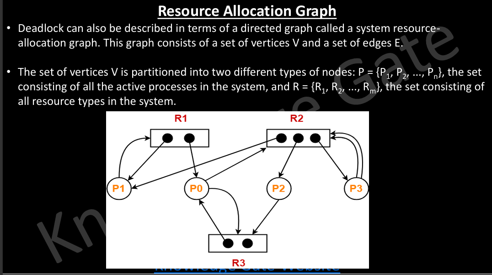
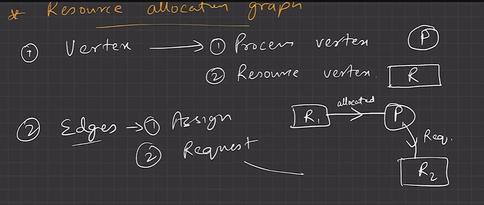
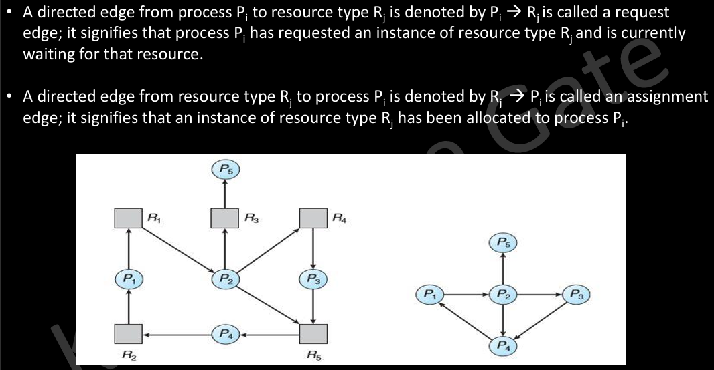
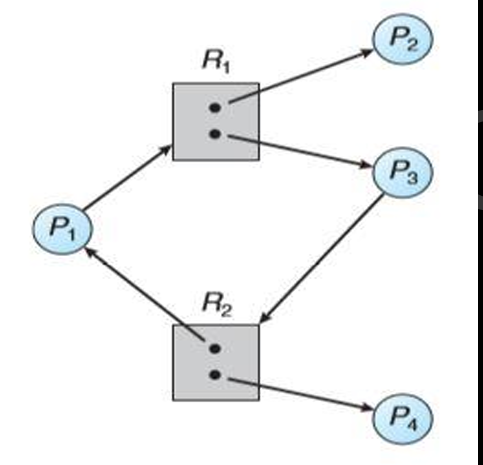
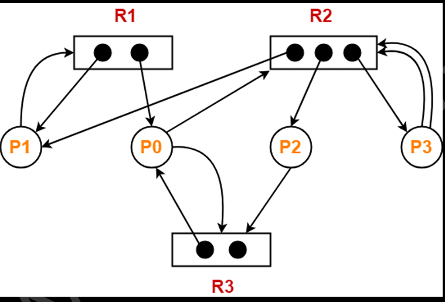
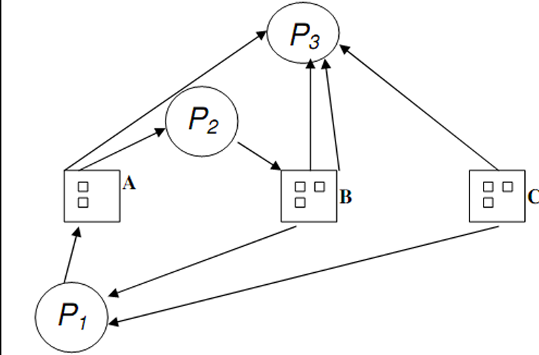
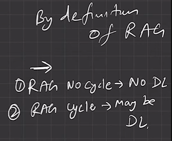
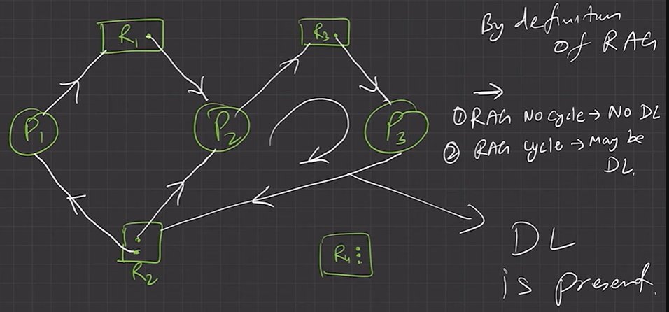
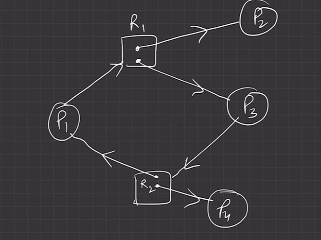
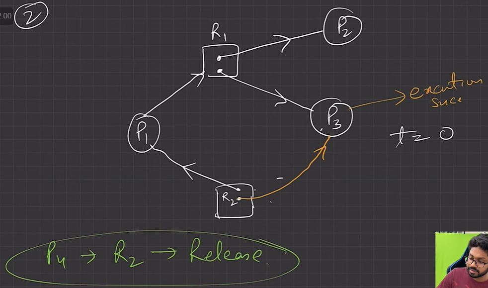

# 4.7.3.2 Resource Allocation Graph

• Cycle in resource allocation graph is necessary but not sufficient condition for detection of deadlock. Presence of a cycle on resource allocation graph doesn't necessarily mean that there's a deadlock. If cycle is not there then deadlock is definitely not there.

• If every resource have only one resource in the resource allocation graph than detection of cycle is necessary and sufficient condition for deadlock detection.

CYCLE AND DEADLOCK:

CYCLE BUT NO DEADLOCK:

