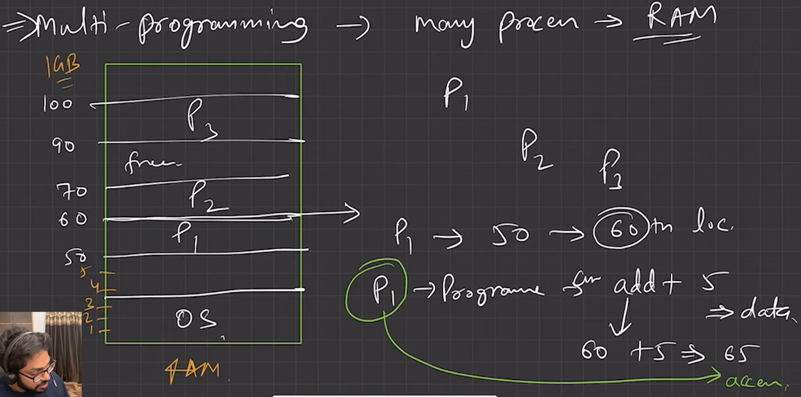
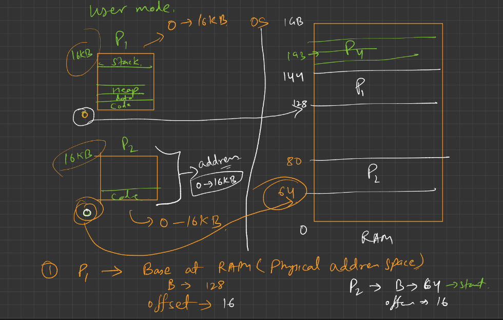
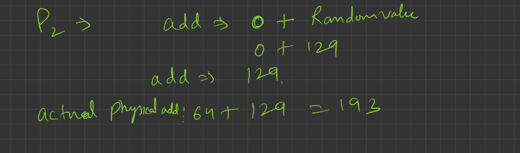

# 4.9.1 Memory Management

(Chapter-9: Memory Management) - Memory Hierarchy, Locality of reference, Multiprogramming with fixed partitions, Multiprogramming with variable partitions, Protection schemes, Paging, Segmentation, Paged segmentation.

| [Lecture 24: Memory Management in OS \|\| Contiguous Memory Allocation](<https://www.youtube.com/watch?v=ZNcArN7ODrw&list=PLDzeHZWIZsTr3nwuTegHLa2qlI81QweYG&index=25&pp=iAQB>) | [Lecture 25: How OS manages Free Space? \|\| Memory Management](<https://www.youtube.com/watch?v=_hrKEA1sEUo&list=PLDzeHZWIZsTr3nwuTegHLa2qlI81QweYG&index=26&pp=iAQB>) | [Lecture 26: What is Paging? \|\| Non-Contiguous Memory Allocation](<https://www.youtube.com/watch?v=P65WxiAjySs&list=PLDzeHZWIZsTr3nwuTegHLa2qlI81QweYG&index=27&pp=iAQB>) | [Lecture 27: What is Segmentation \|\| Non-Contiguous Memory Allocation](<https://www.youtube.com/watch?v=fRPz3dQ2LZc&list=PLDzeHZWIZsTr3nwuTegHLa2qlI81QweYG&index=28&pp=iAQB>) |  |
| --- | --- | --- | --- | --- |

[L12: Memory management, Virtual memory, Paging and more](<https://www.youtube.com/watch?v=MWfLtoRO11Y&list=PL7CBVLpg0zqfIdcwDNa5c2xbhvK4crNqc&index=18&pp=iAQB>)

[L-5.1: Memory Management and Degree of Multiprogramming | Operating System](<https://www.youtube.com/watch?v=eESIFJz7mJw&list=PLxCzCOWd7aiGz9donHRrE9I3Mwn6XdP8p&index=46&pp=iAQB>)

[L-5.2: Memory management  Techniques | Contiguous and non-Contiguous | Operating System](<https://www.youtube.com/watch?v=FrTttJLN7Kw&list=PLxCzCOWd7aiGz9donHRrE9I3Mwn6XdP8p&index=47&pp=iAQB>)

[L-5.3: Internal Fragmentation | Fixed  size Partitioning | Memory management | Operating System](<https://www.youtube.com/watch?v=bK-VhQA512c&list=PLxCzCOWd7aiGz9donHRrE9I3Mwn6XdP8p&index=48&pp=iAQB>)

[L-5.4: Variable size Partitioning |  Memory management | Operating System](<https://www.youtube.com/watch?v=JdPmsrYqRDY&list=PLxCzCOWd7aiGz9donHRrE9I3Mwn6XdP8p&index=49&pp=iAQB>)

[L-5.5: First Fit, Next Fit, Best Fit, Worst fit Memory Allocation | Memory Management | OS](<https://www.youtube.com/watch?v=N3rG_1CEQkQ&list=PLxCzCOWd7aiGz9donHRrE9I3Mwn6XdP8p&index=50&pp=iAQB>)

[L-5.6: GATE Question Solved on First Fit,Best Fit and Worst fit Memory Allocation | Operating System](<https://www.youtube.com/watch?v=W7wDlABjCQI&list=PLxCzCOWd7aiGz9donHRrE9I3Mwn6XdP8p&index=51&pp=iAQB>)

[L-5.7: GATE 2007 Question Solved on First Fit,Best Fit and Worst fit with timeline |Operating System](<https://www.youtube.com/watch?v=XOFTINaUZt8&list=PLxCzCOWd7aiGz9donHRrE9I3Mwn6XdP8p&index=52&pp=iAQB>)

[L-5.8: Need of Paging | Memory Management | Operating System](<https://www.youtube.com/watch?v=I2TbCGNv1xQ&list=PLxCzCOWd7aiGz9donHRrE9I3Mwn6XdP8p&index=53&pp=iAQB>)

[L-5.9: What is Paging | Memory management |  Operating System](<https://www.youtube.com/watch?v=6c-mOFZwP_8&list=PLxCzCOWd7aiGz9donHRrE9I3Mwn6XdP8p&index=54&pp=iAQB>)

[L-5.10: Question Explanation on Logical address and Physical address space | Operating System](<https://www.youtube.com/watch?v=30P73tWmU0s&list=PLxCzCOWd7aiGz9donHRrE9I3Mwn6XdP8p&index=55&pp=iAQB>)

[L-5.11: Question Explanation on Paging | Memory Management | Operating System](<https://www.youtube.com/watch?v=L80DakYu4uw&list=PLxCzCOWd7aiGz9donHRrE9I3Mwn6XdP8p&index=56&pp=iAQB>)

[L-5.12: Page Table Entries | Format of Page Table | Operating System](<https://www.youtube.com/watch?v=JyPMJnnkNmQ&list=PLxCzCOWd7aiGz9donHRrE9I3Mwn6XdP8p&index=57&pp=iAQB>)

[L-5.13: 2-Level Paging in Operating System | Multilevel Paging](<https://www.youtube.com/watch?v=PiEq1CoP0ds&list=PLxCzCOWd7aiGz9donHRrE9I3Mwn6XdP8p&index=58&pp=iAQB>)

[L-5.14: Inverted paging | Memory Management | Operating System](<https://www.youtube.com/watch?v=spApKfUa8BI&list=PLxCzCOWd7aiGz9donHRrE9I3Mwn6XdP8p&index=59&pp=iAQB>)

[L-5.15: Paging Questions in Operating System(OS) | Imp Question for all competitive exams](<https://www.youtube.com/watch?v=ucNJMcX-duE&list=PLxCzCOWd7aiGz9donHRrE9I3Mwn6XdP8p&index=60&pp=iAQB>)

TWO PROCESS EXECUTE INDEPENDENTLY, SO OS MUST HANDLE THAT P1 DO NOT CHANGE P2s MEMORY.

