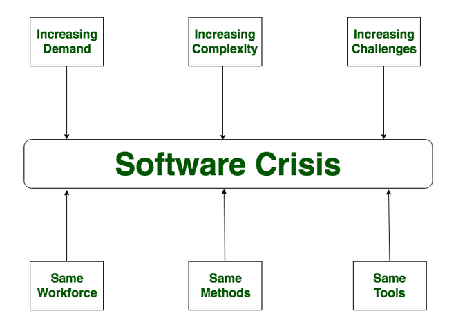

# 5.1.2 Introduction

**Unit-1 (****Introduction)**

  - Introduction to Software Engineering

  - Software Components

  - Software Characteristics

  - Software Crisis

  - Software Engineering Processes

  - Similarity and Differences from Conventional Engineering Processes

  - Software Quality Attributes

  - Software Development Life Cycle (SDLC) Models:

    - Waterfall Model

    - Prototype Model

    - Spiral Model

    - Evolutionary Development Models

    - Iterative Enhancement Models

**What is Software**

  - **Program:** A step-by-step set of instructions written in a programming language to perform a specific task on a computer.

  - **Software:** A program combined with proper documentation (including requirement analysis, design, coding, and testing) and user manuals (such as installation guides).

    - Software = Program + Documentation

**Software Components**

  - A program is a subset of software. It becomes software only when documentation and an operating procedure manual are prepared.

  - **Components:**

    - **Program** \* **Documents:** Software documentation includes all descriptions, programs, graphics, and instructions related to the design, coding, testing, and preparation of the software.

    - **Operating Procedure (User Manual & Operational Manual):** Provides information about the software, how to use it, how to install it, and how to control its activities.

**Software Crisis**

  - **Problems with Software:**

    - The major problems in the software industry are that software often exceeds its development cost and time limits, and is frequently of poor quality.

  - "As long as there were no machines, programming was no problem at all; when we had a few weak computers, programming became a mild problem, and now we have gigantic computers, programming has become an equally gigantic problem." — Edsger Dijkstra, Humble Programmer (EWD340), Communications of the ACM

