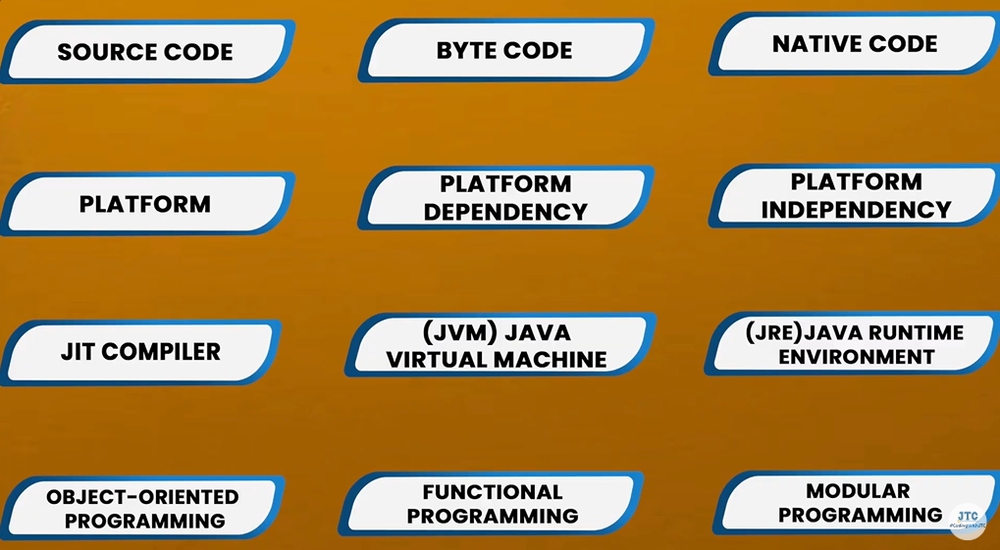

# 1.1 Topics

**1. Introduction to Java**

  - **Overview of Java**: History, features, and use cases

  - **Setting Up Java Environment**: Install JDK, setup IDE (Eclipse, IntelliJ IDEA, or VS Code).

  - **Hello World Program**: Writing your first Java program.

  - **JVM Features and Architecture:**  why Java is secure, portable, object-oriented, robust, multithreaded, etc. along with the architecture, how a Java program executes, what makes Java as a Platform independent language

[Compiler vs Interpreter](<https://www.geeksforgeeks.org/compiler-vs-interpreter-2/>) [How Java is Platform Independent?](<https://www.geeksforgeeks.org/java-platform-independent/>) [JVM Architecture](<https://www.geeksforgeeks.org/jvm-works-jvm-architecture/>) [Features of Java](<https://www.geeksforgeeks.org/jdk-17-new-features-in-java-17/>)

  - **Java Ecosystem:** Understand JVM, JRE, and JDK.

[Java Introduction \| Vishwa Mohan \| Day - 01](<https://www.youtube.com/watch?v=Dp8fkFl__Fw>)

[Java Features & Comparison \| Vishwa Mohan \| Day -02](<https://www.youtube.com/watch?v=TERyAoEHFvM>)

[How to Setup Java and Java First Program \| Vishwa Mohan \| Day -03](<https://www.youtube.com/watch?v=epvgX2JhrPw>)

[Advance Java \| Introduction \| J2EE \| Java \| Video 1](<https://www.youtube.com/watch?v=ptfZLyuOzFc>)

[Set Path \| Command Prompt \| Byte Codes \| Core Java \| Java \| Video 3 \|](<https://www.youtube.com/watch?v=mLWJJExuH_0&pp=0gcJCX4JAYcqIYzv>)
