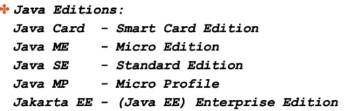
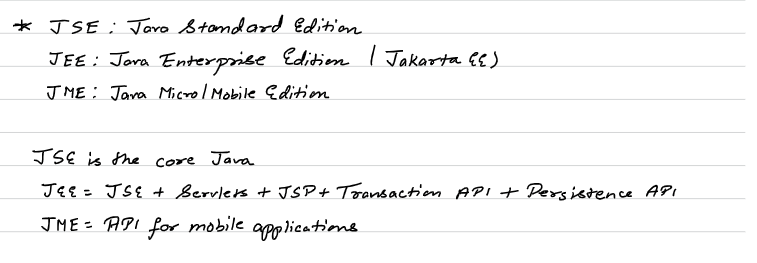

# 1.2 Java History, JShell



## SETUP:

## JSHELL

Experimental java runs directly in the terminal

``` jshell ```

Jshell > 2+ 3

Jshell > System.out.print(6);

Jshell >  System.out.println("hello world!);

type `jshell` to go in jshell and type `/exit` to leave

**Tasks.json for VS Code Input Output Setup**

  - .vscode > tasks.json

  - Java code files should be in a subfolder inside of workspace folder (ROOT), and input.txt and output.txt in ROOT.

{

"version": "2.0.0",

"tasks": \[

{

"label": "run-java",

"type": "shell",

"command": "cmd.exe",

"args": \[

"/c",

"javac ${file} && java -cp ${workspaceFolder} ${relativeFileDirname}.${fileBasenameNoExtension} < ${workspaceFolder}/input.txt > ${workspaceFolder}/output.txt"

\],

"group": {

"kind": "build",

"isDefault": true

},

"options": {

"cwd": "${workspaceFolder}"

},

"presentation": {

"echo": false,

"reveal": "silent",

"focus": false,

"panel": "dedicated"

},

"problemMatcher": \[\],

"detail": "Compiles and runs the current Java file with input from input.txt and output to output.txt, supporting packages."

}

\]

}


