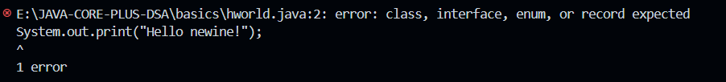
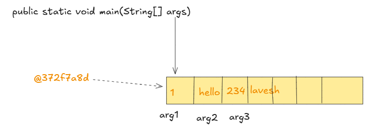
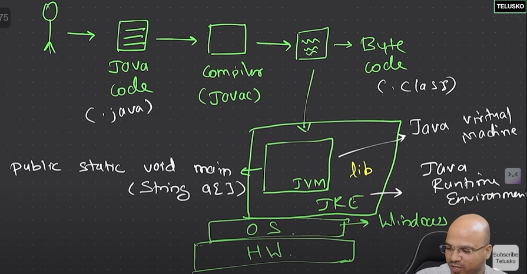
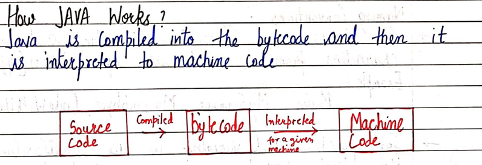
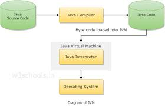
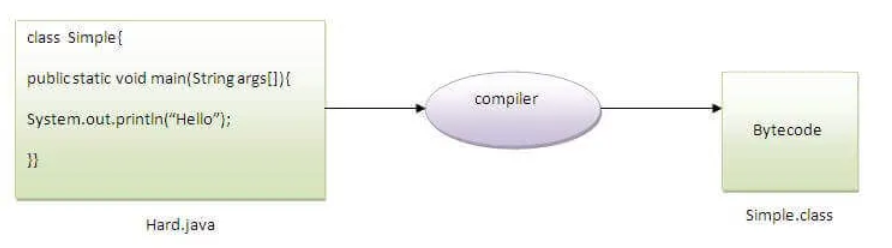
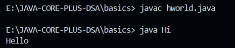

# 1.3 Hello World

## JAVA CODE

For running and compiling java code:

| To compile: | **javac className.java** |
| --- | --- |
| To execute: | **java className** |
| Directly compile and execute (new feature- single file) | **java className.java** |

Directly printing without making class and main method gives error:

## How Java Works

package basics; // <name of subfolder>

class hello{

// ENTRY POINT OF CODE: MAIN FUNCTION

public static void main(String args\[\]){

System.out.println("Hello Lavesh!");

System.out.print("Hello Lavesh!");

}

}

Let's see what is the meaning of class, public, static, void, main, String\[\], System.out.println().

  - **class** keyword is used to declare a class in Java.

  - **public** keyword is an access modifier that represents visibility. It means it is visible to all. This method can be called from anywhere. JVM calls it from outside the package.

  - **static** is a keyword. If we declare any method as static, it is known as the static method. The core advantage of the static method is that there is no need to create an object to invoke the static method. The main() method is executed by the JVM, so it doesn't require creating an object to invoke the main() method. So, it saves memory.

  - If we do not create an object of the class, then we cant call the methods of that class through the object. Because when an object is created then only it goes to memory and we can point to its methods. So we create a static method, so that as soon as class is made this static method goes to memory directly without even needing to instantiate an object. Static method doesn't depend on object instantiation.

  - **void** is the return type of the method. It means it doesn't return any value.

  - **main** represents the starting point of the program. MAIN IS THE DEFAULT METHOD THAT A COMPILER RUNS AS A STARTING POINT. JVM calls the main method of bytecode to run the program.

  - **String\[\] args** or **String args\[\]** is used for [command line argument](<https://www.javatpoint.com/command-line-argument>).

class args{

public static void main(String args\[\]){

/\* printing the args\*/

System.out.println(args);

System.out.println(args.length);

System.out.println(args\[0\]);

System.out.println(args\[1\]);

System.out.println(args\[2\]);

System.out.println(args\[3\]);

}

}

**Javac args.java**

**Java args 1 hello 234 lavesh **

\[Ljava.lang.String;@372f7a8d

4

1

hello

234

lavesh

  - [System.out.println(](<https://www.javatpoint.com/system-out-println-in-java>)**)** is used to print statement. Here, System is a class, out is an object of the PrintStream class, println() is a method of the PrintStream class.

**Difference between print() and println() methods**

Both methods are used to display the results on the monitor. The **print()** method displays the result on the console and **retains the cursor in the same line**. It works only with an argument. The **println()** method also displays the result on the console but **moves the cursor to the next line**. It can also work without arguments.

## HOW JAVA WORKS:

Java is first compiled to bytecode and then interpreted to machine code.

Q) Can you save a Java source file by another name than the class name?

Yes, if the class is not public. It is explained in the figure given below:

| To compile: | javac Hard.java |
| --- | --- |
| To execute: | java Simple |

Observe that, we have compiled the code with file name but running the program with class name. Therefore, we can save a Java program other than class name.

// hworld.java

class Hi{

public static void main(String args\[\]){

System.out.println("Hello");

}

}

Why in java single file we can have only one public class?
