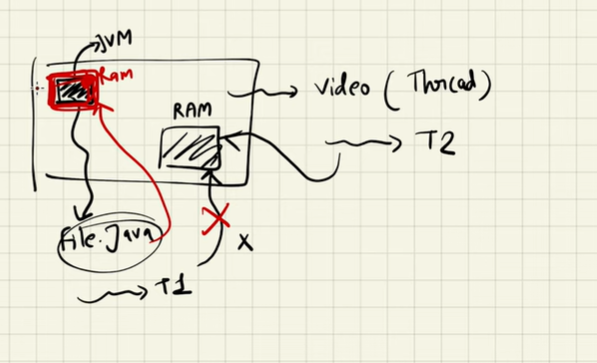
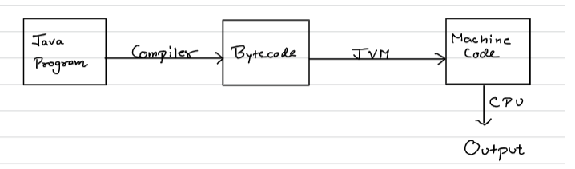
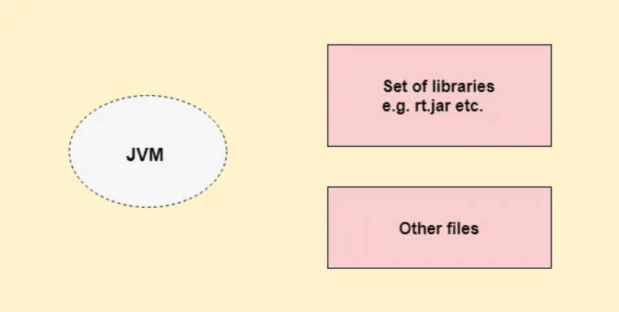
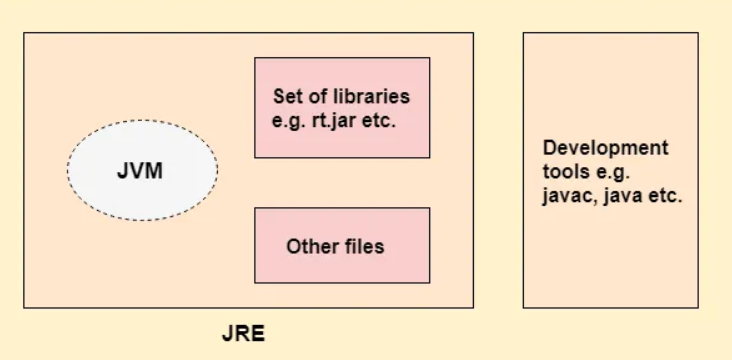
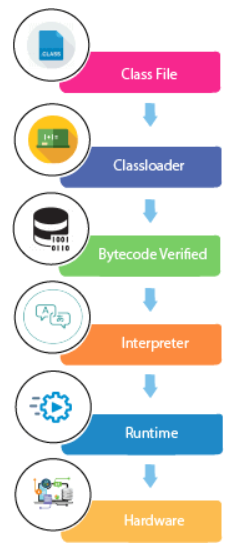

# 1.4 Java Internals

JDK, JRE, JVM (Java virtual machine)

All are platform dependent.

**JVM**

JVM (Java Virtual Machine) is an abstract machine. It is called a virtual machine because it doesn't physically exist. It is a **specification that provides a runtime environment in which Java bytecode can be executed**. It can also run those programs which are written in other languages and compiled to Java bytecode. Java gives us platform independency and thread safety.

If video player is running on thread T1 and our JVM is running code on thread T2 and both thread T1 and T2 want to access the RAM, so JVM wont access the common RAM. It will only use the RAM which is allocated to JVM for functioning. JVM asks for RAM, Storage and CPU for its functioning. So, this provides isolation to JVM and its thread processes.

JVMs are available for many hardware and software platforms. **JVM, JRE, and JDK are**** platform dependent**** because the configuration of each **[OS](<https://www.javatpoint.com/os-tutorial>)** is different from each other.** However, **Java is platform independent**. There are three notions of the JVM: *specification*, *implementation*, and *instance*.

The JVM performs the following main tasks:

  - Loads code

  - Verifies code

  - Executes code

  - Provides runtime environment

A JVM converts bytecode to machine code; JVM interprets the bytecode and translates it into machine code specific to the platform it's running on.

Input for JVM is bytecode and output is machine code. Same Bytecode can be run on any JVM, and JVM (platform dependent) interprets it accordingly to the platform, thus making java platform independent.

JVM has JIT (Just In Time) compiler which takes bytecode and converts it to machine code. Compiled bytecode is platform independent. JVM is platform dependent.

**JRE**

  - JRE is an acronym for Java Runtime Environment. It is also written as Java RTE. The Java Runtime Environment is a **set of software tools which are used for developing Java applications**.

  - JRE = JVM + Class Libraries (java.math, java.util)

  - It is used to provide the runtime environment. It is the implementation of JVM. It physically exists. JRE provides an environment that allows you to run the Java software locally.

  - It contains a set of libraries + other files that JVM uses at runtime.

  - If we have JRE then we can run any java program but we cant code the program.

  - JRE doesn’t contain any development tools like java compiler, debugger etc. If you want to execute any java program, you should have JRE installed.

**JDK**

JDK is an acronym for Java Development Kit. The Java Development Kit (JDK) is a software development environment which is used to develop Java applications and [applets](<https://www.javatpoint.com/java-applet>). It physically exists. It contains JRE + development tools.

The JDK contains** a programming language (java)**, **private Java Virtual Machine (JVM) and a few other resources such as an interpreter/loader (java), a compiler (javac), an archiver (jar), a documentation generator (Javadoc), etc.** to complete the development of a Java Application.

