# 1.4.1 JVM Architecture

- JVM (Java Virtual Machine) is an abstract machine.

- It is called a virtual machine because it doesn't physically exist. It is a **specification that provides a runtime environment in which Java bytecode can be executed**.

- JVM is responsible for converting the bytecode into machine code before running Java applications on any platform. It is platform dependent by nature. There is a JVM for every type of operating system i.e. it was coded for three different architectures i.e. Windows, macOS, Linux.

- It can also run those programs which are written in other languages and compiled to Java bytecode.

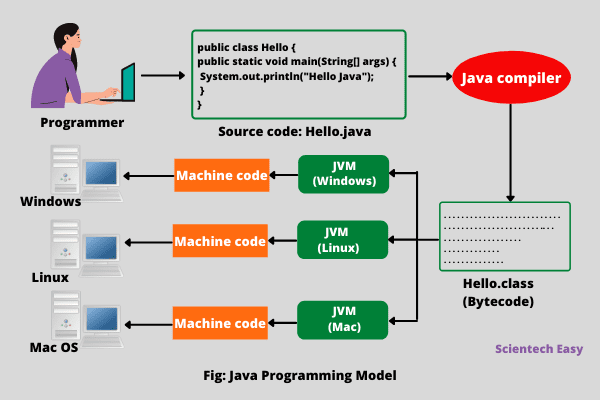

- Bytecode is not machine instructions instead they are instructions which JVM can understand.

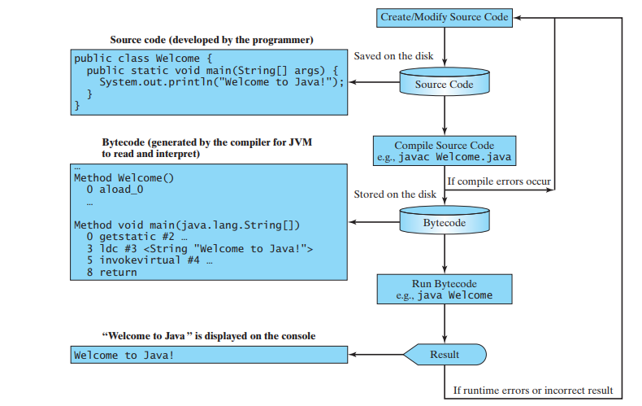

**Need for Java Virtual Machine**

Java virtual machine performs the following tasks:

  - Loads the code.

  - Verifies code.

  - Executes the code.

  - Provides a run-time environment for various applications.

  - JVM provides a Memory area.

  - Provides a Register set.

  - JVM provides the garbage collection heap.

  - Reports fatal errors.

  - Provides a class file format

**JVM Architecture:**

Let's understand the internal architecture of JVM. It contains three main subsystems:

  - classloader subsystem,

  - memory area (runtime data area)

  - execution engine

**JVM Memory Management:**

The major concepts in Java Memory Management :

  - JVM Memory Structure (memory area)

  - Working of Garbage Collector

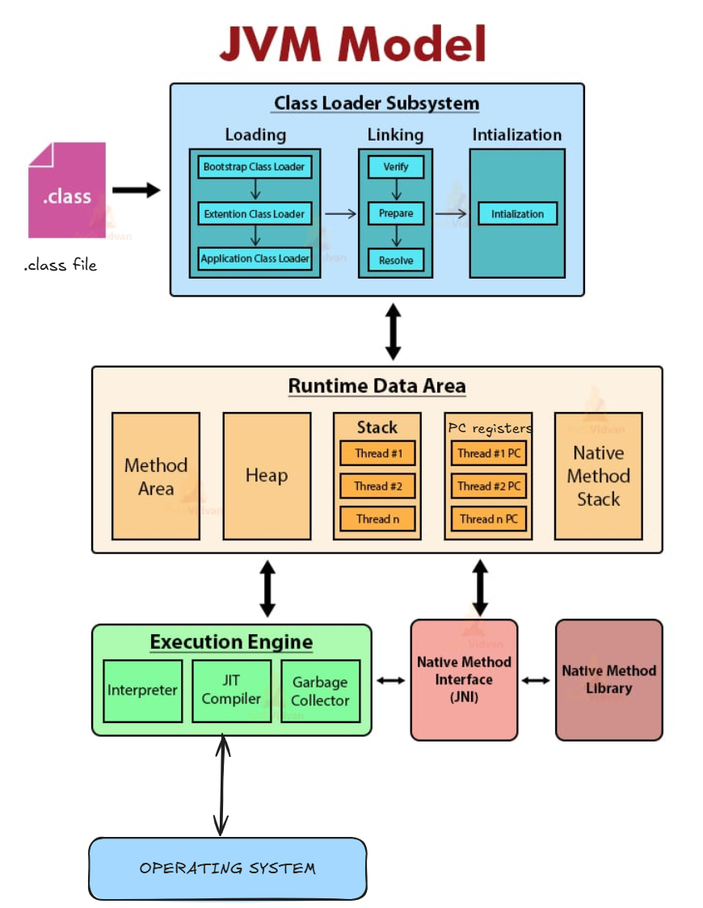

**Class Loader Subsystem**

**Classloader:** It is the **subsystem of JVM that is used to load class files**.

Classloader is a subsystem of JVM which is used to load class files in memory. Whenever we run the java program, it is loaded first by the classloader. Classloader scans all the classes using classpath.

The Class Loader subsystem is the only component of the JVM that deals with the host device’s file system. It’s responsible for locating class files and loading classes into the JVM.

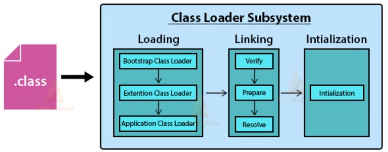

Three built-in classloaders in Java are:

**1. Bootstrap ClassLoader**

This is the classloader which is the super class of Extension classloader. It loads the rt.jar file.

**2. Extension ClassLoader**

It is the ClassLoader which loads the jar files present in the directory. This is the child Bootstrap classLoader and parent of System classloader. It loads classes from the JDK extensions directory, usually **$JAVA_HOME/lib/ext** directory.

**3. System/Application ClassLoader**

It is the classLoader which loads the class files from the classpath. This is the child of the Extension classloader.

*The process of loading classes in the JVM is dynamic, meaning that classes aren’t preloaded but rather loaded on demand, this is known as lazy loading. *

On program start, the **JVM loads the class containing the main() method** and all the classes it references. Afterward, whenever a new type is encountered, the ClassLoader system is asked to load it.

ClassLoader Delegation:

When JVM request for a class, it invokes a **loadClass()** method of the java.lang.ClassLoader class by passing the fully classified name of the class. The loadClass() method calls for findLoadedClass() method to check that the class has been already loaded or not. It is required to avoid loading the class multiple times.

If the class is not loaded, it delegates the request to parent ClassLoader to load the class. If the ClassLoader is not finding the class, it invokes the findClass() method to look for the classes in the file system. The following diagram shows how ClassLoader loads class in Java using delegation.

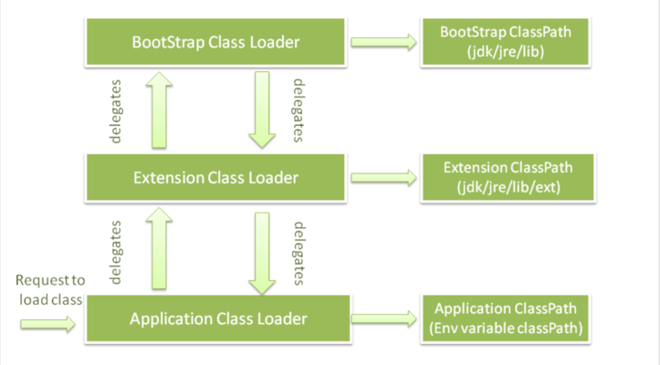

  - Suppose that we have an application specific class Student.class. The request for loading of this class files transfers to Application ClassLoader. It delegates to its parent Extension ClassLoader. Further, it delegates to Bootstrap ClassLoader. Bootstrap search that class in rt.jar and since that class is not there. Now request transfer to Extension ClassLoader which searches for the directory jre/lib/ext and tries to locate this class there.

  - If the class is found there, Extension ClassLoader loads that class. Application ClassLoader never loads that class. When the extension ClassLoader does not load it, then Application ClaasLoader loads it from CLASSPATH in Java.

**Visibility principle **states that child ClassLoader can see the class loaded by the parent ClassLoader, but vice versa is not true. It means if Application ClassLoader loads Student.class, in such case, trying to load Student.class explicitly using Extension ClassLoader throws ClassNotFoundException.

Let us see an example to print the classloader name

package com.techvidvan.jvm;

public class Test1 {

public static void main(String\[\] args) {

// Let's print the classloader name of the current class.

//Application/System classloader will load this class

Class c = Test1.class;

System.out.println(c.getClassLoader());

//If we print the classloader name of String, it will print null because it is an

//in-built class which is present in rt.jar, Bootstrap classloader loads it.

System.out.println(String.class.getClassLoader());

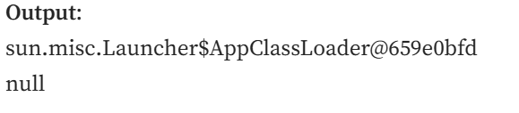

Important Functions of ClassLoader

  1. **Loading = Loading of classes using classpath**

    1. This operation loads files from secondary memory into the main memory (RAM) for execution. The Classloader reads the .class file, generates the corresponding binary data, and saves it in the method area.

    1. JVM stores some information **\[METADATA\]** for each .class file in the method area. This information is:

      1. The fully qualified name of the loaded class and its immediate parent class.

      1. Whether .class file is related to interface or an enum or a class.

      1. Modifier, Variables and Method information, etc.

After loading the .class file, JVM creates an object of type Class to represent this file in the heap memory. The programmers can use this Class object for getting class level information like the name of the class, parent name, methods, and variable information, etc. To get this object reference we can use the getClass() method of Object class.

  1. **Linking = Linking the classes wherever they're required. **

This operation combines different files in the main program together. It performs verification, preparation, and (optionally) resolution.

    - **Verification**** (Bytecode verification)**: The Verification phase checks the correctness of the .class file. It means that it checks that the file formation and generation is by a valid compiler or not. If the verification fails then we get a java.lang.Verify Exception.

    - **Preparation**: JVM allocates memory for class variables and initializes the memory to default values.

    - Resolution: Resolution is the process of replacing symbolic references with direct references. It uses searching into the method area to locate the referenced entity.

  1. **Initializing = Setting default values of data members/methods**.

    - This operation involves the assignment of all static variables with their specific values in the block of the program.

    - In this phase, there is an assignment of all static variables with their values defined in the code and static block.

    - The execution takes place from top to bottom in a class and from parent to child in the class hierarchy.

Bytecode Verifier

**Bytecode Verifier:** Checks the code fragments for illegal code that can violate access rights to objects.

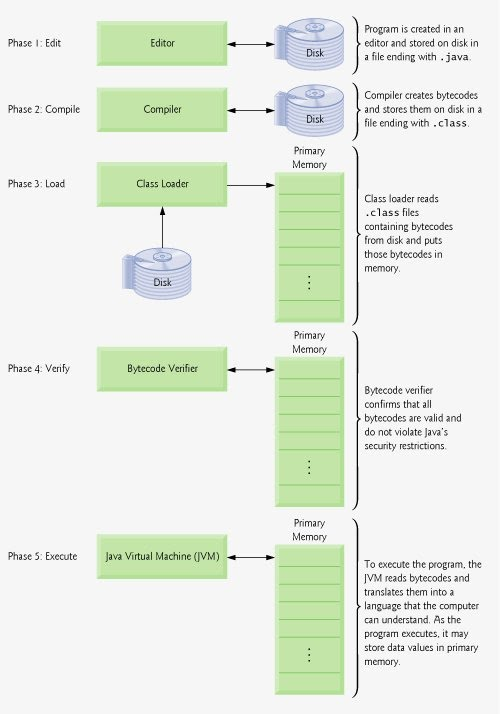

You will find that the byte code verification happens only once not twice (https://stackoverflow.com/questions/25541778/does-verification-of-byte-code-happen-twice)

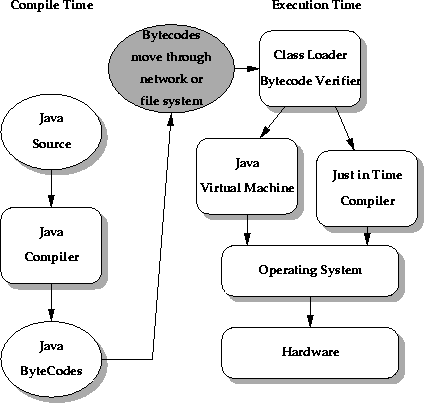

JVM Language Stack

Code is run by Thread and it has a JVM stack. Each thread have their own JVM stack where they have local and static variables.

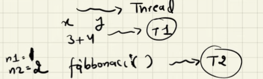

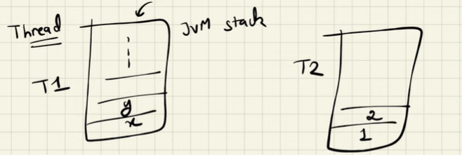

Method Area

We have loaded classes and the classes have metadata, so all this metadata is put in method area.

JVM stores some information **\[METADATA\]** for each .class file in the method area. This information is:

  1. The fully qualified name of the loaded class and its immediate parent class.

  1. Whether .class file is related to interface or an enum or a class.

  1. Modifier, Variables and Method information, etc.

Registers

It is a hardware storage component that points. It is very fast, much faster than RAM. PC register points to the line of code which needs to be run. A thread in JVM Stack has its own PC register so that they can run their instructions.

Heap

By default, the JVM heap size is 256MB.

Memory Area

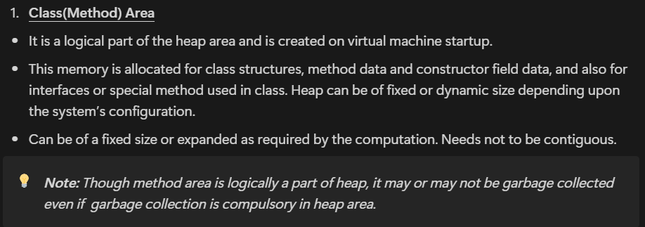

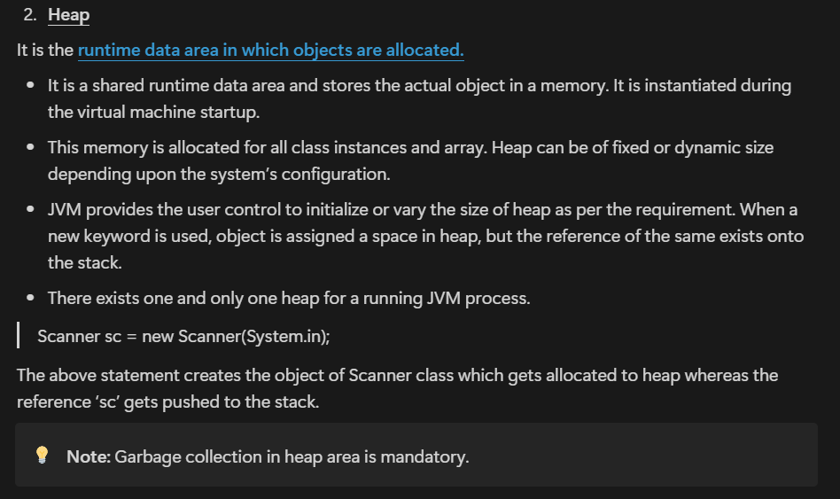

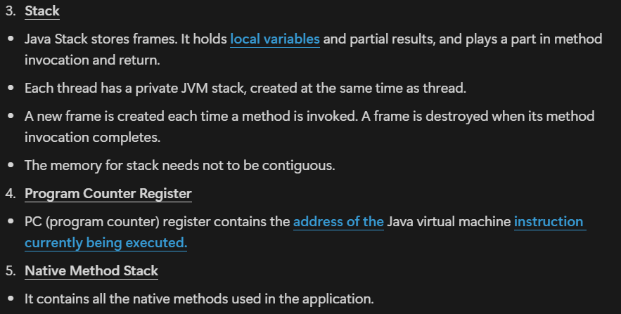

**Execution Engine**

It is the component of JVM that reads data from memory locations and executes the instructions. It has three major components namely a virtual processor, an interpreter, and a JIT compiler.

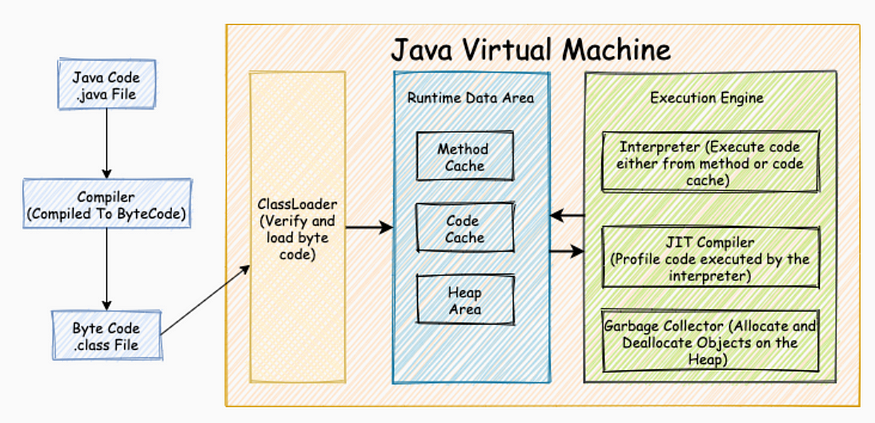

RESOURCES USED:

  1. BEST SOURCE: https://medium.com/@amitvsolutions/java-virtual-machine-guide-7dfc25c1f56f

  1. JVM Video Must Watch: [🔥](<https://youtu.be/48bHZPzCpGg?si=RqSjNacT7SPyorus>)[ How JVM Internally Works | JVM Architecture in detail | Learn About JVM \[Hindi\]](<https://youtu.be/48bHZPzCpGg?si=RqSjNacT7SPyorus>)

  1. [JVM Anatomy 101](<https://youtu.be/BeMi8K0AFAc?si=ggxGFK-RFmfHpqZk>)

[JVM Architecture in-depth explanation in Hindi | Java Interview Question | Simple Explanation](<https://www.youtube.com/watch?v=CDijVBqEeJ8>)

## FAQs

**Why is there need for Bytecode, if we already need to have architecture dependent step, i.e. JVM?**

Bytecode provides platform independence. JVMs, though architecture-specific, interpret the same bytecode, enabling "write once, run anywhere." This decouples source code compilation from target machine specifics, improving portability and security (through bytecode verification).
