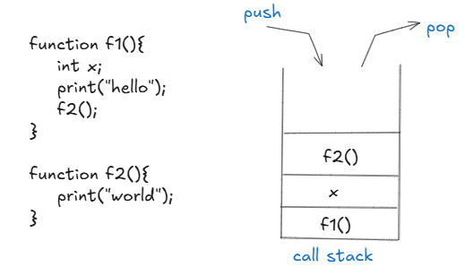
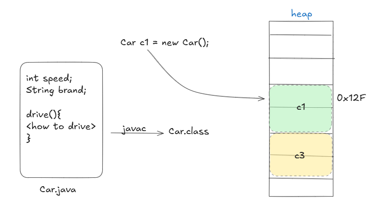

# 1.5 Memory Management

**Memory Management & Performance Optimization**

Heap vs. Stack Memory

Garbage Collection (GC Algorithms: Mark-Sweep, G1, ZGC)

finalize() Method (Deprecated in Java 9+)

Weak References (WeakHashMap, SoftReference)

https://iampravo.medium.com/journey-of-javas-garbage-collector-so-far-7c00af8c89dc

  - JVM Architecture (Heap, Stack, Metaspace, Garbage Collection)

  - Java Garbage Collectors (G1GC, ZGC, ParallelGC)

  - Performance Optimization Techniques

[Memory Management in JAVA | Vishwa Mohan | Day -11](<https://www.youtube.com/watch?v=3HcW_mGJLag>)

**Process, Stack Memory in Java**

Each running program is called a **process**. Every process has at least one **thread**, and each thread is allocated a **stack memory** in RAM. The stack follows the **Last In, First Out (LIFO)** principle, meaning that when a function is called, it is pushed onto the stack, and once execution completes, it is popped off.

**Call Stack:**

  - The stack stores function calls, local variables, and execution states.

  - Functions are pushed onto the stack when called and popped when execution finishes.

  - It is automatically managed, making it efficient but limited in size.

**Heap Memory and Garbage Collection**

The **heap memory** is a shared resource accessible by all threads. It is used to store objects dynamically allocated during runtime. Unlike stack memory, heap memory needs to be managed explicitly.

**Key Points:**

  - Objects created using new are stored in the heap.

  - The heap is not automatically cleared when objects are no longer needed.

  - **Garbage Collection (GC)** automatically frees up memory by removing **unreferenced objects**, ensuring efficient memory management.

