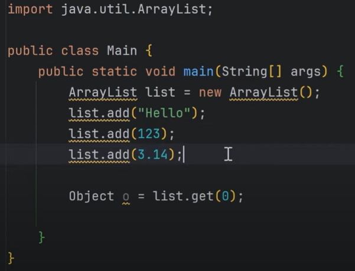
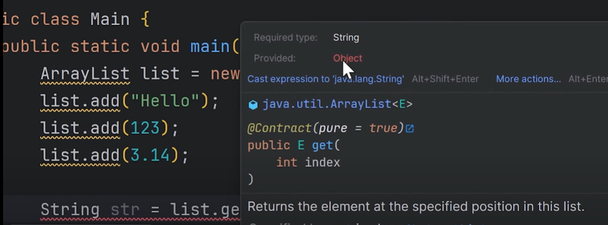
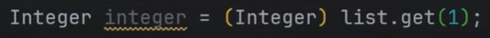
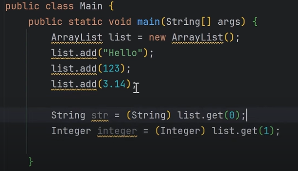
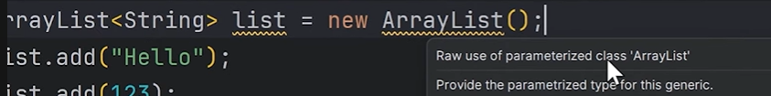
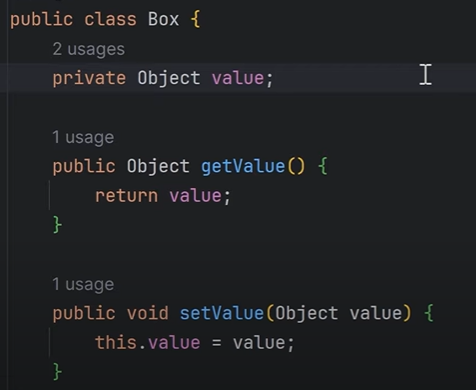

# 10.3 Notes

- Introduced in Java 5

Why Generics were introduced?

If we are storing random data types in an ArrayList and then try to access the index 0, and try assigning it (Alt + Enter in intellij) then by default it will get stored as type Object. Not at String/Integer (Child) etc which extend the Object class (Parent).

If we try to store in String then we'll get an error saying required types is String but the get method returned Object:

Solution 1: Typecast the object to string

Similarly at index 1, there is integrer so we'll need to cast Object type to integer:

Full Code:

But say we don't know before hand that there is Integer at index 1 and then we cast to string (this gives no compile error):

import java.util.ArrayList;

public class Main {

public static void main(String\[\] args) {

ArrayList list = new ArrayList();

list.add("Hello");

list.add(123);

list.add(3.14);

String str = (String) list.get(0);

String str1 = (String) list.get(1);

}

}

Then we get runtime exception:

Exception in thread "main" java.lang.ClassCastException: **class java.lang.Integer cannot be cast to class java.lang.String** (java.lang.Integer and java.lang.String are in module java.base of loader 'bootstrap')

Above code has 3 major issues

  1. No Type safety

  1. Manual casting

  1. No Compile Time checking

Our ArrayList is not type-safe. It is made to store objects of different types. Thus, during list.get we have to manually type-cast. This causes errors at runtime, even if no error shown at compile time.

Make arrayList of type string, by adding <String> on both sides:

Do this:

Or use diamond operator "< >"

Another Example:

**public class Main {**

**    public static void main(String\[\] args) {**

**        Box box = new Box();**

**        box.setValue(1);**

**        String i = (String) box.getValue(); // EXCEPTION !!!**

**        System.out.println(i);**

**    }**

**}**

This will also give ClassCastException. Since we stored an integer object using  setValue and then expecting a String using getValue.
