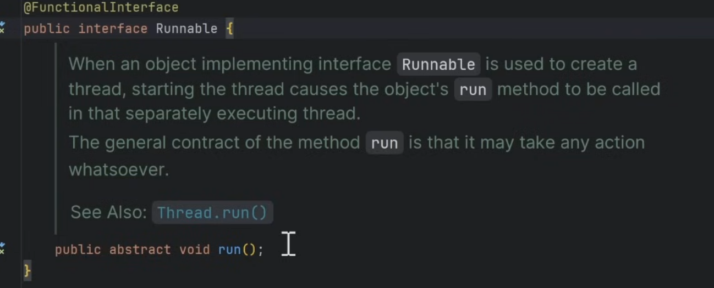

# 11.3 Lambda Expressions

**Lambda Expressions**: Syntax and usage. https://www.geeksforgeeks.org/lambda-expressions-java-8/

[Master Java Lambda Expressions in 90 Mins | Java 8 Lambda Expressions Full Course | Java Tutorial](<https://www.youtube.com/watch?v=0ada8fAMpVs>)

[Lambda Expression in java 8 in Hindi ( Step by Step Explanation)](<https://www.youtube.com/watch?v=u8DpSS8Skv0&pp=ygUZamF2YSA4IGxhbWJkYSBleHByZXNzaW9uc9IHCQm_AIO1pN6f1A%3D%3D>)

Interview Question:

[Lambda Expression In Java | Java Interview Questions and Answers](<https://www.youtube.com/watch?v=ulC_yfMHJL8&pp=ygUsamF2YSA4IGxhbWJkYSBleHByZXNzaW9uIGludGVydmlldyBxdWVzdGlvbnM%3D>)

[Lambda Expression Interview Questions & Answers | java8 | Lambda Expression Tutorial | Java8 LB](<https://www.youtube.com/watch?v=gOXWOIF9z-4&pp=ygUsamF2YSA4IGxhbWJkYSBleHByZXNzaW9uIGludGVydmlldyBxdWVzdGlvbnM%3D>)

