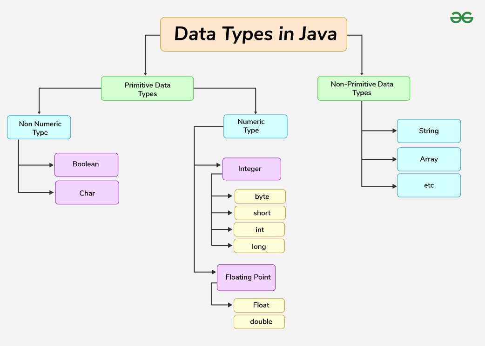
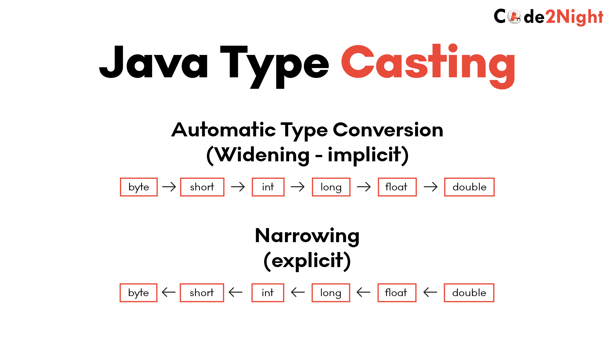
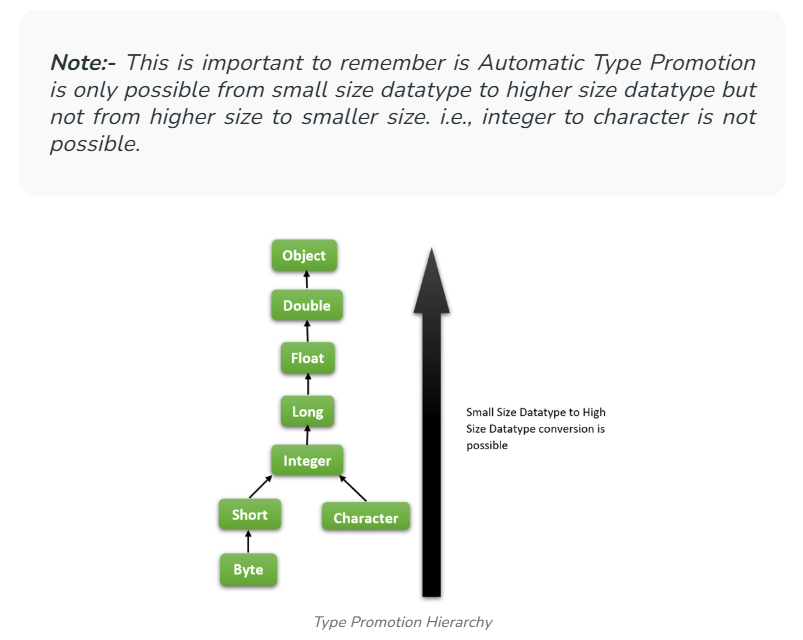

# 2.2 Variables, Data Types, Literals

**VARIABLES****:**

  - Database is permanent (persistent) storage, what if we want to store an input from the user (temporary), for processing, we use variables for that.

  - Java is a static typed language, and strongly typed language. If we need to store data in a variable, then we need the data, name of variable, as well as the TYPE of data **(Data Types)** to be stored in the variable.

  - Static Type = Data Type of a variable must be defined.

  - Strongly Typed = For each data type, we have a range/limit of values that a variable of that data type can store.

  - Variable is a container which holds a value, which is declared as:

DataType variableName = value;

  - Eg: int var = 32;

  - **Variable Naming Convention:**

    - Variable name is case sensitive.

    - Variable name can be any legal identifier, and can contain unicode letters and Digits. eg: abcA$

    - Variable name can start with: $, _ or letter

    - Variable name can not be Java reserved keywords like new, class, while, for, interface, int, float etc.

    - Casing convention: small (one word) or camelCase (two words) or CAPITAL (for constants - static final variable - immutable)

      - static final int JAIPUR = 2;

**DATA TYPES / TYPES OF VARIABLES:**

**PRIMITIVE DATA TYPES**

By default: double

`float num2 = 3.5;` // Type mismatch: cannot convert from double to float

use `float num2 = 3.5f`

**// -128 to 127 , 8 bits = 1 byte**

**byte** **byteNum** **=** **4****;**

**System****.****out****.****println****(byteNum);**

**// byte byteNum2 = 129;**

**// System.out.println(byteNum2); **

**// error: incompatible types: possible lossy conversion from int to byte**

**// other data types: short (16 bits, 2 bytes)**

**// int (4 bytes, 32 bits) ~ 10^9**

**int** **num1** **=** **3****;**

**System****.****out****.****println****(num1);**

**// long (64 bits, 8 bytes) , suffix `l` can be skipped**

**long** **longNum** **=** **23423l****; **

**System****.****out****.****println****(longNum);**

**// double (15 decimals), 64 bits**

**// default data type for decimal numbers**

**double** **num2** **=** **4.5****; ****// 8 bytes**

**System****.****out****.****println****(num2);**

**// float num2 = 3.5; float takes 32 bits**

**// Type mismatch: cannot convert from double to float**

**float** **num3** **=** **4.5f****; ****// 4 bytes**

**System****.****out****.****println****(num3);**

**// JAVA char (2 bytes) follows UNICODE and not ASCII**

**// C++ follows ASCII characters and thus its char has 1 byte**

**char** **ch** **=** **'k'****; ****// 2 bytes, single quotes**

**System****.****out****.****println****(ch);**

**// char ch2 = "k"; **

**// System.out.println(ch2);**

**// error: incompatible types: String cannot be converted to char**

**String ****s** **=** **"abd"****;**

**System****.****out****.****println****(s);**

**// boolean (1 bit), true or false, and doesnt support 0 or 1**

**boolean** **flag** **=** **true****; ****// true, false**

**// bool b = 0; // Type mismatch: cannot convert from int to boolean**

**System****.****out****.****println****(flag);**

**LITERALS**

**/\* LITERALS \*/**

**int** **num4** **=** **0b101****; ****// binary of 5**

**System****.****out****.****println****(num4);**

**int** **num5** **=** **0x1A****; ****// hexadecimal of 26**

**System****.****out****.****println****(num5);**

**int** **num6** **=** **100_00_00_00****; ****// 100000000**

**System****.****out****.****println****(num6);**

**// _ can be used to separate digits for better readability**

**double** **num7** **=** **56****;**

**System****.****out****.****println****(num7); ****// 56.0**

**double** **num8** **=** **7e10****; ****// 7 \* 10^10**

**System****.****out****.****println****(num8); ****// 7.0E10**

**double** **num9** **=** **7e5****; ****// 7 \* 10^5**

**System****.****out****.****println****(num9); ****// 700000.0**

**char** **ch2** **=** **'****\\u****0061'****; ****// unicode of 'a'**

**char** **ch3** **=** **'a'****; **

**char** **ch4** **=** **99****; ****// ASCII of 'c'**

**        ch3****++****;**

**System****.****out****.****println****(ch2); ****// a**

**System****.****out****.****println****(ch3); ****// b **

**System****.****out****.****println****(ch4); ****// c**

**TYPECASTING and TYPE CONVERSION**

// 1. Implicit typecasting (Widening) - CONVERSION // No need to CAST

// 2. Explicit typecasting (Narrowing) - CASTING // Need to CAST

**        // Implicit typecasting (Widening)**

// byte -> short -> int -> long -> float -> double

// char -> int -> long -> float -> double

// byte -> short -> int -> long -> float -> double

byte byteNum = 4;

short shortNum = byteNum;

int intNum = shortNum;

long longNum = intNum;

float floatNum = longNum;

double doubleNum = floatNum;

System.out.println(doubleNum);

// char -> int -> long -> float -> double

char ch = 'k';

int chInt = ch;

long chLong = chInt;

float chFloat = chLong;

double chDouble = chFloat;

System.out.println(chDouble);

**        // Explicit typecasting (Narrowing)**

// double -> float -> long -> int -> short -> byte

// double -> float -> long -> int -> char

int a = 11;

byte b = (byte) a;

System.out.println(b);

float f = 12.5f;

int i = (int) f;

System.out.println(i);

int aNum = 257;

byte bNum = (byte) aNum;

// 257 % 256 \[range of byte\] = 1

System.out.println(bNum);

**        // TYPE PROMOTION**

byte x = 10;

byte y = 30;

int z = x \* y; // type promotion

// int z = (int) x \* y; // 300

System.out.println(z);

[5. How FLOAT and DOUBLE  Number Stored in Memory?  |  IEEE 754 Representation](<https://www.youtube.com/watch?v=NZ3qAfM8Ztw&list=PL6W8uoQQ2c63f469AyV78np0rbxRFppkx&index=6&pp=iAQB>)
