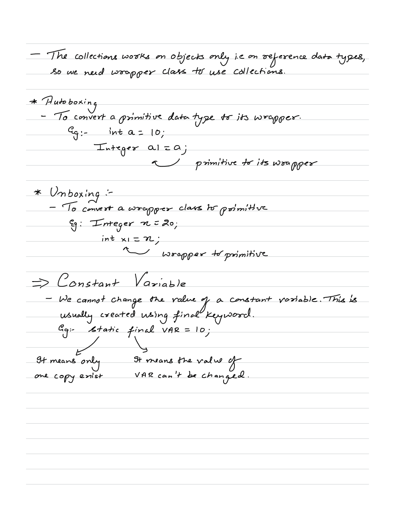
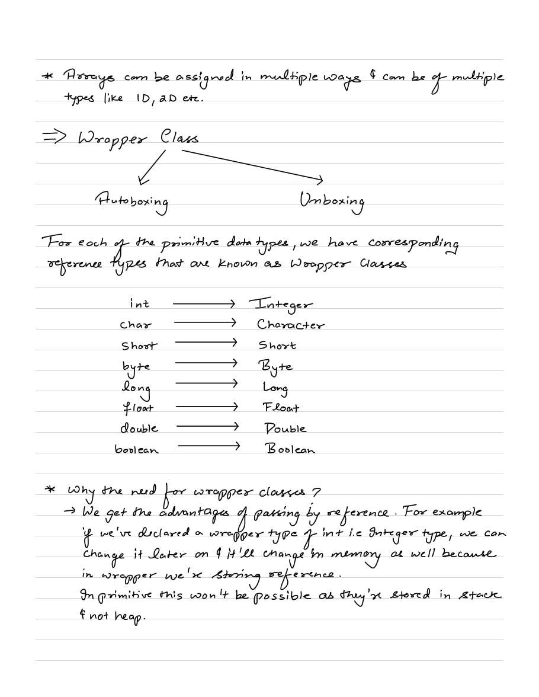
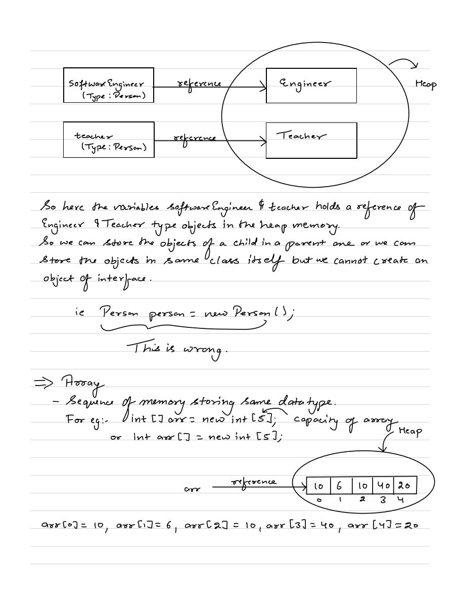
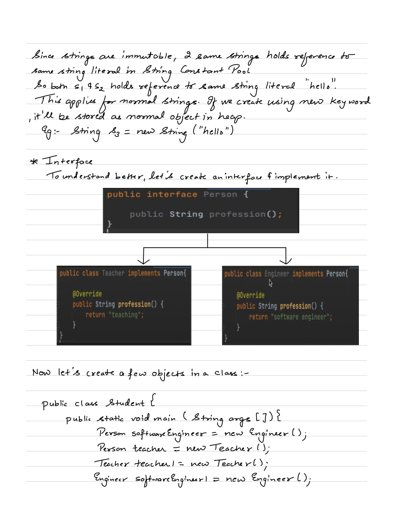
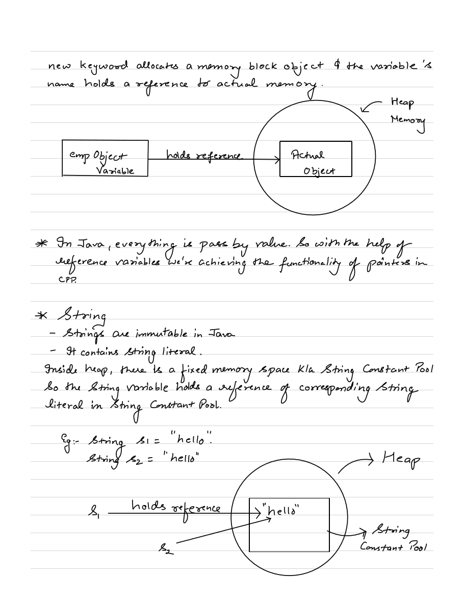
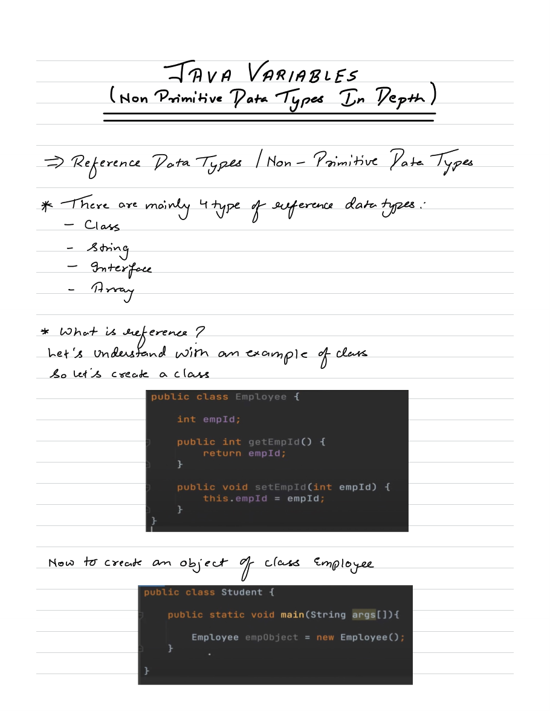

# 2.2.2 Reference/Non-Primitive Data Types

**Types of Variables(local, instance, static)**

1. Local Variables

A variable defined within a block or method or constructor is called a local variable.

The Local variable is created at the time of declaration and destroyed after exiting from the block or when the call returns from the function.

The scope of these variables exists only within the block in which the variables are declared, i.e., we can access these variables only within that block.

Initialization of the local variable is mandatory before using it in the defined scope.

2. Instance Variables

Instance variables are non-static variables and are declared in a class outside of any method, constructor, or block.

As instance variables are declared in a class, these variables are created when an object of the class is created and destroyed when the object is destroyed.

Unlike local variables, we may use access specifiers for instance variables. If we do not specify any access specifier, then the default access specifier will be used.

Initialization of an instance variable is not mandatory. Its default value is dependent on the data type of variable. For *String* it is *null, *for* float *it is* 0.0f, *for* int *it is* 0, *for Wrapper classes like *Integer* it is *null, etc.*

Instance variables can be accessed only by creating objects.

We initialize instance variables using [constructors](<https://www.geeksforgeeks.org/constructors-in-java/>) while creating an object. We can also use [instance blocks](<https://www.geeksforgeeks.org/using-instance-blocks-in-java/>) to initialize the instance variables.

Java

Copy

// Java Program to show the use of
// Instance Variables
import java.io.\*;

class GFG {

// Declared Instance Variable
    public String geek;
    public int i;
    public Integer I;
    public GFG()
    {
        // Default Constructor
        // initializing Instance Variable
        this.geek = "Shubham Jain";
    }

// Main Method
    public static void main(String\[\] args)
    {
        // Object Creation
        GFG name = new GFG();

// Displaying O/P
        System.out.println("Geek name is: " + name.geek);
        System.out.println("Default value for int is "+ name.i);
      
        // toString() called internally
        System.out.println("Default value for Integer is "+ name.I);
    }
}

​

3. Static Variables

Static variables are also known as class variables.

These variables are declared similarly to instance variables. The difference is that static variables are declared using the static keyword within a class outside of any method, constructor, or block.

Unlike instance variables, we can only have one copy of a static variable per class, irrespective of how many objects we create.

Static variables are created at the start of program execution and destroyed automatically when execution ends.

Initialization of a static variable is not mandatory. Its default value is dependent on the data type of variable. For *String* it is *null*, for *float* it is *0.0f*, for *int* it is *0*, for *Wrapper classes* like *Integer* it is *null,* etc.

If we access a static variable like an instance variable (through an object), the compiler will show a warning message, which won’t halt the program. The compiler will replace the object name with the class name automatically.

If we access a static variable without the class name, the compiler will automatically append the class name. But for accessing the static variable of a different class, we must mention the class name as 2 different classes might have a static variable with the same name.

Static variables cannot be declared locally inside an instance method.

[Static blocks](<https://www.geeksforgeeks.org/static-blocks-in-java/>) can be used to initialize static variables.

Java

Copy

// Java Program to show the use of
// Static variables
import java.io.\*;

class GFG {
    // Declared static variable
    public static String geek = "Shubham Jain";
  
    public static void main(String\[\] args)
    {

// geek variable can be accessed without object
        // creation Displaying O/P GFG.geek --> using the
        // static variable
        System.out.println("Geek Name is : " + GFG.geek);

// static int c = 0;
        // above line, when uncommented,
        // will throw an error as static variables cannot be
        // declared locally.
    }
}

## Non-primitive Data Types

These are wrappers, made on top of primitive data types.

String

Integer

Long

package basics;

public class nonprimitive {

public static void main(String args\[\]){

// Declaring a non-primitive variable

Integer a = 1;

System.out.println(Integer.toString(a)); // toSting is static method

String fname = "Lavesh";

String lname = "Gupta";

String name = fname + lname;

System.out.println(name);

}

}
