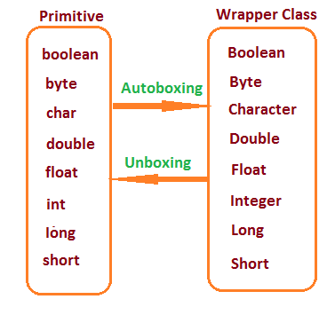

# 2.2.3 Wrapper Class

https://www.linkedin.com/pulse/wrapper-classes-vs-primitive-data-types-bhavishya-ambati-978nc/

[Mastering Wrapper Classes in Java: Autoboxing, Autounboxing, Methods Explained](<https://www.youtube.com/watch?v=suBZpy8Z2VY&list=PLA3GkZPtsafY62QhQ030p85HAer0pFDdr&index=30&pp=iAQB>)
