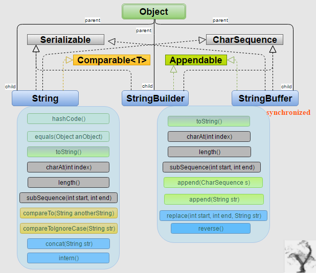
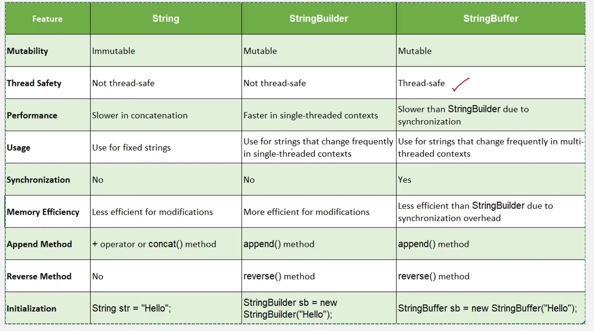

# 5.2 String vs StringBuilder vs StringBuffer

[Strings, StringBuilders and Arraylists - Level 1 - YouTube](<https://www.youtube.com/playlist?list=PL-Jc9J83PIiFIKbdCKuYwsV8KaX-jHe0V>)

[Arrays and Strings - Level 2 - YouTube](<https://www.youtube.com/playlist?list=PL-Jc9J83PIiE-TR27GB7V5TBLQRT5RnSl>)

[Knuth–Morris–Pratt (KMP) Pattern Matching Substring Search -  First Occurrence Of Substring](<https://www.youtube.com/watch?v=BXCEFAzhxGY>)

[How To Permute A String - Generate All Permutations Of A String](<https://www.youtube.com/watch?v=GCm7m5671Ps&pp=0gcJCX4JAYcqIYzv>)

[The IP Address Decomposition Problem - Compute All Valid IP Addresses From Raw IP String](<https://www.youtube.com/watch?v=KU7Ae2513h0>)

[Coding Interview Patterns Z Algorithm - Matching Patterns in A String](<https://www.youtube.com/watch?v=pcL05iQHRsk>)
