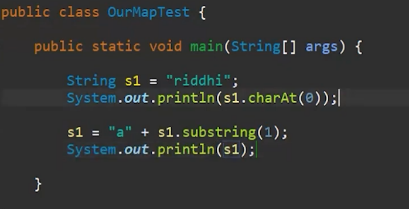
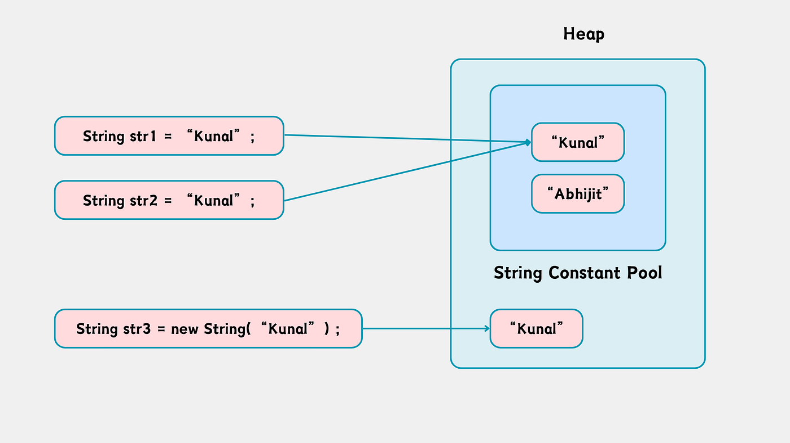
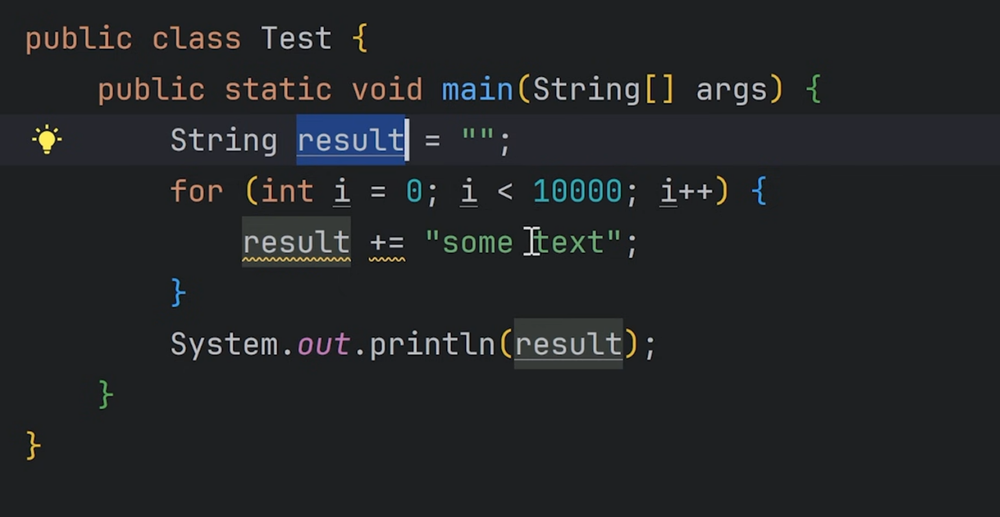
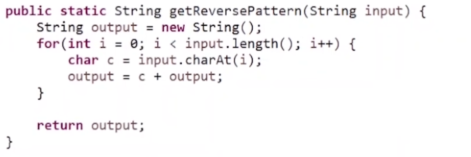
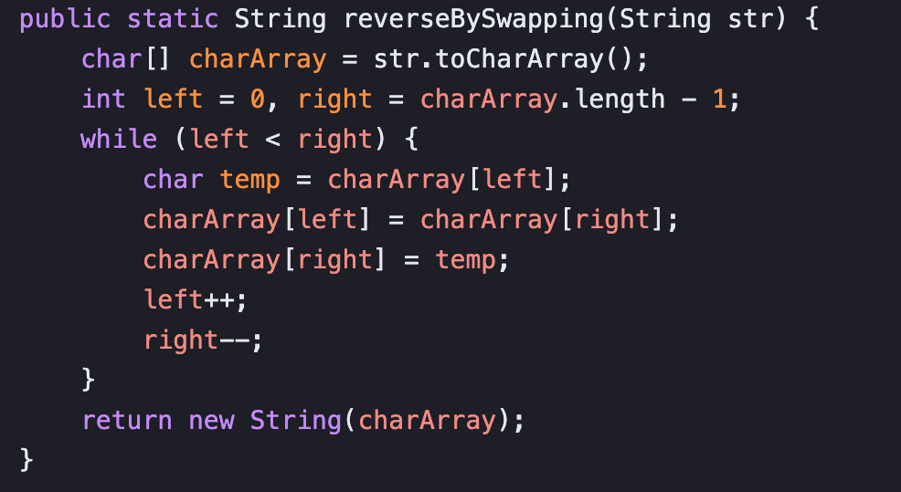

# 5.3 String Class

**String s1 = "lavesh";**

  - This uses the **String Constant Pool (SCP)**.

  - Java checks if "lavesh" already exists in the pool.

    - If yes → it reuses the same object.

    - If no → it creates it in the pool.

  - **Memory efficient** because of reuse.

**String s1 = new String("lavesh");**

  - This **always creates a new object in heap memory**, even if "lavesh" already exists in the pool.

  - The literal "lavesh" still goes into the pool, but:

    - new String(...) creates a **separate object in heap**.

👉 **If any part is decided at runtime → result goes to heap, not SCP**

public class StringTrapDemo {

public static void main(String\[\] args) {

// 🔹 Case 1: Compile-time concatenation

String s1 = "hello";

String s2 = "he" + "llo";

// 🔹 Case 2: Runtime concatenation

String s3 = "he" + s1;

System.out.println(s1 == s2); // true

System.out.println(s1 == s3); // false

// 🔹 Case 3: final makes it compile-time

final String f1 = "llo";

String s4 = "he" + f1;

System.out.println(s4 == "hello"); // true

// 🔹 Case 4: both final

final String a = "he";

final String b = "llo";

String s5 = a + b;

System.out.println(s5 == "hello"); // true

// 🔹 Case 5: mixed (one final, one not)

final String x = "he";

String y = "llo";

String s6 = x + y;

System.out.println(s6 == "hello"); // false

}

}

String constantString = "interned Baeldung";

String newString = new String("interned Baeldung");

assertThat(constantString).isNotSameAs(newString);

String internedString = newString.intern();

assertThat(constantString) .isSameAs(internedString);

String reversed = new StringBuilder(str).reverse().toString();

public boolean equals(Object anObject) {

if (this == anObject) {

return true;

}

return (anObject instanceof String aString)

&& (!*COMPACT_STRINGS *|| this.coder == aString.coder)

&& StringLatin1.*equals*(value, aString.value);

}

String result = String.format("format string", args...);

String s = String.format("Name: %s, Age: %d", name, age);

System.out.println(s);
