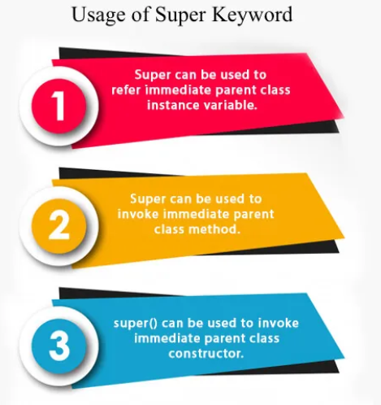
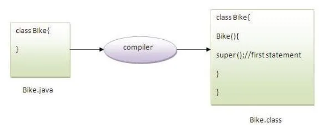

# 6.11 Super Keyword

super() is added in each class constructor automatically by compiler if there is no super() or this().

As we know well that default constructor is provided by compiler automatically if there is no constructor. But, it also adds super() as the first statement.

**example of super keyword where super() is provided by the compiler implicitly.**

class Animal{

Animal(){System.out.println("animal is created");}

}

class Dog extends Animal{

Dog(){

System.out.println("dog is created");

}

}

class TestSuper4{

public static void main(String args\[\]){

Dog d=new Dog();

}}

Output:

animal is created

dog is created

- Calling of superclass instance variable
When a subclass has a member (variable) with the same name as a member in the superclass, the super keyword can be used to refer to the superclass's version of the variable.

Example:

class Parent {

String name = "Parent's Name";

}

class Child extends Parent {

String name = "Child's Name";

public void displayNames() {

System.out.println(name);          // Refers to Child's `name`

System.out.println(super.name);   // Refers to Parent's `name`

}

}

public class Main {

public static void main(String\[\] args) {

Child child = new Child();

child.displayNames();

}

}

Child's Name

Parent's Name

- Superclass constructor
The super keyword can be used to explicitly call a constructor of the superclass. This is particularly useful when the superclass does not have a default constructor or when you want to pass specific arguments to the superclass constructor.
**Example:**

class Parent {

public Parent(String message) {

System.out.println("Parent Constructor: " + message);

}

}

class Child extends Parent {

public Child() {

super("Hello from Child"); // Calls the Parent constructor with an argument

System.out.println("Child Constructor");

}

}

public class Main {

public static void main(String\[\] args) {

Child child = new Child();

}

}

Output:

C#

Copy

Parent Constructor: Hello from Child

Child Constructor

- Superclass method
When a method in the subclass overrides a method in the superclass, you can use super to call the overridden method in the superclass.
**Example:**

class Parent {

public void display() {

System.out.println("Parent Display");

}

}

class Child extends Parent {

@Override

public void display() {

System.out.println("Child Display");

super.display(); // Calls the Parent's display method

}

}

public class Main {

public static void main(String\[\] args) {

Child child = new Child();

child.display();

}

}

Output:

CSS

Copy

Child Display

Parent Display
