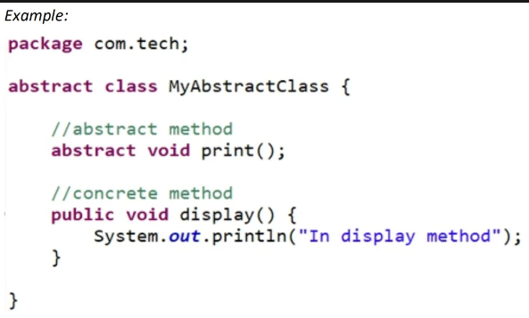
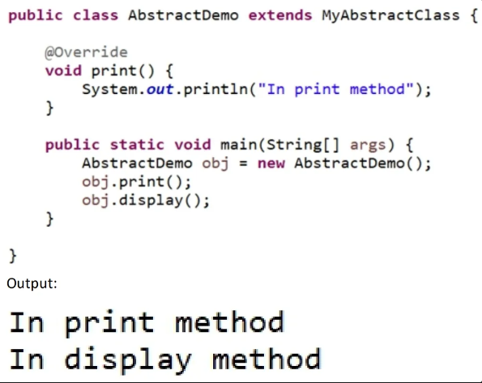
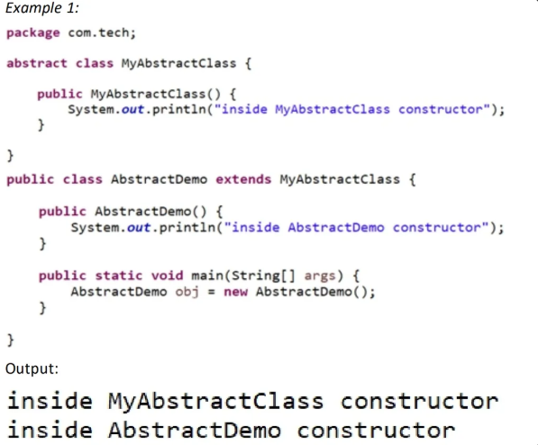
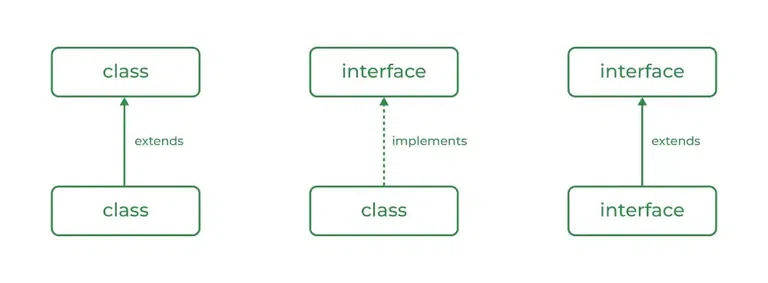
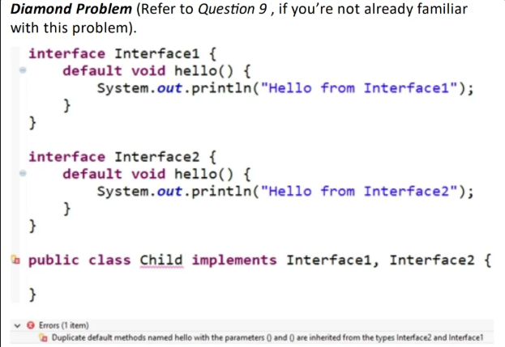
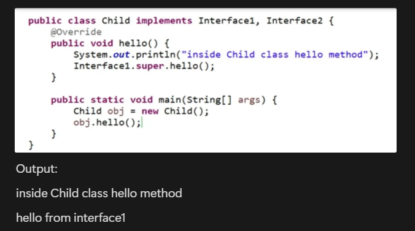
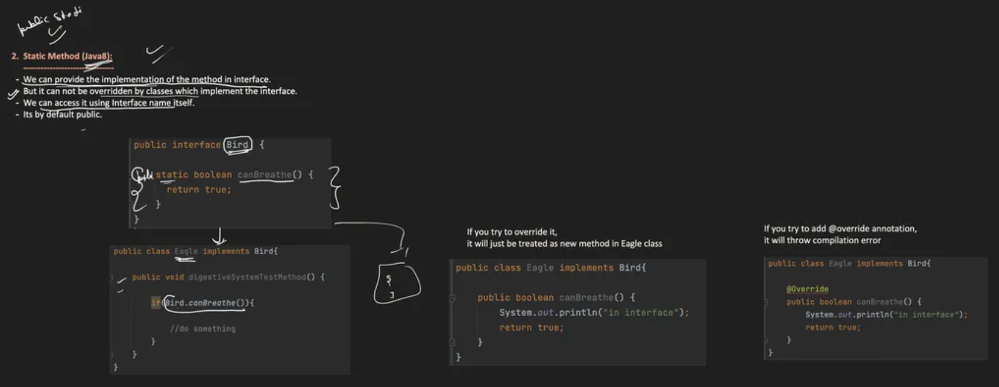

# 6.13.1 Abstraction

- Data Abstraction hides internal implementation and show only essential functionality to user.

- It can be achieved using Interface and Abstract Class

## Abstract class:

- A class that is declared using “abstract” keyword is known as abstract class. It can have abstract methods (methods without body) as well as concrete methods (methods with body).
**Some points to remember:**

  - An abstract class cannot be instantiated, which means you are not allowed to create an object of the abstract class. This also means, an abstract class has no use unless it is extended by some other class

  - If there is any abstract method in a class then that class must be declared abstract

  - The first non-abstract class which is extending from an abstract class will have to give implementation of the abstract methods defined in abstract class.

  - 

  - 

- Does Abstract class have constructor?
This is a famous interview queson and the answer is: Yes, abstract classes have constructor. Either you can provide it or the default one will be provided by Java. Now, you must be wondering if you cannot create an object of abstract class then what is the need of a constructor.
One thing you must know is that the constructors are used when you are creating an object of a class, to initialize the data members of that class and your abstract class can have data members.
Now, when your class extends abstract class then the same abstract class will become super class for your extending class and remember when you have constructor of your class then first line of your constructor is always a call to super class constructor and this is the me when your abstract class constructor will get called.

- 

## Interface

  - An interface in Java is a blueprint of a class. It has static constants and abstract methods.

  - Interface specify what a class must do but not how to do

  - An interface is like defining a contract that is fulfilled by implemenng classes

  - An interface is used to achieve full abstracon.

  - All methods in an interface are public and abstract by default and all variables declared in an interface are constants i.e. public, stac and final

  - A class which implements an interface will have to provide implementaon of all the methods that are defined in the interface

  - A class can implement more than one interface, this is how Java allows mulple inheritance.

  - Since Java 8, we can have default and stac methods in an interface

// The Interface

public interface Vehicle {

// Abstract methods (no bodies)

void startEngine();

void accelerate(int speed);

void brake();

}

// The Class implementing the interface

public class Car implements Vehicle {

private String model;

private int currentSpeed;

// Constructor

public Car(String model) {

this.model = model;

this.currentSpeed = 0;

}

// Implementing startEngine

@Override

public void startEngine() {

System.out.println(model + "'s engine is purring to life.");

}

// Implementing accelerate

@Override

public void accelerate(int speed) {

currentSpeed += speed;

System.out.println(model + " accelerated to " + currentSpeed + " mph.");

}

// Implementing brake

@Override

public void brake() {

currentSpeed = 0;

System.out.println(model + " has come to a complete stop.");

}

}

public class Main {

public static void main(String\[\] args) {

// Declaring as the interface type, instantiating the class

Vehicle myCar = new Car("Tesla Model 3");

// Calling the implemented methods

myCar.startEngine();

myCar.accelerate(60);

myCar.brake();

}

}

- Difference between abstract class and interface

  - Abstract class can have both abstract and concrete methods but interface can only have abstract methods (Java 8 onwards, it can have default and stac methods as well)

  - Abstract class methods can have access modifiers other than public but interface methods are implicitly public and abstract

  - Abstract class can have final, non-final, static and non-static variables but interface variables are only static and final

  - A subclass can extend only one abstract class but it can implement multiple interfaces

  - An Abstract class can extend one other class and can implement multiple interfaces but an interface can only extend other interfaces

In this question, the interviewer may try to confuse you by saying that from Java 8 onwards, you can have static and default methods in an Interface so now what is the difference between abstract class and interface and the answer you should tell is – We can sll extend only one class but can implement mulple interfaces.

  - Why Java 8 has introduced default methods?
To extend the capability of an already existing interface, default methods are introduced in Java 8. Let’s understand this by one example:
Consider there are 100 classes that are implementing one interface. Now you want to define one new method inside your interface. In this case you will have to change all the implementation classes to fulfill the interface contract. So, Java introduced default methods, here you can provide default implementation of that new method inside your interface and as it is not mandatory to provide implementation of default methods by the implementing classes, all the 100 classes can use the default implementation or if they want they can provide their own implementation by overriding the default method.

Now consider one interesting scenario: You have two interfaces, Interface1 and Interface2 both having default method hello() and one class is implementing these 2 interfaces without giving implementation to this default method. You see the problem here? Yes, it is the famous

So, to avoid this error, it is mandatory to provide implementaon for common default methods of interfaces

- Why Java 8 has introduced static methods?
Consider an example where you want to define a ulity class, what you usually do is you define a class which contains stac methods and then you call these methods using class name. Now, Java 8 onwards you can do the same thing using an Interface by giving only stac methods inside your interface. This way of using Interface for defining ulity classes is beer as it helps in performance also, because using a class is more expensive operaon than using an interface.

- Java Interface in Depth

  - Private methods in interfaces
Interfaces are able to use private methods to hide details on implementation from classes that implement the interface. As a result, one of the main benefits of having these in interfaces is encapsulation.
https://www.baeldung.com/java-interface-private-methods#:~:text=Private [methods can be implemented static or non-static.&text=Within the interface%2C other statically,of these private static methods.&text=The output is the string,to the buzz() method](<https://www.baeldung.com/java-interface-private-methods#:~:text=Private%20methods%20can%20be%20implemented%20static%20or%20non%2Dstatic.&text=Within%20the%20interface%2C%20other%20statically,of%20these%20private%20static%20methods.&text=The%20output%20is%20the%20string,to%20the%20buzz()%20method>).

  - default methods in interface
https://www.educative.io/courses/java-8-lambdas-stream-api-beyond/default-methods-in-interfaces

  - static methods in interface

  - 

[Abstraction in Java \| Abstract Class \| Abstract Method](<https://www.youtube.com/watch?v=W0Qv4UkCo6k&list=PLA3GkZPtsafY62QhQ030p85HAer0pFDdr&index=23&pp=iAQB>)
