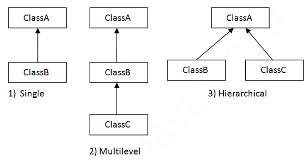

# 6.13.3 Inheritance

Why Multiple inheritance is not supported in java ?

Multiple inheritance is not supported in Java through class.

**Q) Why multiple inheritance is not supported in java?**

To reduce the complexity and simplify the language, multiple inheritance is not supported in java.

Consider a scenario where A, B, and C are three classes. The C class inherits A and B classes. If A and B classes have the same method and you call it from child class object, there will be ambiguity to call the method of A or B class.

Since compile-time errors are better than runtime errors, Java renders compile-time error if you inherit 2 classes. So whether you have same method or different, there will be compile time error.

  - Aggregation
If a class have an entity reference, it is known as Aggregation. Aggregation represents **HAS-A** relationship.

[Inheritance in Java \| Method Overriding \| super keyword](<https://www.youtube.com/watch?v=CGHL1zuD5fY&list=PLA3GkZPtsafY62QhQ030p85HAer0pFDdr&index=21&pp=iAQB>)

[Inheritance & Object Relationships in Java \| Vishwa Mohan \| Day- 14](<https://www.youtube.com/watch?v=Vusjkfj44dw>)
