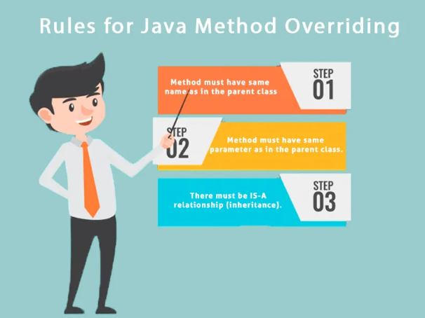

# 6.13.4 Polymorphism

- Method overloading
If a [class](<https://www.javatpoint.com/object-and-class-in-java>) has multiple methods having same name but different in parameters, it is known as **Method Overloading**.
**Different ways to overload the method
**There are two ways to overload the method in java

  1. By changing number of arguments

  1. By changing the data type
<aside> 💡 In Java, Method Overloading is not possible by changing the return type of the method only.
</aside>
**Can we overload java main() method?
**Yes, by method overloading. You can have any number of main methods in a class by method overloading. But [JVM](<https://www.javatpoint.com/jvm-java-virtual-machine>) calls main() method which receives string array as arguments only. Let's see the simple example:

class TestOverloading4{

public static void main(String\[\] args){System.out.println("main with String\[\]");}

public static void main(String args){System.out.println("main with String");}

public static void main(){System.out.println("main without args");}

}

**Can we override static method?**

No, a static method cannot be overridden. It can be proved by runtime polymorphism, so we will learn it later.

**Why can we not override static method?**

It is because the static method is bound with class whereas instance method is bound with an object. Static belongs to the class area, and an instance belongs to the heap area.

**Can we override java main method?**

No, because the main is a static method.

  - Covariant return type
The covariant return type specifies that the return type may vary in the same direction as the subclass.
Before Java5, it was not possible to override any method by changing the return type. But now, since Java5, it is possible to override method by changing the return type if subclass overrides any method whose return type is Non-Primitive but it changes its return type to subclass type. Let's take a simple example:

class A{

A get(){return this;}

}

class B1 extends A{

@Override

B1 get(){return this;}

void message(){System.out.println("welcome to covariant return type");}

public static void main(String args\[\]){

new B1().get().message();

}

}

[Polymorphism: Compile Time vs Run Time ( Dynamic Method Dispatch )](<https://www.youtube.com/watch?v=TRlz0X5hD7E&list=PLA3GkZPtsafY62QhQ030p85HAer0pFDdr&index=22&pp=iAQB>)

[Polymorphism in Java | Vishwa Mohan | Day - 15](<https://www.youtube.com/watch?v=P7W-7XJneQA>)
