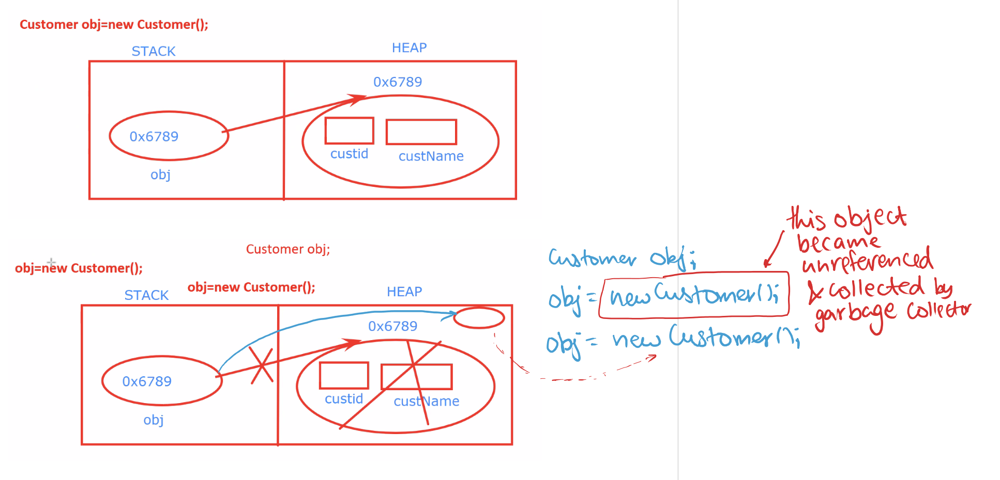

# 6.2 Class, Object

- OOPS - Object Oriented Programing

## Class, Object, and Types of Classes

## Object:

- Object is a real world entity:

- Every object has:

  - Behaviour or Functions  - Methods

  - Properties or State - Data Variables

- Life cycle of an object
The life cycle of a Java object involves the following stages:

  1. **Creation**: Using the new keyword or reflection.
MyClass obj = new MyClass();

  1. **Usage**: Object methods and fields are accessed.
obj.method();

  1. **Garbage Collection**: When no references to the object exist, the garbage collector reclaims the memory.
obj = null; // Eligible for garbage collection

- Anonymous object in Java
An **anonymous object** is an object that is created without being assigned to a reference variable. It is used immediately and discarded.

## Class:

- Blueprint/Skeleton of an object, from which object can be created

- To create an object, class is required.

- From one class we can create multiple objects.

- Keyword: class

**Object Creation from Class:**

class Customer{

private int **custid**;

private String **custName**;

public int **age**;

public String **company**;

public Customer(int id, String name){

custid = id;

custName = name;

}

// age & company not set in constructor

// custid and  custName initialised with default values

void display(){

System.out.println(custid + " " + custName);

}

}

public class demo3 {

public static void main(String\[\] args){

Customer regularCust = new Customer();

Customer bestCust = new Customer(5, "Lavesh");

bestCust.display();

// System.out.println(bestCust.custid);

System.out.println(bestCust.age); // default: 0

System.out.println(bestCust.company); // default: null

System.out.println(bestCust.toString());

}

}

