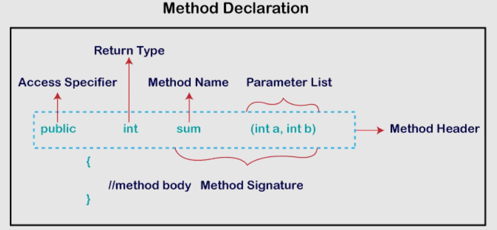
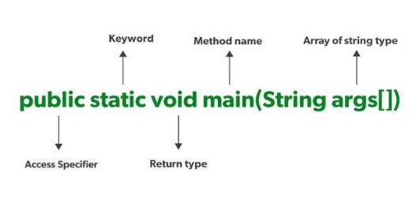

# 6.5 Methods

**Access Specifier:** Access specifier or modifier is the access type of the method. It specifies the visibility of the method. Java provides **four** types of access specifier:

  - **Public:** The method is accessible by all classes when we use public specifier in our application.

  - **Private:** When we use a private access specifier, the method is accessible only in the classes in which it is defined.

  - **Protected:** When we use protected access specifier, the method is accessible within the same package or subclasses in a different package.

  - **Default:** When we do not use any access specifier in the method declaration, Java uses default access specifier by default. It is visible only from the same package only.

  - Why static method can’t be overriden
The short answer is No. Static methods in Java cannot be overridden. This is because **static methods are not associated with the instance of a class, but with the class itself**. Therefore, when a subclass inherits a static method from its parent class, it cannot modify the behavior of the static method in any way.

- why constructor can't be static or final or abstract or synchronized  in java

  - It isn't necessary to declare a constructor final because they are not class members and they do not inherit.

  - Constructor needs to have a body and implementation, so there is no sense in making them abstract.

  - A constructor is called when an object of a class is created, so no use of the static constructor.

  - Another thing is that if we will declare static constructor then we can not access/call the constructor from a subclass. Because we know static is allowed within a class but not by a subclass.

- private constructors

  - Private constructors **allow us to restrict the instantiation of a class**. Simply put, they prevent the creation of class instances in any place other than the class itself.

There are several patterns and benefits to restricting explicit class instantiation, and we’ll go through the most common ones in this tutorial:

  - The [singleton pattern](<https://www.baeldung.com/java-singleton>)

  - Delegating constructors

  - Uninstantiable classes

    - Uninstantiable classes are classes that we cannot instantiate. In this example, we’ll create **a class that simply contains a collection of static methods**:

  - The [builder pattern](<https://www.baeldung.com/java-builder-pattern-freebuilder>)

- Static method and Instance method
**Instance Method**

  - Instance method(s) belong to the Object of the class, not to the class i.e. they can be called after creating the Object of the class.

  - Instance methods are not stored on a per-instance basis, even with virtual methods. They’re stored in a single memory location, and they only “know” which object they belong to because this pointer is passed when you call them.

  - They can be overridden since they are resolved using **dynamic binding** at run time.

// Example to illustrate accessing the instance method .

import java.io.\*;

class Foo {

}

class GFG {

public static void main(String\[\] args)

{

}

Output: GeeksforGeeks

**Static Method**

  - Static method(s) are associated with the class in which they reside i.e. they are called without creating an instance of the class i.e **ClassName.methodName(args)**.

  - They are designed with the aim to be shared among all objects created from the same class.

  - Static methods can not be overridden, since they are resolved using **static binding** by the compiler at compile time. However, we can have the same name methods declared **static** in both **superclass** and **subclass**, but it will be called [Method Hiding](<https://www.geeksforgeeks.org/overriding-in-java/>) as the derived class method will hide the base class method.

// Example to illustrate Accessing

// the Static method(s) of the class.

import java.io.\*;

class Geek {

}

class GFG {

public static void main(String\[\] args)

{

}

Output:

vaibhav

mohit

- Main method
**Java’s main() method** is the starting point from where the **JVM** starts the execution of a Java program. JVM will not execute the code, if the program is missing the main method. Hence, it is one of the most important methods of Java, and having a proper understanding of it is very important.

- 

**String\[\] args
**It stores Java command-line **arguments** and is an array of type ***java.lang.String*** class. Here, the name of the String array is *args* but it is not fixed and the user can use any name in place of it.

// Java Program to demonstrate

// the working of String\[\] args

// in the main() method

class GeeksforGeeks {

// Commamd-Line Code ->

// javac GeeksforGeeks.java

// java GeeksforGeeks 1 2 3

public static void main(String\[\] args)

{

for (String elem : args)

System.out.println(elem);

}

}

Output:

1

2

3

**Overloading main() Method in Java**

Overloading the main() method is possible in Java, meaning we can create any number of main() methods in a program.

To overload the main() method in Java, we need to create the main() method with different parameters.

public class Main {

public static void main(String\[\] args) {

if (args.length == 0) {

System.out.println("Running main() with no arguments");

} else if (args.length == 1) {

try {

int value = Integer.parseInt(args\[0\]);

main(value);

} catch (NumberFormatException e) {

main(args\[0\]);

}

} else {

// Handle more arguments as needed

}

}

public static void main(int value) {

System.out.println("Running main() with integer argument: " + value);

}

public static void main(String message) {

System.out.println("Running main() with string argument: " + message);

}

}

Output: Running main() with no arguments

**Can the main method be int? If not, why?**

No, Java main method can not be int. There are two main reasons for it:JVM looks for public static void main(String\[\] args) when starting the program execution as it is the standard signature for entry. Using int signature would cause confusion and compatability issues while program execution.Having void signature means the main method will not return anything, but using int signature means the main function will have to return integer, which isn’t useful for JVM.

**Can we execute a Java program without the main method?**

No, From JDK7 main method is mandatory. The compiler will verify first, whether main() is present or not. If your program doesn’t contain the main method, then you will get an error “main method not found in the class”.To check more about the topic refer to Is main method compulsory in Java? article.

**Can we declare the main() method without String\[\] args?**

Yes, we can declare the main() method without String\[\] args. Although it will generate an error message if we directly try to execute the main method inside the driver class as done in the below example.

[Methods in Java \| Overloading \| Signature \| Mutability](<https://www.youtube.com/watch?v=cNktHZVMJLY&list=PLA3GkZPtsafY62QhQ030p85HAer0pFDdr&index=16&pp=iAQB>)
