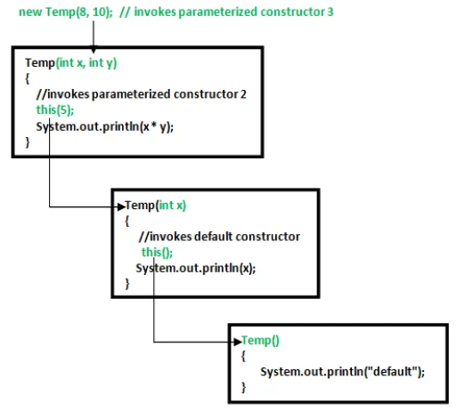

# 6.6 Constructors

**Constructors in Java**

  - Constructor

    - It is a special type of method which is used to initialize the object.

    - Every time an object is created using the new() keyword, at least one constructor is called.

    - It calls a default constructor if there is no constructor available in the class. In such case, Java compiler provides a default constructor by default.
**Rules for creating Java constructor
**There are two rules defined for the constructor.

    1. Constructor name must be the same as its class name

    1. A Constructor must have no explicit return type

    1. **A Java constructor cannot be abstract, static, final, and synchronized
****Q) What is the purpose of a default constructor?
**The default constructor is used to provide the default values to the object like 0, null, etc., depending on the type.

class Student3{

int id;

String name;

//method to display the value of id and name

void display(){System.out.println(id+" "+name);}

public static void main(String args\[\]){

//creating objects

Student3 s1=new Student3();

Student3 s2=new Student3();

//displaying values of the object

s1.display();

s2.display();

}

}

Output:

0 null

0 null

**Q) Does constructor return any value?**

Yes, **it is the current class instance** (You cannot use return type yet it returns a value).

**Can constructor perform other tasks instead of initialization?**

Yes, like object creation, starting a thread, calling a method, etc. You can perform any operation in the constructor as you perform in the method.

**Is there Constructor class in Java?**

Yes.

**What is the purpose of Constructor class?**

Java provides a Constructor class which can be used to get the internal information of a constructor in the class. It is found in the java.lang.reflect package.

- Constructor overloading
In Java, we can overload constructors like methods. The constructor overloading can be defined as the concept of having more than one constructor with different parameters so that every constructor can perform a different task.

public class Student {

//instance variables of the class

int id;

String name;

Student(){

System.out.println("this a default constructor");

}

Student(int i, String n){

id = i;

name = n;

}

public static void main(String\[\] args) {

//object creation

Student s = new Student();

System.out.println("\\nDefault Constructor values: \\n");

System.out.println("Student Id : "+s.id + "\\nStudent Name : "+s.name);

System.out.println("\\nParameterized Constructor values: \\n");

Student student = new Student(10, "David");

System.out.println("Student Id : "+student.id + "\\nStudent Name : "+student.name);

}

}

- Constructor chaining in Java
Constructor chaining is the process of calling one constructor from another constructor with respect to current object.
One of the main use of constructor chaining is to avoid duplicate codes while having multiple constructor (by means of constructor overloading) and make code more readable.
Constructor chaining can be done in two ways:

  - **Within same class**: It can be done using **this()** keyword for constructors in the same class

  - **From base class:** by using **super()** keyword to call the constructor from the base class.
**Rules of constructor chaining**

  1. The **this()** expression should always be the first line of the constructor.

  1. There should be at-least be one constructor without the this() keyword (constructor 3 in above example).

  1. Constructor chaining can be achieved in any order.

// Java program to illustrate Constructor Chaining

// within same class Using this() keyword

class Temp

{

// default constructor 1

// default constructor will call another constructor

// using this keyword from same class

Temp()

{

// calls constructor 2

this(5);

System.out.println("The Default constructor");

}

}

Output:

75

5

The Default constructor

Constructor Chaining to other class using super() keyword

// Java program to illustrate Constructor Chaining to

// other class using super() keyword

class Base

{

String name;

}

class Derived extends Base

{

// constructor 3

Derived()

{

System.out.println("No-argument constructor " +

"of derived");

}

}

- Copy constructor in Java
A copy constructor in a Java class is a [constructor](<https://www.baeldung.com/java-constructors>) that **creates an object using another object of the same Java class**.
That’s helpful when we want to copy a complex object that has several fields, or when we want to make a [deep copy](<https://www.baeldung.com/java-deep-copy>) of an existing object.
Copy constructors, by convention, should provide a deep copy of objects, the main convenience provided by copy constructors is when your object becomes too complex. Note that java.lang.Cloneable provides an (almost) similar declaration.
But there are a number of advantages to using copy constructors over the Cloneable interface.

  1. Cloneable as an interface does not actually provide any methods. For it to be effective, you still need to override the clone method of java.lang.Object. This is quite a counterintuitive use for an interface.

  1. clone returns an Object. For it to be of any use, you still need to typecast. This is awkward and could lead to runtime errors.

  1. The clone method is poorly documented. For clone, things can get messed up if you have final fields pointing to mutable objects.

  1. Most importantly, copy constructors can take in and deep copy instances of subclasses. IMO, this is where copy constructors really shine.
There are more advantages (see Joshua Bloch's *Effective Java 2e*) but these are the points which I have found most pertinent to what I have worked on so far.

\[1\] Nothing in the Java language actually provides a default construct for deep copying. At most, objects can just tell programmers that they can be deep copied by, say, implementing Cloneable or providing a copy constructor.

[What are constructors in Java ?](<https://www.youtube.com/watch?v=uCAaTvO7dn0&list=PLA3GkZPtsafY62QhQ030p85HAer0pFDdr&index=20&pp=iAQB>)

[Classes, Objects, and Constructors in Java | Vishwa Mohan | Day - 10](<https://www.youtube.com/watch?v=Hb6ALCh87Os>)
