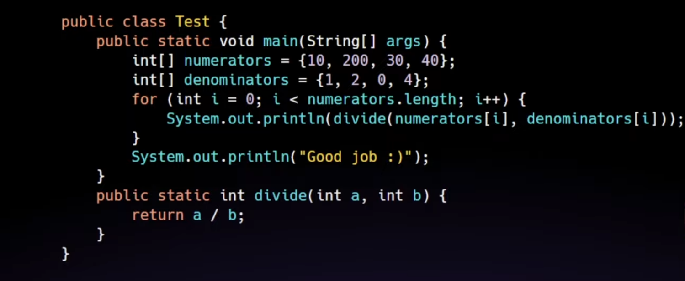

# 8.1 Exception handling in Java

**12. Exception Handling **[What are Exceptions](<https://www.geeksforgeeks.org/exceptions-in-java/>)

  - **Types of Exceptions**: Checked, unchecked, and errors. [Checked and Unchecked Exception](<https://www.geeksforgeeks.org/checked-vs-unchecked-exceptions-in-java/>)

  - **Try-Catch Block**: Writing exception handling blocks. [Try and Catch Blo](<https://www.geeksforgeeks.org/try-catch-throw-and-throws-in-java/>)[ck](<https://www.geeksforgeeks.org/try-catch-throw-and-throws-in-java/>) [Multiple & Nested Try Catch](<https://www.geeksforgeeks.org/nested-try-blocks-in-exception-handling-in-java/>)

  - **Finally Block**: Ensuring resource release. [Finally Block](<https://www.geeksforgeeks.org/java-program-to-use-finally-block-for-catching-exceptions/>)

  - **Throw and Throws**: Declaring exceptions and throwing exceptions. [Throw vs Throws](<https://www.geeksforgeeks.org/difference-between-throw-and-throws-in-java/>)

  - **Custom Exceptions**: Creating your own exception classes.

Master try-catch, finally, throw, and throws.

[Exception Handling and File Processing in Java | Vishwa Mohan | Day - 24](<https://www.youtube.com/watch?v=nDdXw-A94Vg>)

[Exception Handling in Java | Explained in HINDI | Java Interview question | BitsAndBytes](<https://www.youtube.com/watch?v=ttIDyJchadw>)

[19. Exception Handling in Java with Examples](<https://www.youtube.com/watch?v=tw4wWCsGNe4&list=PL6W8uoQQ2c63f469AyV78np0rbxRFppkx&index=20&pp=iAQB>)

[Exception Handling in Java](<https://www.youtube.com/playlist?list=PLW9FyU4GZfQZ9sCvySY_jhYSfKr-iyS7d>)

[Exception Handling In One Video | Java](<https://www.youtube.com/watch?v=3noWoQBn3qk>)

