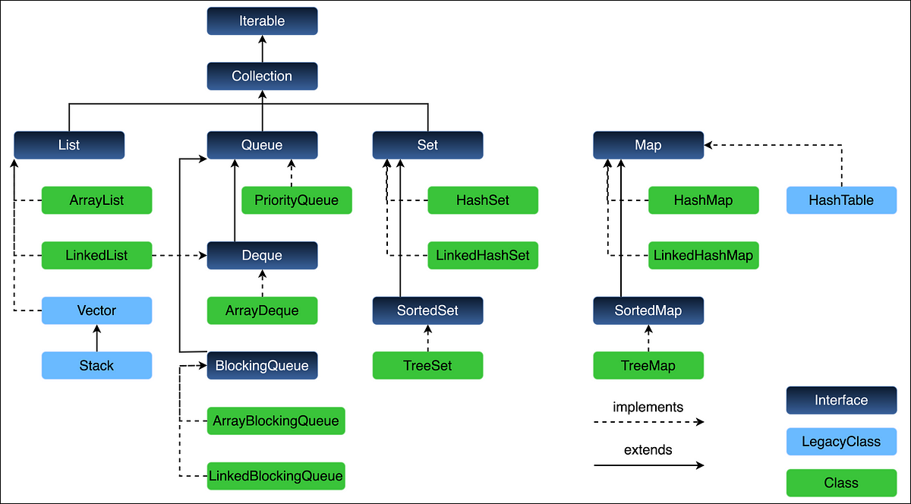

# 9.2 Introduction

- What is collection framework
The **Collection in Java** is a framework that provides an architecture to store and manipulate the group of objects. Store multiple values/data together. Used for implementing data structures using inbuilt classes (introduced in Java 1.2)

Eg: int num = 5; int nums\[\] = new int\[5\];

Collection API means that we can directly use it, no need to implement.

Collection API - Concept

Collection - Interface, and some classes implement this

Collections - Class

[Complete Java Collections Framework & Streams Masterclass 2024](<https://youtu.be/92k5uokmW9o?si=KViY08ruCfJfRmZm>)

[Master Java Collections Framework in 3 Hours ](<https://www.youtube.com/watch?v=VE_AAUxTUCY&pp=ygUZamF2YSBjb2xsZWN0aW9uIGZyYW1ld29yaw%3D%3D>)[🔥🔥](<https://www.youtube.com/watch?v=VE_AAUxTUCY&pp=ygUZamF2YSBjb2xsZWN0aW9uIGZyYW1ld29yaw%3D%3D>)[ | Full Course in Depth | For DSA | Java Tutorial](<https://www.youtube.com/watch?v=VE_AAUxTUCY&pp=ygUZamF2YSBjb2xsZWN0aW9uIGZyYW1ld29yaw%3D%3D>)

[Java Collection Framework - Part 1: Overview and Introduction](<https://www.youtube.com/watch?v=A1VQxLCR-lY>)

[Java Collections Framework in One Shot \| Lecture 59 \| JAVA and DSA Foundation Course](<https://www.youtube.com/watch?v=-klVeM0x8K8&list=PLxgZQoSe9cg00xyG5gzb5BMkOClkch7Gr&index=63&pp=iAQB>)

[22. Collections in Java - Part1 \| Java Collections Framework in depth](<https://www.youtube.com/watch?v=TT1-qsuHMXs&list=PL6W8uoQQ2c63f469AyV78np0rbxRFppkx&index=23&pp=iAQB>)

[Collection API in Java](<https://www.youtube.com/playlist?list=PLW9FyU4GZfQb6W0ToQkQKbZwC63vbRVT4>)

[Java Collections \| Vishwa Mohan \| Day - 26](<https://www.youtube.com/watch?v=alyUIO2wpag>)
