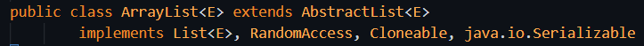
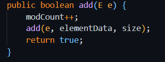

# 9.4 List

[List in Java collection \| Explained in Hindi](<https://www.youtube.com/watch?v=jYwsdCTyMBI>)

[ArrayList \| Collection \| Java \| API \| ](<https://www.youtube.com/watch?v=cl7rw5_G_18>)[😇](<https://www.youtube.com/watch?v=cl7rw5_G_18>)

ArrayList

LinkedList

List is an **interface**, and you cannot create an object of an interface in Java. Instead, you should use a class that implements List, such as ArrayList, LinkedList, etc.

List is interface. ArrayList is class. E is any datatype (called generics). Every ArrayList is a List but not vice versa.

List<String> arr = newArrayList<>();

ArrayList implements List and will have all the implementations  of the methods (method overriding) in List interface.  // Strategic Design Pattern

Eg:

List specifies

boolean add(E e);

ArrayList implements:

