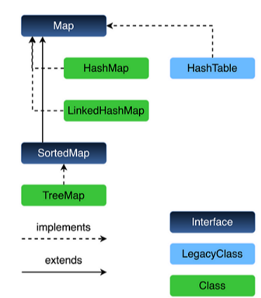
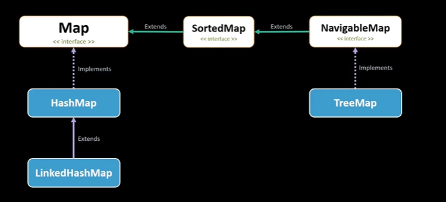
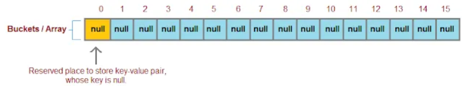
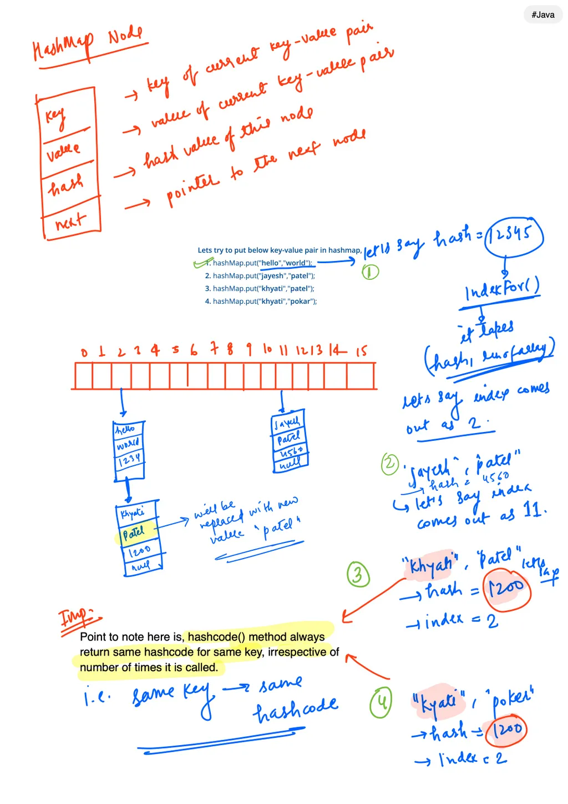
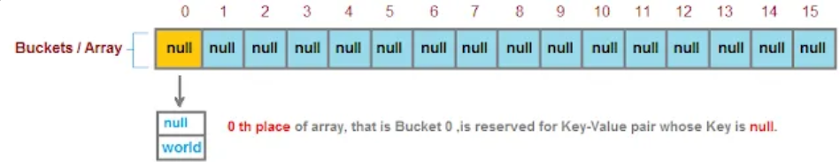
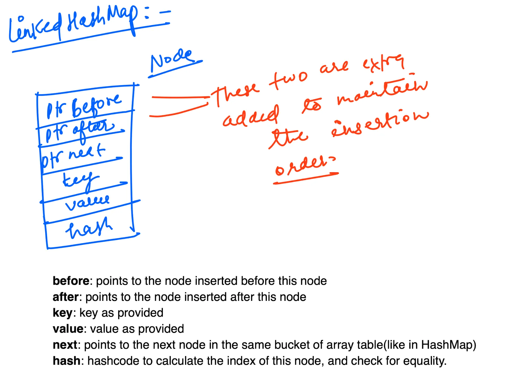
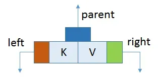

# 9.5 Map

DSA >> Hashing >> HashMap >> [HashMap](<onenote:https://d.docs.live.net/1B496228341EAA92/NOTES/DSA/Hashing.one#HashMap&section-id={906BE812-1AC0-854F-AC1B-A6626A523552}&page-id={B23F1438-9339-4C81-A849-A3F69782D336}&end>)

__________________________________________________________________________________________________

[How to use HashMaps in Java ?  Code Walkthrough | Helpful for DSA | Collection Framework](<https://www.youtube.com/watch?v=5OD-0mHB864>)

[How are HashMaps implemented in Java? Internal Working Explained With Code | IMP Interview Question](<https://www.youtube.com/watch?v=sHpjxXX81Gw&pp=0gcJCU8JAYcqIYzv>)

[Working with Map \[T \] in Java! Vishwa Mohan | Day -29](<https://www.youtube.com/watch?v=kB46Us20BFQ>)

[Java Collection Framework - Part 5 : Map Interface | Explained in Hindi](<https://www.youtube.com/watch?v=SODJlKaKHcg>)

- Map is not part of collection interface but it part of collection framework.

- Map is a data structure in java that stores key-value pairs.

- Key is the identifier of the value hence it allows **unique key (never duplicate)** and value can be duplicate.

// You cannot create an object of an interface in Java.

// Instead, you should use a class that implements Map eg: HashMap, TreeMap, etc.

Map<String, String> map = new HashMap<>();

// this is also possible

HashMap<String, Integer> marks = new HashMap<>();

marks.put("Maths", 90);

marks.put("Science", 80);

marks.put("English", 70);

marks.put("History", 60);

for(Map.Entry<String, Integer> entry: marks.entrySet()) {

System.out.println(entry.getKey() + " : " + entry.getValue());

}

[#94 Map in Java](<https://www.youtube.com/watch?v=VcXYlkICcQU&pp=ygUVbWFwIGludGVyZmFjZSBpbiBqYXZh>)

- HashMap
This class is found in **java.util** package. It provides the basic implementation of the Map interface of Java. HashMap in Java stores the data in (Key, Value) pairs, and you can access them by an index of another type (e.g. an Integer).

- To search a pair in map, we use KEY.

- One object is used as a key (index) to another object (value). If you try to insert the duplicate key in HashMap, it will replace the element of the corresponding key.

- HashMap Internal Working
Hashmap is very popular data structure and found useful for solving many problems due to O(1) time complexity for both get and put operation.
**Internal working of Get and Put operation
**Hashmap store objects in key-value pair in a table.

  1. Objects are stored by method hashmap.put(key, value)

  1. Objects are retrieved by calling hashmap.get(key) method.
**Put Operation:**

  - Hashmap works on principle of hashing and internally uses hashcode as a base, for storing key-value pair. With the help of hashcode, Hashmap stores objects and retrieves it in constant time O(1)

  - Hashcode is basically used to distribute the objects systematically, so that searching can be done faster.

Default Hashmap size is 16. It means, default array size is 16, starting from index 0 to 15.

*Remember, new item that need to be stored, first is compared with every item already present in link list, if the item with same key is found then instead of creating new node/key-value pair, only value for matched node will be replaced.*

If two Objects have same hashcode, it doesn't mean both are same. hashcode is used to group all Objects having same hashcode in one bucket, So that searching within bucket can be done faster compare to all Objects dumped in one bucket.

**Get Operation:**

  - Irrespective of number of times it is called, indexFor(hash, table.length) method will always return same index for same hashcode.

  - If no item with matching key is found in the Bucket, then it will return value as null.

**hashcode and equals method:**

  1. We saw, two in-different object's can have same hashcode, which ultimately have same bucket.

  1. To get the object, each key-value pair in that bucket need to be to compared against the key until object is not found.

<aside> 💡

***hashcode()**** method generate hashcode of a object, which helps in identifying exact bucket.*

***equals()**** method compares each element in the bucket until matching key is not found.*

</aside>

**Null key placement:**

We just saw, how put operation of hashmap works, say **hashmap.put("hello","world");**

**1.** First **hashcode** of key "**hello**" is evaluated, which is supplied to **indexFor** method to identify exact bucket.

**2. What if we try to put key-value pair like, hashmap.put(null,"world");**

Above statement is perfectly valid and **key here is null.**

*If key is null then it will be stored at ****first bucket*** ***/*** ***array\[0\]****, because hashcode of null key is always 0.*

- What is Load factor and Rehashing in HashMap?
Hashmap is very popular data structure and found useful for solving many problems due to O(1) time complexity for both get and put operation.
**Load Factor:**

  - When the total number of items in hashmap goes on increasing keeping the default initial capacity of hashmap 16, At one point of time, hashmap performance will start degrading and need to increase buckets for improving performance.

  - Load Factor is a measure, which decides when exactly to increase the hashmap capacity(buckets) to maintain get and put operation complexity of O(1).
<aside> 💡
*Default load factor of Hashmap is 0.75f (i.e 75% of current map size).
*</aside>
<aside> 💡
*Default capacity of Hashmap is 2^4 = 16 buckets.
*</aside>
**Problem:** Initially we was doing good, when bucket size was more(16) and total items was less. When total items keep growing, at one point, our performance start degrading due to much items present in each bucket. So what do you think problem is???
Problem is, keeping bucket size fixed(16), we kept on increasing the total number of items in map and that disturbed time complexity.
If we increase the total number of buckets, when total items in each bucket starts increasing, then we will be able to keep constant number of items in each bucket and maintain the time complexity of O(1) for get and put operation.

**The decision of "When to increase the number of buckets" is decided by Load Factor.**

    - *When Load factor ratio (m/n) reaches 0.75 at that time hashmap increases its capacity, where n = the total size of the hash map and m = number of entries in a map.*

    - initially bucket size is 16, when we have 12th comes in capacity will be 12/16=0.75. it this the time we should increase the capacity? NO!

    - when 13th elements comes in then capacity will be 13/16=0.81,
now, we need to increase the capacity of map.

**Rehashing:**

    - Rehashing is the process of re-calculating the hashcode of already stored entries (Key-Value pairs), to move them to another bigger size hashmap when Load factor threshold is reached.

**Why Rehashing is required?**

    - After doubling the capacity, what to do with the key-value pairs already present in buckets?

    - If we keep the existing key-value pairs as it is, then doubling the capacity may not help,

    - because O(1) complexity will be achieved only if items are evenly distributed across all buckets.

    - So for each existing key-value pairs, hashcode is calculated again with increased hashmap capacity as a parameter, which results in either placing the item in same bucket or in different bucket.

Hashmap maintain complexity of O(1) while inserting data in and getting data from hashmap, but for 13th key-value pair, put request will no longer be O(1), because as soon as map will realize that 13th element came in, that is 75% of map is [filled.It](<http://filled.It>) will first double the bucket(array) capacity and then it will go for Rehash.

Rehashing requires re-computing hashcode of already placed 12 key-value pairs again and putting them at new index which requires time.

  - ConcurrentHashMap and its interview questions
https://javabypatel.blogspot.com/2016/09/concurrenthashmap-interview-questions.html

  - equals and hashCode method scenarios in HashMap when the key is a custom class
equals and hashCode methods are called when we store and retrieve values from hashmap. So, when the interviewer asks this question, it is mostly asked with an example, where the hashmap’s key is a custom class and you are given some situations where either equals() is implemented or hashCode() is implemented, sometimes properly, sometimes not. We will discuss all combinations with programs below so you can give the correct answer in any situation.
Before we continue, just remember if in your custom class, you are not implementing equals() and hashCode(), then the Object class equals() and hashCode() will be called, and also remember about the contract between these 2 methods. It says when 2 objects are equal according to equals() method, then their hashCode must be same, reverse may not be true.

- LinkedHashMap

  - LinkedHashMap is the data structure used to store the key-value pairs like HashMap but it guarantees the order of insertion(unlike the HashMap). So the elements are stored in the order of their insertion.

  - To maintain the order of insertion **we need 2 more pointers** at every Node(besides the next pointer required for LinkedList functionality). So besides this linkedList, another doubly-linked-list is also maintained in the hashmap which is used to handle the insertion order.

More details at: https://anmolsehgal.medium.com/java-linkedhashmap-internal-implementation-44e2e2893036

- TreeMap

  - *TreeMap* is a map implementation that keeps its entries sorted according to the natural ordering of its keys or better still using a comparator if provided by the user at construction time.

  - 

  - TreeMap does not use hashing for storing keys. It uses a data structure called the Red-Black tree. This implementation provides guaranteed log(n) time cost for the containsKey, get, put and remove operations.

The rule is that starting from the root, any element in the left branch of any node is always less than the element in the node itself. Those on the right are always greater. What defines greater or less than is determined by the natural ordering of the elements or the defined comparator at construction time.
This rule guarantees that the entries of a Treemap will always be in sorted and predictable order.
Secondly, a red-black tree is a self-balancing binary search tree. This attribute and the above guarantee that basic operations like search, get, put and remove take logarithmic time *O(log n)*.
Some of the important points to remember about TreeMap in java are;

    1. Apart from implementing the Map interface, Java TreeMap also implements NavigableMap and indirectly implements the SortedMap [interface](<https://www.journaldev.com/1601/interface-in-java>). TreeMap also extends AbstractMap class.

    1. TreeMap entries are sorted in the natural ordering of its keys. It also provides a constructor to provide [Comparator](<https://www.journaldev.com/780/comparable-and-comparator-in-java-example>) to be used for ordering. So if you are using any class as key, make sure it’s implementing [Comparable interface](<https://www.journaldev.com/780/comparable-and-comparator-in-java-example>) for natural ordering.

    1. Java TreeMap implementation provides guaranteed log(n) time cost for the containsKey, get, put and remove operations.

    1. TreeMap is not synchronized and hence not thread-safe. For multithreaded environments, you can get a wrapped synchronized using Collections.synchronizedSortedMap method.

    1. TreeMap methods to get keyset and values return [Iterator](<https://www.journaldev.com/13460/java-iterator>) that is fail-fast in nature, so any concurrent modification will throw [ConcurrentModificationException](<https://www.journaldev.com/378/java-util-concurrentmodificationexception>).

    1. **TreeMap in java doesn’t allow null keys, however, you can have multiple null values associated with different keys.**

- SortedMap
SortedMap is an interface in the [collection framework](<https://www.geeksforgeeks.org/collections-in-java-2/>). This interface extends the [Map interface](<https://www.geeksforgeeks.org/map-interface-java-examples/>) and provides a total ordering of its elements (elements can be traversed in sorted order of keys). The class that implements this interface is [TreeMap](<https://www.geeksforgeeks.org/hashmap-treemap-java/>).
The SortedMap interface is a subinterface of the java.util.Map interface in Java. It extends the Map interface to provide a total ordering of its elements, based on the natural order of its keys.
The main difference between a SortedMap and a regular Map is that the elements in a SortedMap are stored in a sorted order, whereas in a Map the elements are stored in an arbitrary order.

import java.util.SortedMap;

import java.util.TreeMap;

public class Main {

public static void main(String\[\] args) {

SortedMap<String, Integer> sortedMap = new TreeMap<>();

}

- EnumMap
*EnumMap* is a [\*Map](<https://docs.oracle.com/en/java/javase/21/docs/api/java.base/java/util/Map.html>)\* implementation that exclusively takes *Enum* as its keys.
Using *Enum* as key makes it possible to do some extra performance optimization, **like a quicker hash computation since all possible keys are known in advance.
**The simplicity of having *enum* as key means *EnumMap* only need to be backed up by a plain old Java *Array* with very simple logic for storage and retrieval. On the other hand, generic *Map* implementations need to cater for concerns related to having a generic object as its key. For example, [HashMap](<https://www.baeldung.com/java-hashmap>)[ needs a complex data structure and a considerably more complex storing and retrieval logic](<https://www.baeldung.com/java-hashmap>) to cater for the possibility of hash collision.
