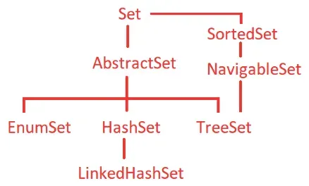
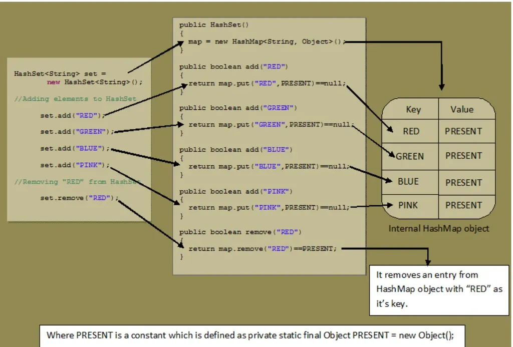

# 9.6 Set

[Java Collection Framework - Part 3: Deep dive into Set interface \| Explained in Hindi](<https://www.youtube.com/watch?v=q_I6ukYxe5o>)

[HashSet and LinkedHashSet in Java! Vishwa Mohan \| Day -27](<https://www.youtube.com/watch?v=WKJPlCyGSQQ>)

// of an interface in Java. Instead, you should use a class

// that implements Set, such as HashSet, TreeSet, etc.

Set<String> set = new HashSet<>();

// this provides various methods to work with the set

set.add("A");

set.add("B");

set.add("C");

set.add("D");

set.add("E");

for(String s: set) {

System.out.println(s);

}

- HashSet
HashSet is a class in Java which implements Set Interface and extends AbstractSet. It allows you to store only 𝒖𝒏𝒊𝒒𝒖𝒆 𝒆𝒍𝒆𝒎𝒆𝒏𝒕𝒔 that means no duplicates are allowed.
➡️ HashSet uses HashMap internally to store data in the form of Key-Value pair.
➡️ Elements are stored using 𝒉𝒂𝒔𝒉𝒊𝒏𝒈 𝒕𝒆𝒄𝒉𝒏𝒊𝒒𝒖𝒆, therefore elements are not stored in an ordered fashion and the elements will be returned in random order.
➡️ Elements are stored in the form of key-value pair (internally by HashMap) where key will the actual element value and value will be the 𝑷𝑹𝑬𝑺𝑬𝑵𝑻 Constant.

- 

➡️ This class permits at most 𝒐𝒏𝒆 𝒏𝒖𝒍𝒍 𝒆𝒍𝒆𝒎𝒆𝒏𝒕 because HashMap allows only one null key.

➡️ HashSet has default initial capacity of 16.

➡️ HashSet has default load factor of 0.75 or 75%.

➡️ HashSet does not have any method(like get(key) in HashMap) to retrieve the object directly.

➡️ The only way to retrieve objects from the HashSet is through iterating the entire HashSet. This can be achieved by using iterator, for, for-each ,etc.

➡️ The iterators returned by HashSet class iterator method are fail-fast: if the set is modified at any time after the iterator is created, in any way except through the iterator’s own remove method, the Iterator throws a 𝑪𝒐𝒏𝒄𝒖𝒓𝒓𝒆𝒏𝒕𝑴𝒐𝒅𝒊𝒇𝒊𝒄𝒂𝒕𝒊𝒐𝒏𝑬𝒙𝒄𝒆𝒑𝒕𝒊𝒐𝒏.

<aside> 💡

*Remember to override equals() and hashCode() for any object you are going to store in HashSet, since your object is used as a key in backup Map, it must override those methods. Make your object Immutable or effective immutable if possible.*

</aside>

https://notebook.zohopublic.in/public/notes/74tdo79dc003d7a2846b9afdfa3f5df7f5d32

**Import java.util.\*; **

**Set<Type> setName = ****new****HashSet<>(); ****// Common implementation**

**Set<Integer> hashSet = new HashSet<>();      // Unordered, allows null, best performance**

**Set<Integer> linkedHashSet = new LinkedHashSet<>(); // Maintains insertion order**

**Set<Integer> treeSet = new TreeSet<>();      // Sorted order, does not allow null**

**set.add(element);    // Adds an element**

**set.remove(element); // Removes an element**

**set.contains(element); // Checks if element exists**

**set.size();         // Returns the number of elements**

**set.isEmpty();      // Checks if the set is empty**

**set.clear();        // Removes all elements**
