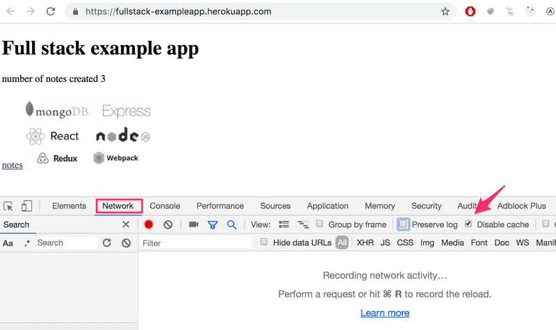
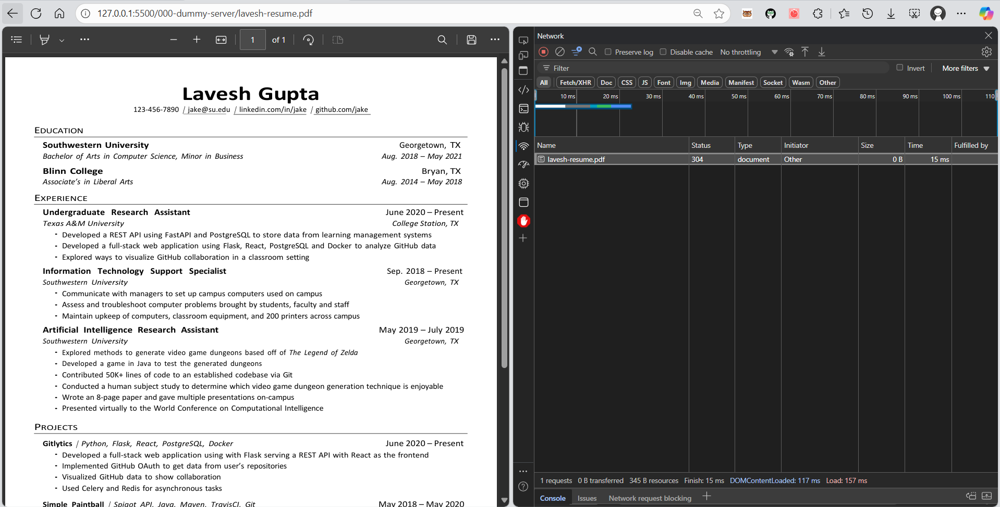
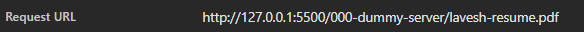
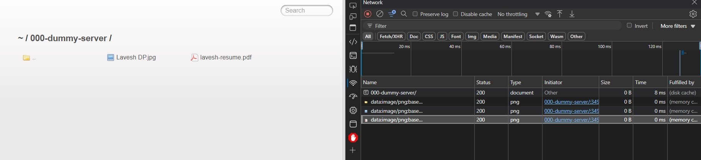

# 1.4 HTTPS Request Response

**The 1st rule of web development:** Always keep the Developer Console open on your web browser. On macOS, open the console by pressing fn-F12 or option-cmd-i simultaneously. On Windows or Linux, open the console by pressing Fn-F12 or ctrl-shift-i simultaneously. The console can also be opened via the context menu.

Remember to always keep the Developer Console open when developing web applications.

The console looks like this:

A screenshot of the developer tools open in a browser

Make sure that the Network tab is open, and check the Disable cache option as shown. Preserve log can also be useful (it saves the logs printed by the application when the page is reloaded) as well as "Hide extension URLs"(hides requests of any extensions installed in the browser, not shown in the picture above).

Type URL in Browser, press ENTER.

Browser sends HTTP request to server

