# 3.2 JavaScript Runtime

## EXECUTION CONTEXT:

"Everything in JavaScript happens inside an Execution Context"

Execution Context is like a big box in which whole JS code is exectued.

When the JavaScript engine executes the JavaScript code, it creates execution contexts.

It has two components.

  - Memory Component - where all variables and functions are stored as key value pair. AKA Variable Environment.

  - Code Component - code is executed, one line at a time. AKA Thread of Execution. .

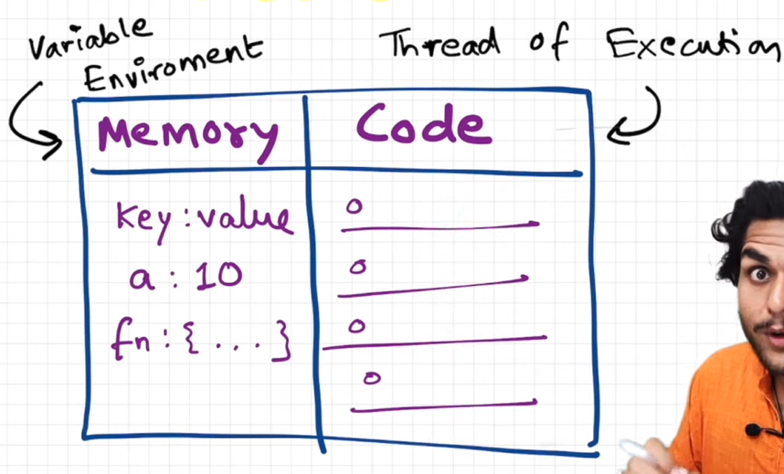

JS is synchronous, single threaded language

JavaScript can execute one command at a time and in a specific order (line by line top to bottom).

## HOW IS JAVASCRIPT CODE EXECUTED?

- When a JS program is ran, or when JS engine executes a script for first time, a **global execution context** is created.

Each execution context is created in two phases:

(i) memory creation phase

(ii) Code execution phase

- Let's consider the below example and its code execution steps:

| **var **n = 2; **function ****square**(num) {   **var **ans = num \* num;   **return **ans; } **var **square2 = square(n); **var **square4 = square(4); |
| --- |

**(i) memory creation phase**

• During this phase, the JavaScript engine performs the following tasks:

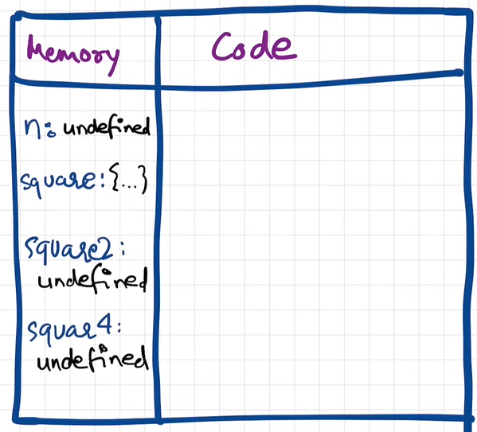

- The very **first** thing which JS does is **memory creation phase**, so it goes to line one of above code snippet, and **allocates a memory space** for variable **'n'** and then goes to line two, and **allocates a memory space** for **function 'square'**.

- When allocating memory **for n it stores 'undefined'**, a special value for 'n'.

- For 'square', it stores the whole code of the function inside its memory space.

- Then, as square2 and square4 are variables as well, it allocates memory and stores 'undefined' for them, and this is the end of first phase i.e. memory creation phase.

After the creation phase, the global execution context moves to the execution phase.

** (ii) Code execution phase**

Now, in **2nd phase** i.e. code execution phase, it starts going through the whole code line by line. assigns the values to variables, and executes the function calls. As it encounters var n = 2, it assigns 2 to 'n'. Until now, the value of 'n' was undefined.

Coming to line 6 i.e. **var square2 = square(n)**, here **functions are a bit different than any other language. **

**When you invoke the function (function call) --> A new execution context is created altogether.**

For each function call, the JavaScript engine creates a new **function execution context**. Instead of creating Global Object, the JS enginer creates the arguments object that is a reference to all the parameters of the function, sets this value to the global object,

Again in this new execution context, in memory creation phase, we allocate memory to num and ans the two variables. And undefined is placed in them.

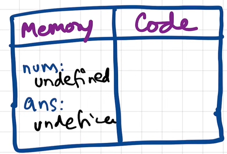

Num = parameter

N = argument = 2

Num <--- n

Num =2

Ans <--- num x num

Ans = 4

Now, in code execution phase of this execution context, first 2 is assigned to num. Then var ans = num \* num will store 4 in ans.

After that, return ans --> returns the control of program back to where this function was invoked from. Returns the result to the global execution context.

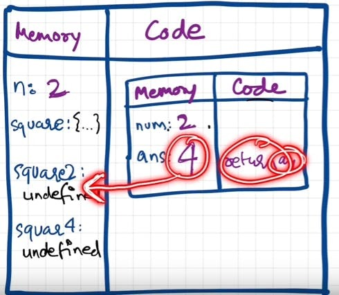

When **return** keyword is encountered, It returns the control to the called line and also **the function execution context is deleted**.

Square2 <-- ans = 4

Same thing will be repeated for square4

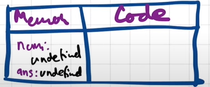

Num <--- 4

Ans <-- num x num = 16

Return

Square4 <-- ans = 16

Square4 = 16

and then after that is finished, the global execution context will be destroyed. So the **final diagram** before deletion would look something like:

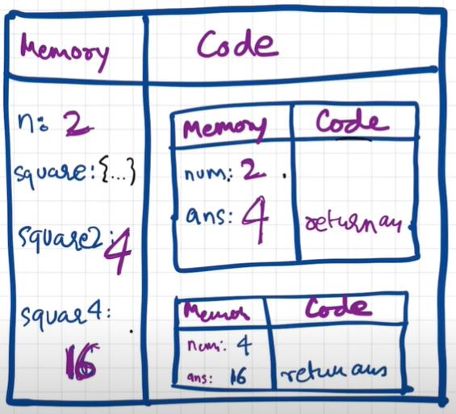

**CALL STACK**

- Javascript manages code execution context creation and deletion with the the help of **Call Stack**.

- Call Stack is a mechanism to keep track of its place in script that calls multiple function.

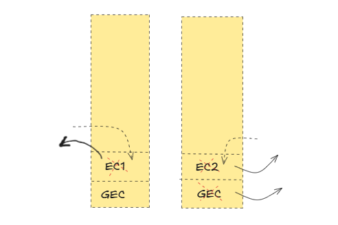

- **Call Stack maintains the order of execution of execution contexts. It is also known as Program Stack, Control Stack, Runtime stack, Machine Stack, Execution context stack.**

- The call stack works based on the last-in-first-out (LIFO) principle.

- The call stack has a fixed size, depending on the implementation of the host environment, either the web browser or Node.js. If the number of execution contexts exceeds the size of the stack, a stack overflow error will occur.

| When you execute a script, the JavaScript engine creates a global execution context (main() or global() function on the call stack) and pushes it on top of the call stack. Whenever a function is called, the JavaScript engine creates a function execution context for the function, pushes it on top of the call stack, and starts executing the function. If a function calls another function, the JavaScript engine creates a new function execution context for the function being called and pushes it on top of the call stack. When the current function completes, the JavaScript engine pops it off the call stack and resumes the execution where it left off. The script will stop when the call stack is empty. |
| --- |

Call Stack Example -

function add(a, b) {

return a + b;

}

function average(a, b) {

return add(a, b) / 2;

}

let x = average(10, 20);

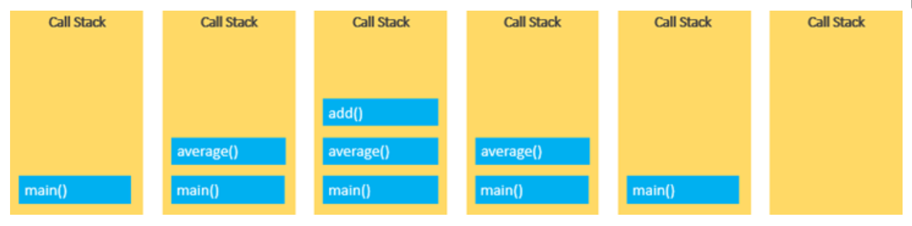

**Asynchronous JavaScript  ---> ****Event Loop**

  - JavaScript is a single-threaded programming language. This means that the JavaScript engine has only one call stack. Therefore, it only can do one thing at a time.

  - When executing a script, the JavaScript engine executes code from top to bottom, line by line. In other words, it is synchronous.

  - It creates the execution contexts and pushes and pops functions onto and off the [call stack](<https://www.javascripttutorial.net/javascript-call-stack/>) in the execution phase.

  - Asynchronous means the JavaScript engine can execute other tasks while waiting for another task to be completed. To do this, the JavaScript engine uses an [event loop](<https://www.javascripttutorial.net/javascript-event-loop/>).

  - For example, the JavaScript engine can:

    - Request for data from a remote server.

    - Display a spinner

    - When the data is available, display it on the webpage.

**HOISTING:**

- **Hoisting happens during creation phase of GEC.**

- During **memory creation phase**, the JS Engine moves the variable and function declarations to the top of your code. This is known as hoisting in JavaScript.

- Variable Hoisting:

  - Variable declarations are moved to the top of the script

  - | console.log(counter); *// **👉** undefined* var counter = 1; | var counter; //hoisting console.log(counter); *// **👉** undefined* counter = 1; |
| --- | --- |
| **Let keyword: ** console.log(counter); *console.log(alien); --> err not defined* let counter = 1; | error: "ReferenceError: Cannot access 'counter' before initialization" |

  - Var: variable counter in the memory and initializes its value to undefined.

  - Let: Counter variable is already in heap memory as JS Engine has hoisted it, however it hasn't been initialised, because it doesn’t initialize the let variables.

- Function Hoisting:

  - JavaScript engine also moves the function declarations to the top of the script, and during creation phase places the function declaration in heap memory

  - To be precise, the JavaScript engine creates an object of the Function type and a function reference add that refers to the function object.

- Difference between Function Statement and Function Expression is Hoisting.

| a();b();function a(){   console.log('a')}var b = function(){   console.log('b')} | We call these functions before declaring them, the what happens. 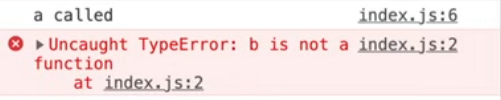 During the hoisting (memory creation), 'a' is created and function is assigned to it, but 'b' is treated with any other variable and set as undefined, hence isn't a function. Thus the error. During execution phase, when JS engine reaches the assignment line, then only an anonymous function is assigned to variable 'b' in GEC. |
| --- | --- |

- **Arrow Functions: **

  - Function expressions and Arrow functions are also not hoisted.

  - add is undefined during memory creation phase and thus errors: Uncaught ReferenceError: add is not defined

  - 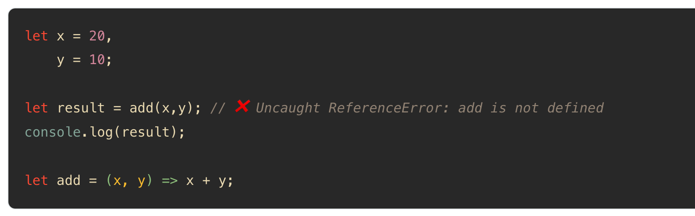

[Arindam Paul - JavaScript VM internals, EventLoop, Async and ScopeChains](<https://www.youtube.com/watch?v=QyUFheng6J0>)

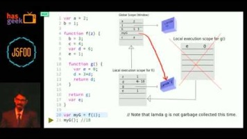
