# 3.4 JavaScript Syntax

**WHITESPACE:**

- Whitespace refers to characters that provide the space between other characters.

- JavaScript has the following whitespace: Carriage return, Space, New Line, tab

- JavaScript engine ignores whitespace. JavaScript bundlers remove all whitespace from JavaScript files and put them into a single file for deployment. By doing this, JavaScript bundlers make the JavaScript code lighter and faster to load in web browsers.

**STATEMENTS:**

- A statement is a piece of code that either declares a variable or instructs the JavaScript engine to perform a task. A simple statement ends with a semicolon (;).

eg: alert('Hello'); alert('World');

- A line-break is also treated as a delimiter (automatic semicolon insertion), so that would also work, but it doesn't always work. But even if we can put an “extra” semicolon somewhere, that’s not an error. It will be ignored.

alert('Hello')

alert('World')

- eg: let message = "Welcome to JavaScript";

- An **expression** is a piece of code that evaluates to a value.

- Semicolons are not required after code blocks {...} and syntax constructs with them like loops:

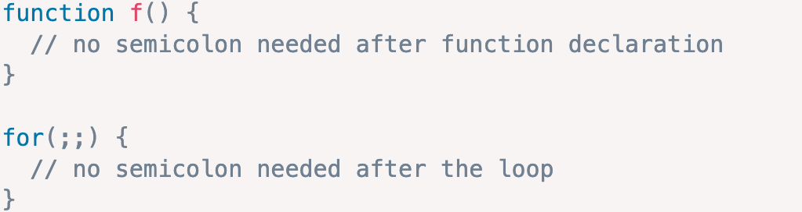

**BLOCKS:**

- A block is a sequence of zero or more simple statements. A block is delimited by a pair of curly brackets {}. For example:

- if (window.localStorage) {

console.log('The local storage is supported');

}

**IDENTIFIERS:**

- An identifier is a name you choose for [variables](<https://www.javascripttutorial.net/javascript-variables/>), parameters, [functions](<https://www.javascripttutorial.net/javascript-function/>), [classes](<https://www.javascripttutorial.net/javascript-class/>), etc. Identifiers in JavaScript are case-sensitive.

- An identifier name starts with a letter (a-z, or A-Z), an underscore(_), or a dollar sign ($) and is followed by a sequence of characters including (a-z, A-Z), numbers (0-9), underscores (_), and dollar signs ($).

KEYWORDS:

- JavaScript defines a list of reserved keywords that have specific uses. You cannot use the reserved keywords as identifiers.

- | 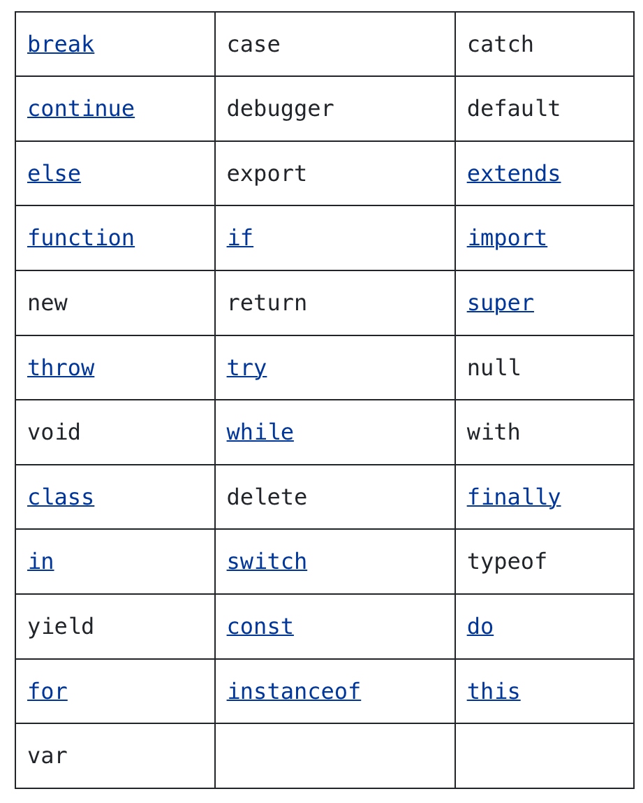 | 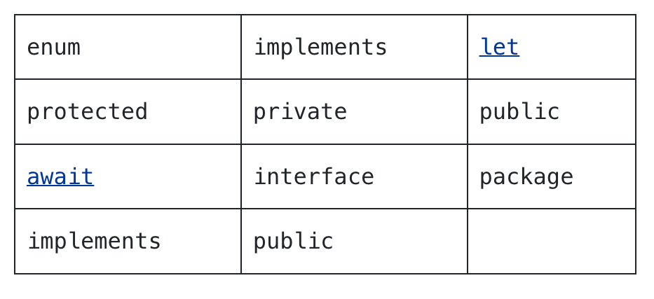 |
| --- | --- |

**STRICT MODE:**

To fully enable all features of modern JavaScript, we should start scripts with "use strict". The directive must be at the top of a script or at the beginning of a function body.

https://javascript.info/strict-mode

- https://javascript.info/javascript-specials

  - Arithematic Operators: +   -   \*   /   %

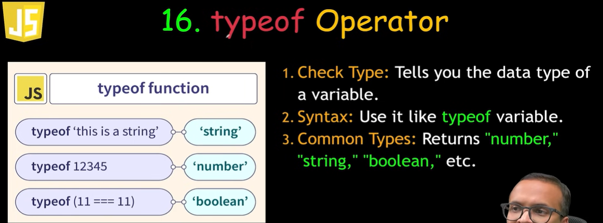

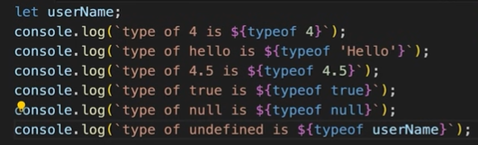

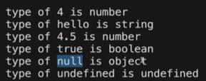

## COMPARISON OPERATORS:

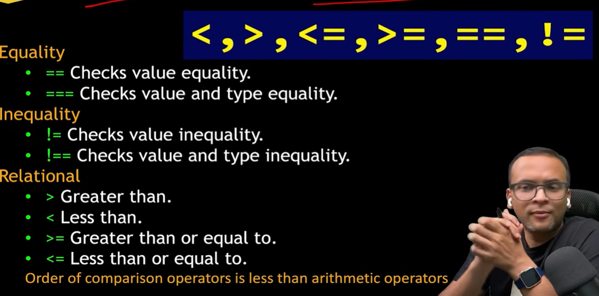

4==4 --> true

4==4.0 --> true

4===4.0 ---> true

4!==4.0 ---> false

'Hello' === "Hello" ---> true

4 <= 8 ----> true

## LOGICAL OPERATORS:

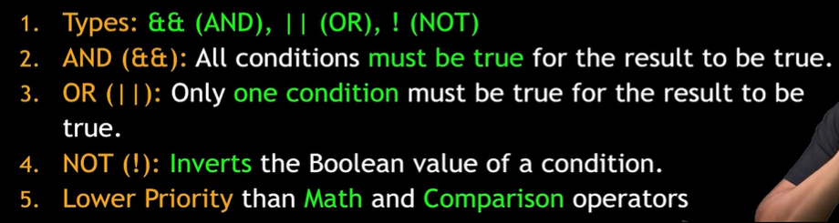

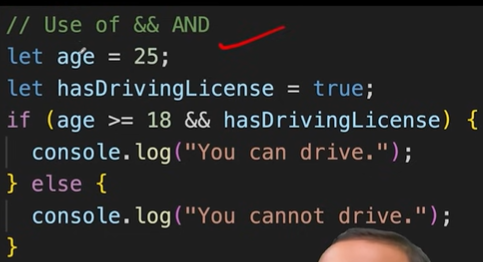

## CONDITIONAL - IF ELSE

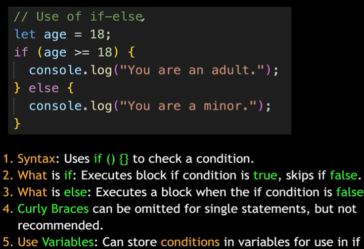

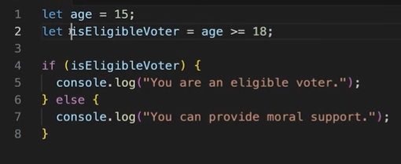

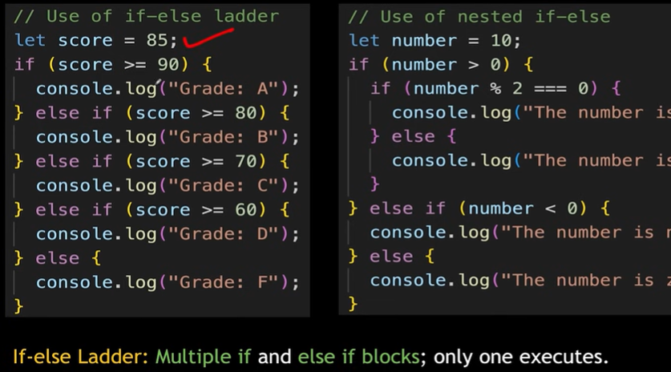

## LOOPS:

  - Repeated execution/iteration of code

  - For, while, do-while, for-each

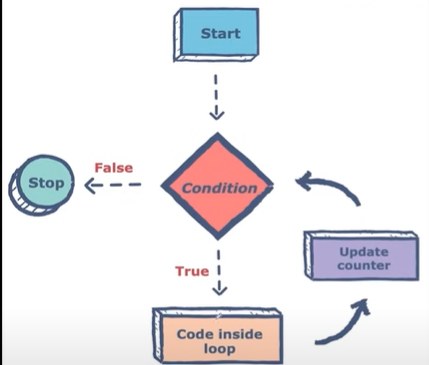

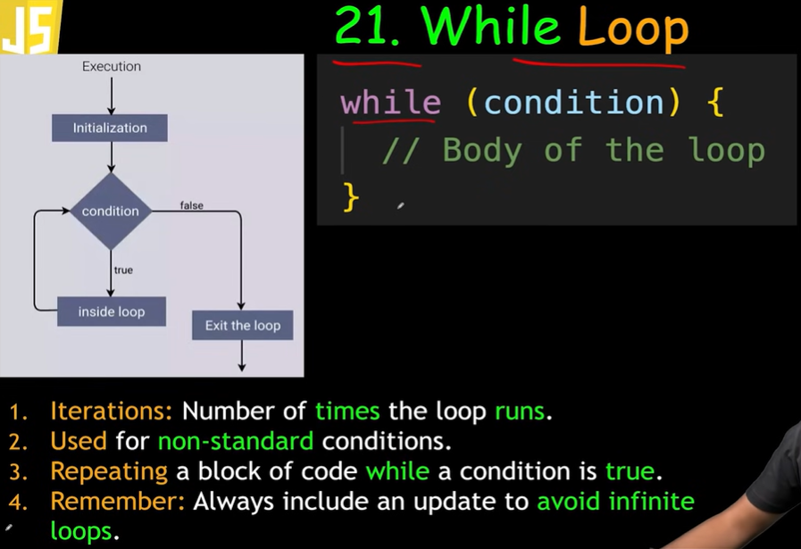

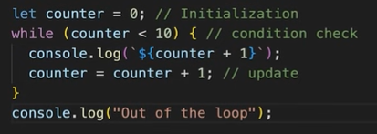

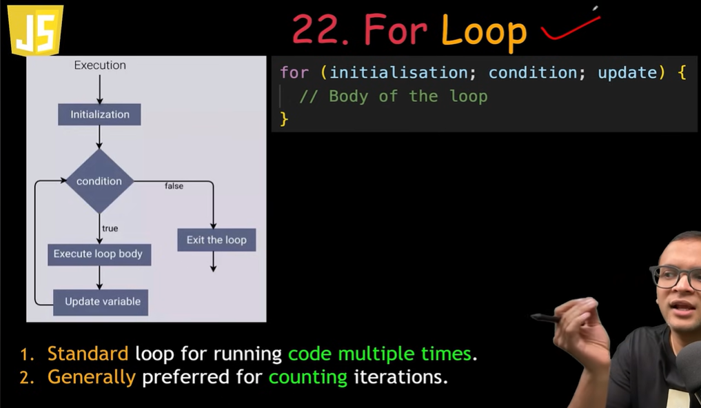

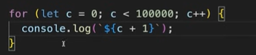
