# 3.4.1 Variables

- [Variables](<https://javascript.info/variables>)

- [Variables](<https://www.javascripttutorial.net/javascript-variables/>) – show you how to declare variables.

- | Variables: | - Containers for storing data values - A variable is a label that references a value like a number or string. Before using a variable, you need to declare it. |
| --- | --- |

- Declaring a variable:

  - Use "var" keyword followed by variable name (any valid identifier). Use "=" for assignment of value.

  - Can't use keywords or reserved words

  - Can't start with a number, no special characters other than $ and _

- String, Integer, Boolean (true, false)

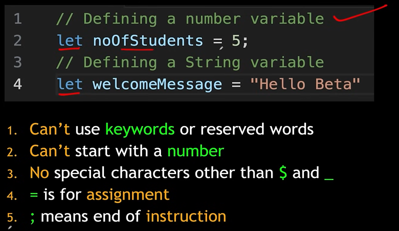

- Let money;

In this money = undefined by default if we don't initialize

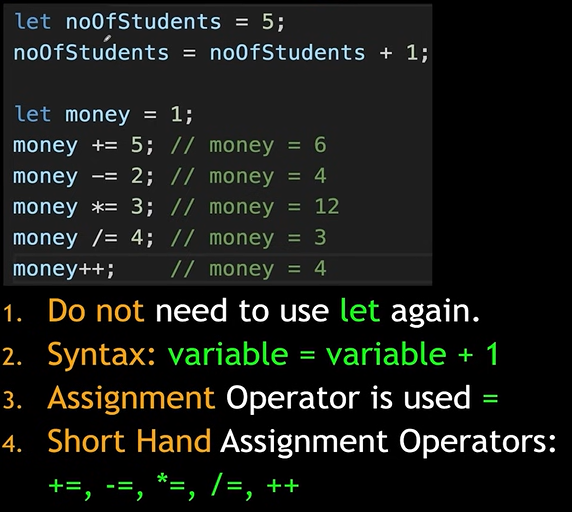

- Money--;

## DECLARATION OF VARIABLES:

- var:

  - Var varname  = 10

  - We can swap 10 later

  - Variables declared through var have full lifetime of program, they have full scope

- let:

  - Let varname = 10

  - 10 is in a box named varname with shield protection… it has a scope

  - You can swap item only if you ask inside the shield

- const:

  - Const varname = 10

  - 10 is locked in a LOCKED cage named varname

  - 10 can't be swapped, but it can be modified (varname.multiply(3)) if method available

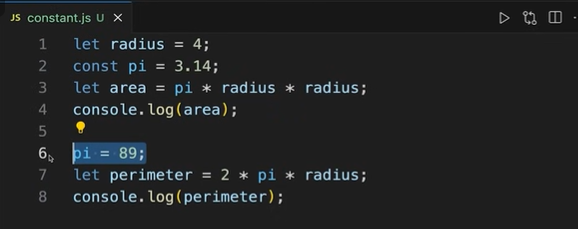

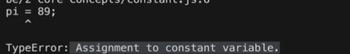

Var vs Let vs Const

## TYPES OF VARIABLES:

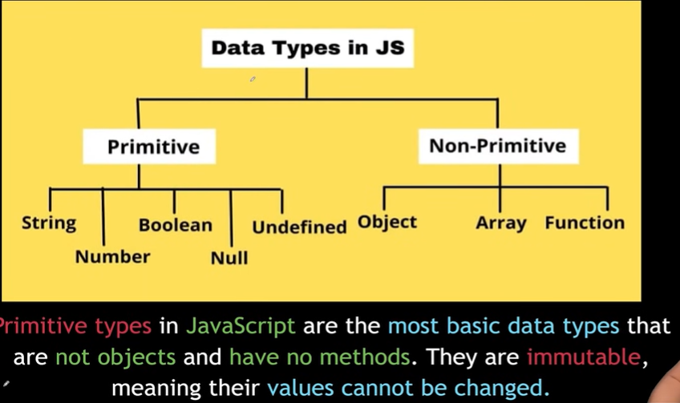

1. ## NUMBERS

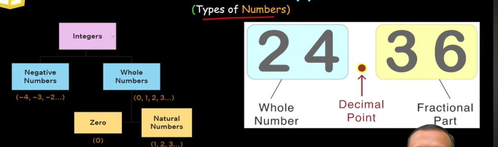

While declaring variable we do not explicitly declare the variable type. JavaScript manages that internally.

Declare variables using Let and constants using Const

1. ## Strings

- Strings hold textual data - character to paragraph

- Strings can be defined using '' or "" or `` (backtick)

- Backticks allow for template literals which can include variables.

- You can combine (concatenate) strings using the + operator.

Eg: "hello" + "world" = "hello world"

Always try to declare string with single quotes.

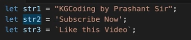

Use of backtick:

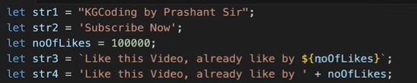

1. ## BOOLEAN:

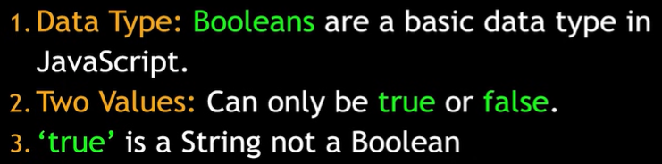

Let money = true/false; --> boolean

Let sunrise = 'true'; ---> string

1. ## NULL VS UNDEFINED:

- Though both are nullish and falsy values: null !== undefined

- | NULL | UNDEFINED |
| --- | --- |
| No value, on pupose | Declared but not yet defined |
| Type: object | Type: undefined |
| Equal to 0 (zero) | Equal to NaN (not a number) |
| Eg: the bowl is empty | Eg: the bowl doesn't exist |

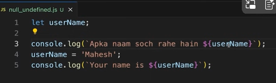

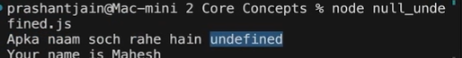

**1. The Two Phases of Execution Context**

Every execution context (Global or Function) goes through two phases. var, let, and const behave differently in each:

**Phase 1: Creation (Memory) Phase**

  - **var**: The JavaScript engine scans the code and allocates memory for var variables. They are immediately initialized with the value undefined. This is why you can "access" them before the actual line of code (though their value is useless).

  - **let & ****const**: Memory is still allocated for these variables, but they are **not initialized**. They enter a "Temporal Dead Zone" (TDZ). They exist in the system, but the engine forbids any access until the execution hits the declaration line.

**Phase 2: Execution Phase**

  - The code runs line by line.

  - **var**: If a value is assigned, undefined is replaced by that value.

  - **let & ****const**: Once the execution reaches the declaration line, the variable is initialized. If no value is provided for let, it becomes undefined. For const, a value must be assigned here, or it throws a syntax error.

**2. Storage Locations (Environment Records)**

In modern JavaScript, the Execution Context uses two different "buckets" to store data:

| **Feature** | **var** | **let & const** |
| --- | --- | --- |
| **Storage Bucket** | **Variable Environment** | **Lexical Environment** |
| **Global Object** | Attached to window (in browsers) | Not attached to the Global Object |
| **Scope** | Function Scoped | Block Scoped ({ }) |

**3. Hoisting Behavior**

While all three are technically "hoisted" (memory is allocated before execution), the **observable behavior** is different:

  1. **var (Traditional Hoisting):
**JavaScript

console.log(a); // Result: undefined
var a = 10;

The engine sees this as: var a; console.log(a); a = 10;

  1. **let & ****const**** (Temporal Dead Zone):
**JavaScript

console.log(b); // Result: ReferenceError: Cannot access 'b' before initialization
let b = 20;

Even though the engine "knows" b exists (hoisted), it stays in the **TDZ** until the let b line is executed.

**4. Summary Table**

| **Property** | **var** | **let** | **const** |
| --- | --- | --- | --- |
| **Hoisting** | Hoisted & initialized as undefined | Hoisted but stays in TDZ | Hoisted but stays in TDZ |
| **Execution Context Phase** | Initialized in Creation Phase | Initialized in Execution Phase | Initialized in Execution Phase |
| **Scope** | Global or Function | Block (if, for, while, {}) | Block (if, for, while, {}) |
| **Re-declaration** | Allowed in same scope | Not allowed | Not allowed |
| **Assignment** | Can be updated | Can be updated | Cannot be reassigned |
