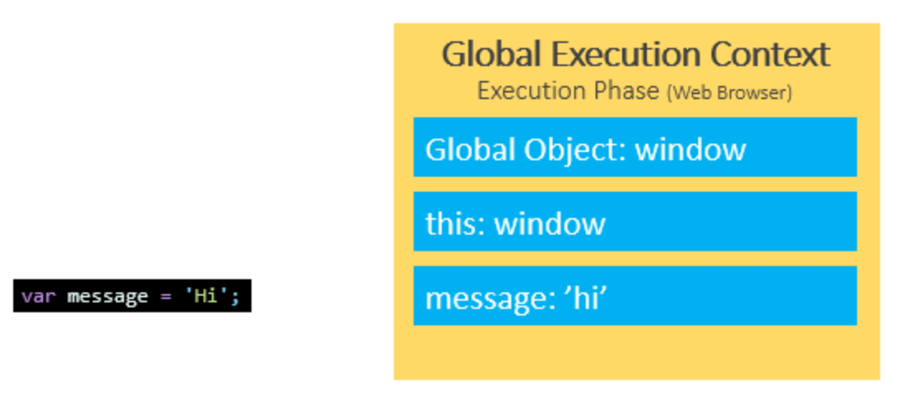
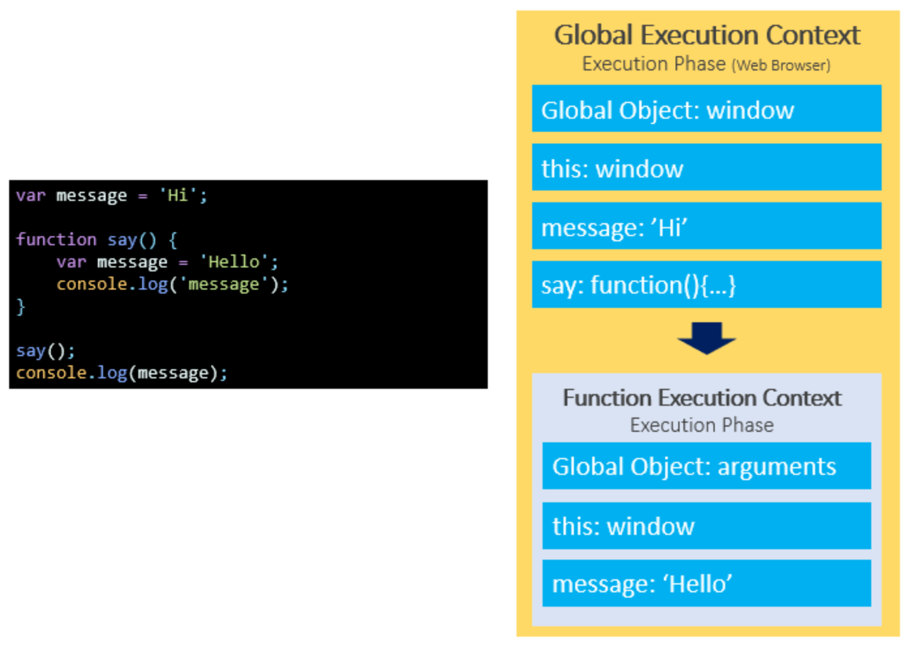
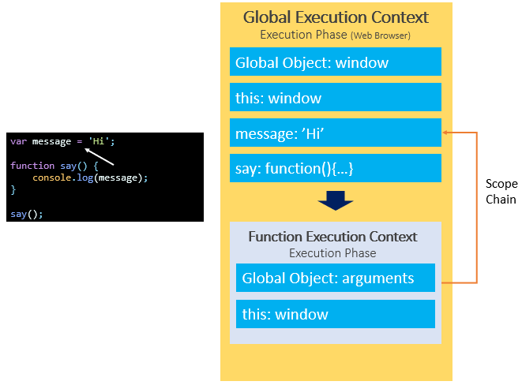

# 3.4.2 Variable Scopes

- Variable scopes determine the visibility and accessiblity of variables

- JS has three scopes:

  - Global Scope

  - Local Scope

  - Block Scope (ES6)

- Global Scope:

  - Variables declared outside of functions are assigned to global execution context and they are in the global scope. They are accessible everywhere in the script.

- Local Scope:

  - The variables that you declare inside a function are local to the function. They are called local variables.

  - When the JavaScript engine executes the function, it creates a function execution context. The variable message declared inside the function is bound to the function execution context of the function, not the global execution context.

- Scope Chain:

  - When we refer the global-scoped variable inside the function, then JS engine seaches the variable in the function execution context and it can't find any. Then it finds in the outer execution context, which is GEC. The way that JavaScript resolves a variable is by looking at it in its current scope, if it cannot find the variable, it goes up to the outer scope, which is called the scope chain.

  - https://www.javascripttutorial.net/javascript-variable-scopes/
