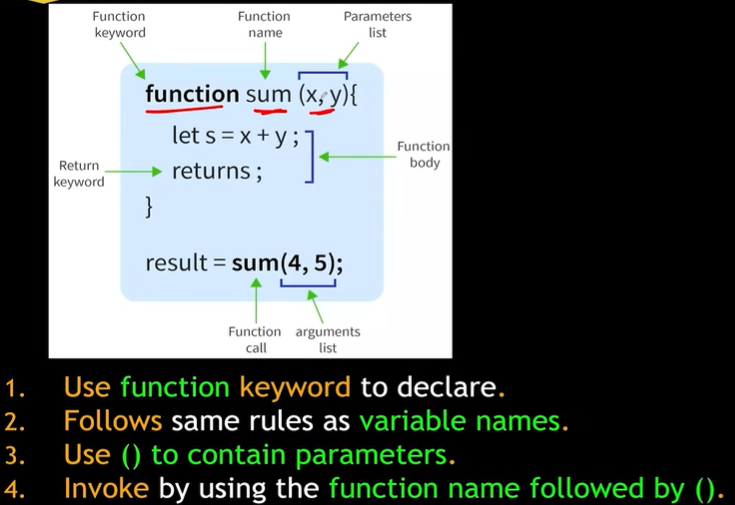
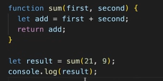

# 3.6 Functions

Section 5. Functions

- [Functions](<https://www.javascripttutorial.net/javascript-function/>) – introduce you to functions in JavaScript.

- [Functions are first-class citizens](<https://www.javascripttutorial.net/javascript-functions-are-first-class-citizens/>) – learn how to store functions in the variables, pass functions into other functions as arguments, and return functions as values.

- [Anonymous Functions](<https://www.javascripttutorial.net/javascript-anonymous-functions/>) – learn about anonymous functions which are the functions without names.

- [Pass-by-value](<https://www.javascripttutorial.net/javascript-pass-by-value/>) – understand how pass-by-value works in JavaScript.

- [Recursive function](<https://www.javascripttutorial.net/javascript-recursive-function/>) – learn how to define recursive functions.

- [Default Parameters](<https://www.javascripttutorial.net/es6/javascript-default-parameters/>) – show you how to define default parameters for functions.

- [Default function parameters](<https://www.javascripttutorial.net/es6/javascript-default-parameters/>) – learn how to set the default value for parameters of a function.

- [Returning multiple values](<https://www.javascripttutorial.net/javascript-return-multiple-values/>) – guide you on how to return multiple values from a function.

- [Functions](<https://javascript.info/function-basics>)

- [Function expressions](<https://javascript.info/function-expressions>)

| - Functions = First class citizens/variables. This means that functions are treated like any other data type (such as numbers, strings, or objects) and can be manipulated and used in various ways that are typically reserved for values. The ability to use functions as values, and to passed as argument and returned from functions is called first class functions. - First class functions - Functions can be passed as "arguments" to another functions: Functions can be passed as arguments to other functions, enabling concepts like callbacks and higher-order functions. const myFunction = function() { console.log("Hello from a variable!"); }; function executeCallback(callback) { callback(); } executeCallback(myFunction); // Passes myFunction as an argument - **Returned as values from other functions:** Functions can be returned as the result of another function's execution, which is fundamental to concepts like closures and function factories. function createGreeter(greeting) { return function(name) { console.log(`${greeting}, ${name}!`); }; } const sayHello = createGreeter("Hello"); sayHello("Alice"); // Outputs: Hello, Alice! |
| --- |

- **Stored in data structures:** Functions can be stored within arrays, objects, or other data structures.

const functionArray = \[

function() { console.log("Function 1"); },

function() { console.log("Function 2"); }

\];

functionArray\[0\](); // Invokes the first function in the array

Anonymous Function:

- A function that doesn’t have a name is called anonymous function.

- Anonymous function do not have an identity. According to ECMA script notation, a function must have a name.

- | function() {   } |  |
| --- | --- |

- Anonymous functions are used in a place where functions are used as values. Anonymous function can be assigned to a variable.
