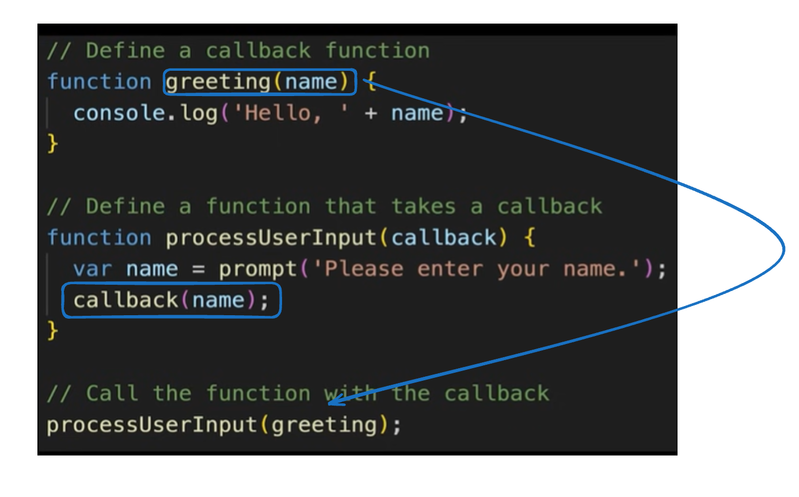

# 3.6.1 Callbacks

[Callback functions](<https://www.javascripttutorial.net/javascript-callback/>) – introduce you to the callback functions and learn how to use the callbacks to handle asynchronous operations.

Greeting function is passed as callback in the processUserInput function.

## ASYNC CODE:
