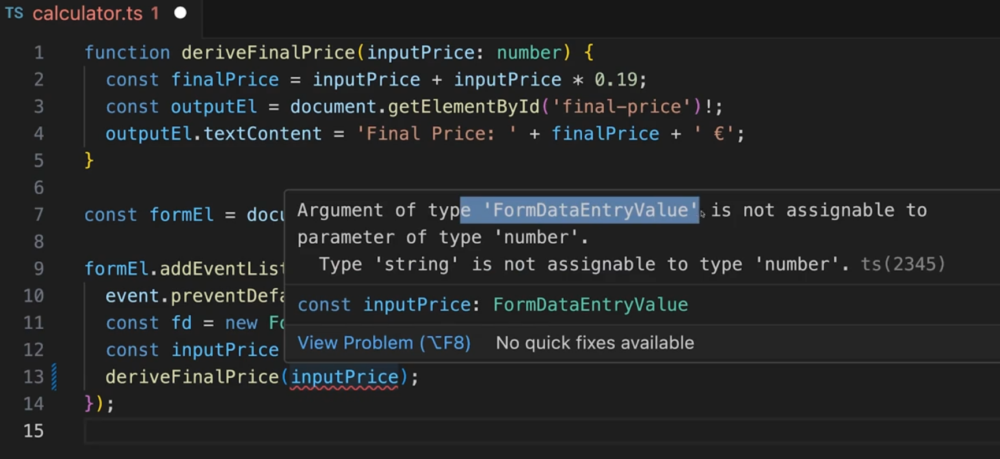
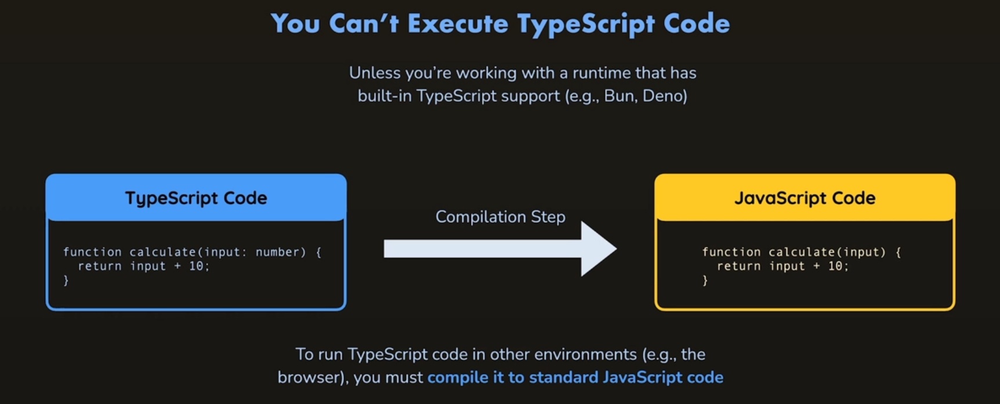

# 4.1 Introduction

- TypeScript is also a popular, mature library maintained by another big company, Microsoft. It allows users to add a rich type system to their JavaScript code, helping them be more productive, particularly in large code bases.

- **TypeScript is**** JavaScript with syntax for types. Javascript superset. Extension to JS: Strict and Static Typing.**

- TypeScript is a strongly typed programming language that builds on JavaScript, giving you better tooling at any scale.

- TypeScript code converts to JavaScript, which runs anywhere JavaScript runs: In a browser, on Node.js, Deno, Bun and in your apps.

All values we extract from an input fields in JS is string. So, when number 15 is entered it is actually '15'.  Javascript concatenates if we add 15 + "2.85" = 152.85

TypeScript shows error before hand:

But TypeScript can't be directly executed in the browser, we also need to install .TS compiler which will compile it to .JS

Compile TS Code:

'**tsc calculator.ts**' ---> calculator.js
