# 4.2 Types

## Assigning and inferring Types

Run ts file directly using node:

**node your_file.ts/your_file.js**

If we don’t specify type then its 'any', or it can be inferred and type narrowed by ts from usage:

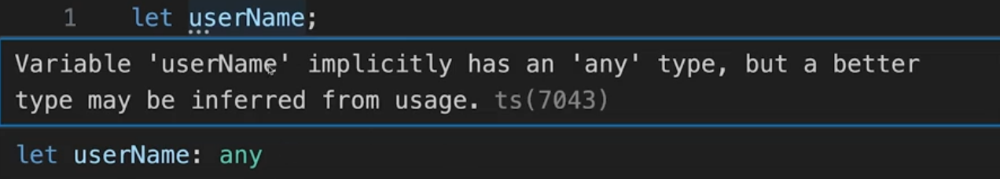

Can set type for variables, parameters:

  1. Variables

let userName: string;

userName = 'Max';

let var_name : <type_annotation/assignment>

JS also has value types, but doesn't have explicit type assignment. Enforcing types is TS functionality.

let userHome = 'Bikaner';

console.log(typeof userHome); ---> string

let userName; --> ts can't infer type

let userAge = 23; --> ts infer (number) type

Reassign is not possible:

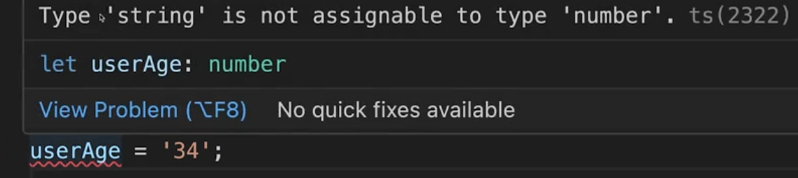

## Default Types:

let age: string | number | undefined = 36;

let hobbies = \['Music', 'Chess'\];

hobbies.push('Study');

infer --> hobbies: string\[\]; can only push string

let users: (string|number)\[\];

let users: Array< string|number >; (Generic Type)

users = \[1, 'Max', 2, 'Anna'\];

let possibleResults: \[number, number\];

possibleResults = \[1,-1\];

possibleResults = \[5,10,12\]; // error

let user: {

name: string;

age: number | string;

hobbies: string\[\];

role: {

description: string;

id: number;

}

} = {

name: 'Max',

age: 38,

hobbies: \['Sports', 'Cooking'\],

role: {

description: 'admin',

id: 5

}

};

**NOTE:**

const someObj = {}; <-- empty object

let val: {} = 'some text'/false/123/{};

--> when defined as type {} means any value that is not null or undefined

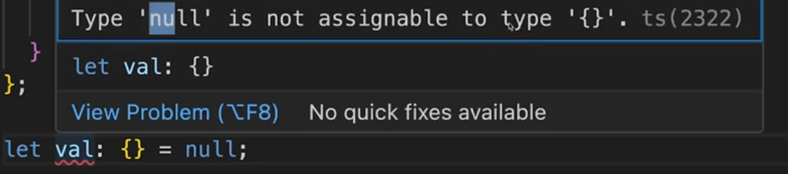

let data: Record<string, number | string>;

data = {

entry1: 1,

entry2: 'some string'

};

Record forces use of object.

type Record<K extends keyof any, T> = { \[P in K\]: T; }

Construct a type with a set of properties K of type T

| ## Enums: Deal with choices. Fixed choice of values to accept in a certain place. Its only available in TS, not in JS. enum Role{ Admin, Editor, Guest, } let userRole: Role = Role.Admin; userRole = Role.Guest; Compiled JS: 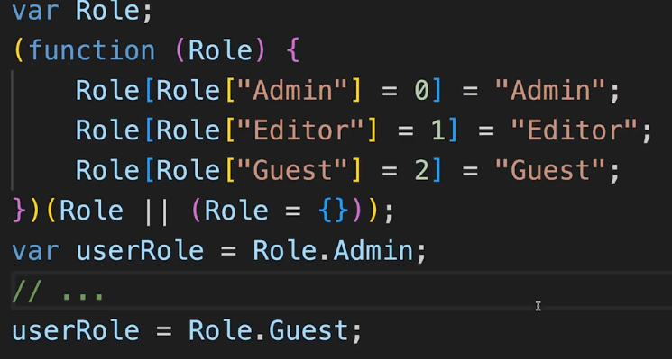 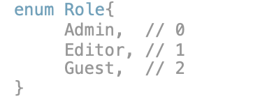 |
| --- |

### Literal Types:

offer greater type safety

let userRole: 'admin'

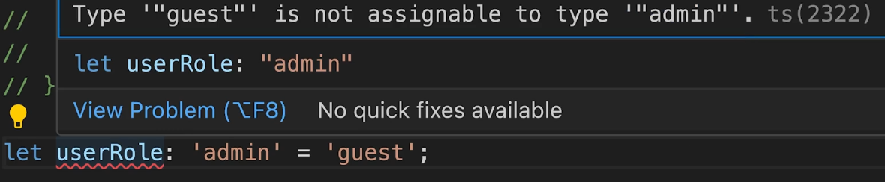

let userRole: 'admin' | 'editor' | 'guest' | 'reader';

userRole = 'guest';

let possibleResults: \[1 | -1, number\]; // \[1, 4\]

let possibleResults: \[1 | -1, 1 | -1\]; // \[1, -1\]

possibleResults = \[1, -1\];

Type Aliases (Custom Type):

type Role = 'admin' | 'editor' | 'guest' | 'reader'; (right side is type definition)

let userRole: Role = 'admin';

function access(role: Role){

. . .

}

Object Type:

type User = {

name: string;

age: number;

role: Role;

permissions: string\[\];

};

### Function Return Value Types:

function add(a: number, b: number) : number {

return a + b;

}

although no need to mention explicitly since ts can infer it most of the times.

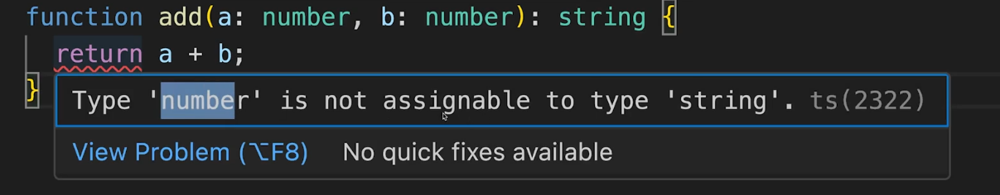

Void type since function doesn't return:

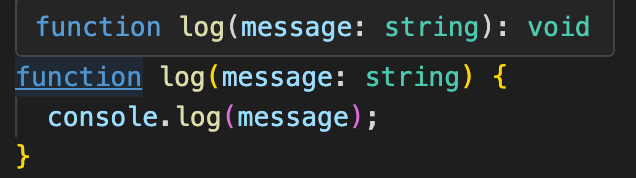

Never --> this will never complete :

function logAndThrow(errorMessage: string): never {

console.log(errorMessage);

throw new Error(errorMessage);

}

const logged = logAndThrow('Hi'); logged : never

Arrow Function:

const logMsg = (msg: string) => {

console.log(msg);

// no return : void

};

function performJob(cb: (msg: string) => void) {

// ...

cb('Job done!');

}

(msg: string) => void --> function type of cb => return type

performJob(logMsg);

type User = {

name: string;

age: number;

greet: () => string;

};

let user: User = {

name: 'Lavesh',

age: 23,

greet() {

console.log('Hello there!');

return this.name;

}

}

user.greet();

### Null and Undefined: (JS Features)

export const getRegionNameByHostName = (

hostname: string | undefined,

): string | null => {

if (!hostname) {

return null;

}

const regex = /devops\\.(.\*?)\\.oci/g;

const match = regex.exec(hostname);

if (!match || match.length < 2) {

return null;

}

return match?.\[1\];

};

Inferred Null

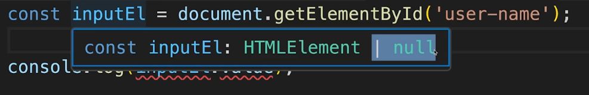

console.log(inputEl.value);

--> inputEl may be possibly null if no element with such an ID

Type narrowing since presence of null already discarded:

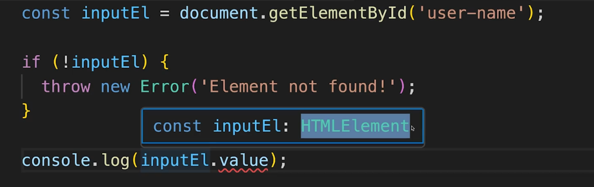

inputEl is now only HTMLElement

Put exclamation! at end of potentially null yielding code. Silence null error of ts. Runtime error if null:

const inputEl = document.getElementById('user-name')!;

or here:

console.log(inputEl!.value);

| This tells that inputEl could be null, and perform .value only if not null: console.log(inputEl?.value); |
| --- |

| TYPECASTING: getElementById gives HTMLElement which doesn't have value property. 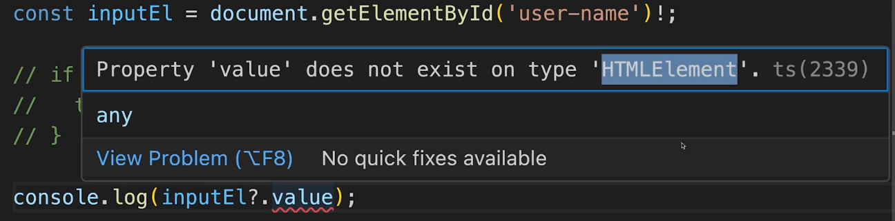 Typecast/ type assertion: <input type="text" id="user-name" /> const inputEl = document.getElementById('user-name') as HTMLInputElement \| null; |
| --- |

| UNKNOWN TYPE: function process(val: unknown) { if ( // type narrowing typeof val === 'object' && !!val && 'log' in val && typeof val.log === 'function' ) { val.log(); } } function process(val: any) { val.log(); } |
| --- |

| OPTIONAL TYPE: make msg parameter optional by adding msg: --> msg?: function generateError(msg?: string) { throw new Error(msg); } generateError(); generateError('Log error'); type User = { name: string; age: number; role?: 'admin' \| 'guest' // optional property }; |
| --- |

| NULLISH COALESCING: (??) ?? checks if left side is null/undefined then right is fallback value let input = ''; const didProvideInput = input ?? false; let input = null/''/0 (falsy); const didProvideInput: false = input \|\| false; |
| --- |
