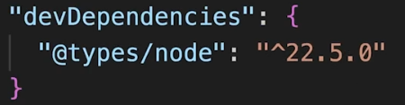

# 4.3 TS Compiler

We can configure TS Compiler. We can manage projects with TS and configure type checking and compilation.

tsc --init --> creates tsconfig.json

tsc

tsc --watch

tsconfig.json -->

{

"compilerOptions": {

"esModuleInterop": true,

"allowJs": true,

"baseUrl": "src",

/\* Language and Environment \*/

"lib": \[

"dom",

"dom.iterable",

"es2015",

"es2016",

"es5",

"es2017",

"es2019.array",

"es2020"

\],

"jsx": "react",

"target": "es5",  --> which js version should the code compile to

"module": "esNext",

"moduleResolution": "node",

"outDir": "./build",

"paths": {

"@clients/\*": \["../gen/clients/\*"\],

"@codegen/\*": \["../gen/\*"\],

"@src/\*": \["../src/\*"\]

},

"plugins": \[

{

"name": "typescript-plugin-css-modules",

}

}

\],

"types": \["jest", "cypress", "node", "@testing-library/jest-dom"\]

},

"include": \["./src/\*\*/\*"\],

"compilerOptions" : {

"strict" : true,

}

}

tsconfig.webpack.json:

{

"extends": "./tsconfig",

"exclude": \[

"\*\*/\*.test.ts",

"node_modules"

\]

}

### TYPE DEFINITIONS FOR THIRD PARTY LIBRARIES:

- Node.js Types Not Built In:
TypeScript does not include Node.js types by default.

- Unrecognized Imports:
TypeScript does not know what to do with imports from modules like Node.js, lodash, Moment.js, or React by default.

- Need for Extra Type Packages:
For third-party libraries, you must manually install additional type packages (**DefinitelyTyped**) because TypeScript won’t recognize their types automatically.
You need to install packages such as @types/node, @types/react, @types/lodash, etc.

