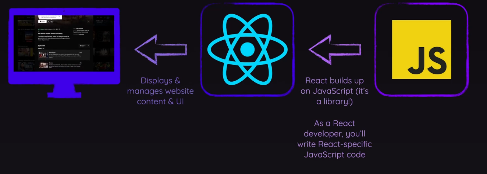
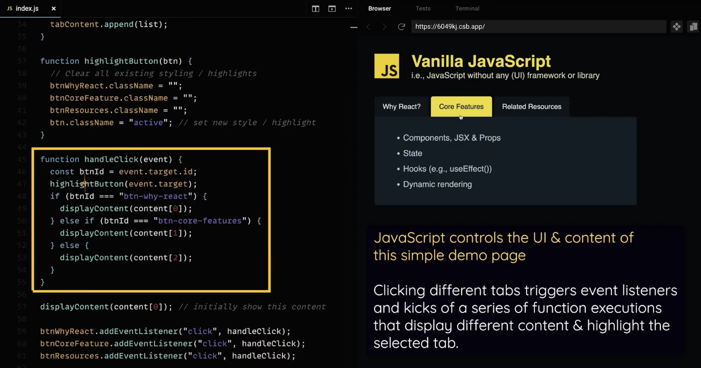
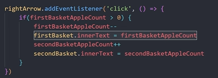
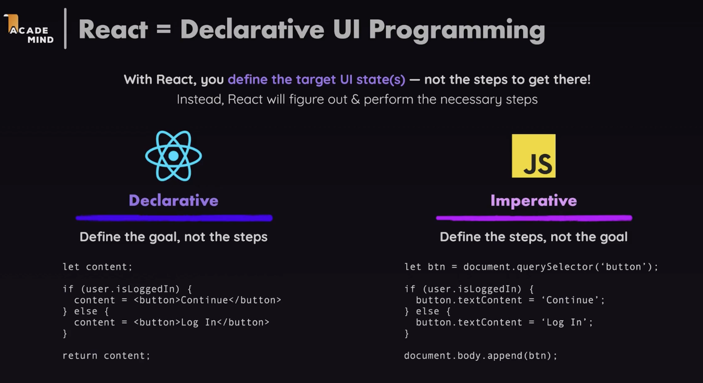
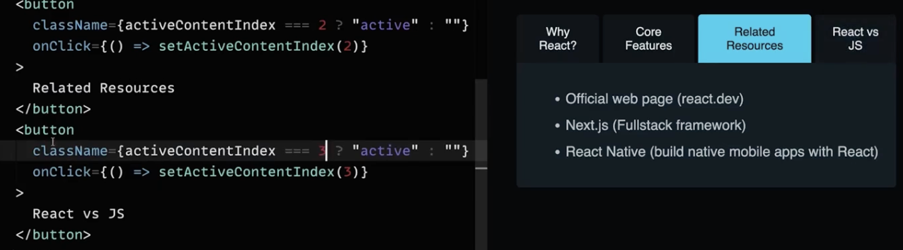
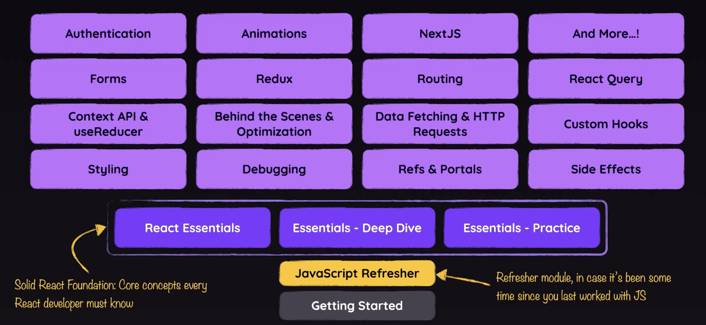

# 5.1 Introduction

- It’s a JavaScript library for building user interfaces. Make frontend. Single Page Applications (SPA) - Page doesn't refresh in browser.

- Smooth transitions without reloading. In the end, its Vanilla JS that does this effect. React just uses the JS features. When clicking a button JS displays different content behind the scenes and updates the webpage without reloading.

- Vanilla JS code for such a complex task can be cumbersome, lengthy and error-prone, hard to maintain. React offers a simpler mental model.

- React updates content without a full page reload primarily through the use of the Virtual DOM and

a process called reconciliation.

- Virtual DOM for performance.

- 

JAVASCRIPT CODE: https://codesandbox.io/p/sandbox/vanilla-js-demo-6049kj?file=%2Findex.js%3A8%2C4

const content = \[

\[

"React is extremely popular",

"It makes building complex, interactive UIs a breeze",

"It's powerful & flexible",

"It has a very active and versatile ecosystem"

\],

\[

"Components, JSX & Props",

"State",

"Hooks (e.g., useEffect())",

"Dynamic rendering"

\],

\[

"Official web page (react.dev)",

"Next.js (Fullstack framework)",

"React Native (build native mobile apps with React)"

\]

\];

const btnWhyReact = document.getElementById("btn-why-react");

const btnCoreFeature = document.getElementById("btn-core-features");

const btnResources = document.getElementById("btn-resources");

const tabContent = document.getElementById("tab-content");

function displayContent(items) {

let listContent = "";

for (const item of items) {

listContent += `<li>${item}</li>`;

}

const list = document.createElement("ul");

tabContent.innerHTML = ""; // clear existing content

list.innerHTML = listContent; // insert new content

tabContent.append(list);

}

function highlightButton(btn) {

// Clear all existing styling / highlights

btnWhyReact.className = "";

btnCoreFeature.className = "";

btnResources.className = "";

btn.className = "active"; // set new style / highlight

}

function handleClick(event) {

const btnId = event.target.id;

highlightButton(event.target);

if (btnId === "btn-why-react") {

displayContent(content\[0\]);

} else if (btnId === "btn-core-features") {

displayContent(content\[1\]);

} else {

displayContent(content\[2\]);

}

}

displayContent(content\[0\]); // initially show this content

btnWhyReact.addEventListener("click", handleClick);

btnCoreFeature.addEventListener("click", handleClick);

btnResources.addEventListener("click", handleClick);

REACT CODE: https://codesandbox.io/p/sandbox/react-vs-vanilla-demo-uc08fv?file=%2Fsrc%2FApp.js%3A6%2C13

import { useState } from "react";

import "./styles.css";

const content = \[

\[

"React is extremely popular",

"It makes building complex, interactive UIs a breeze",

"It's powerful & flexible",

"It has a very active and versatile ecosystem"

\],

\[

"Components, JSX & Props",

"State",

"Hooks (e.g., useEffect())",

"Dynamic rendering"

\],

\[

"Official web page (react.dev)",

"Next.js (Fullstack framework)",

"React Native (build native mobile apps with React)"

\]

\];

export default function App() {

const \[activeContentIndex, setActiveContentIndex\] = useState(0);

return (

<header>

<h1>React.js</h1>

i.e., using the React library for rendering the UI

</header>

<menu>

<button

className={activeContentIndex === 0 ? "active" : ""}

onClick={() => setActiveContentIndex(0)}

>

Why React?

</button>

<button

className={activeContentIndex === 1 ? "active" : ""}

onClick={() => setActiveContentIndex(1)}

>

Core Features

</button>

<button

className={activeContentIndex === 2 ? "active" : ""}

onClick={() => setActiveContentIndex(2)}

>

Related Resources

</button>

</menu>

<ul>

{content\[activeContentIndex\].map((item) => (

<li key={item}>{item}</li>

))}

</ul>

);

}

React watches the variable activeContentIndex (dynamic react managed variable - useState) and if the value of the variable changes, it checks the condition of the HTML code to see if a different UI needs to be rendered then what was rendered before and if required it updates the UI

Vanilla Javascript on the other hand has Imperative Programming: Like everytime we update the value of the variable the we need to update the innerText in DOM by ourselves (by defining the steps).

Updating content\[\] array, we add a fourth button. When button is clicked, the list for 4th button will be shown.

**Add another button using:**

<button

className = {activeContentIndex === 3 ? "active" : ""}

onClick={() => setActiveContentIndex(3)} >

React VS JS

</button>

React has component based architecture.
