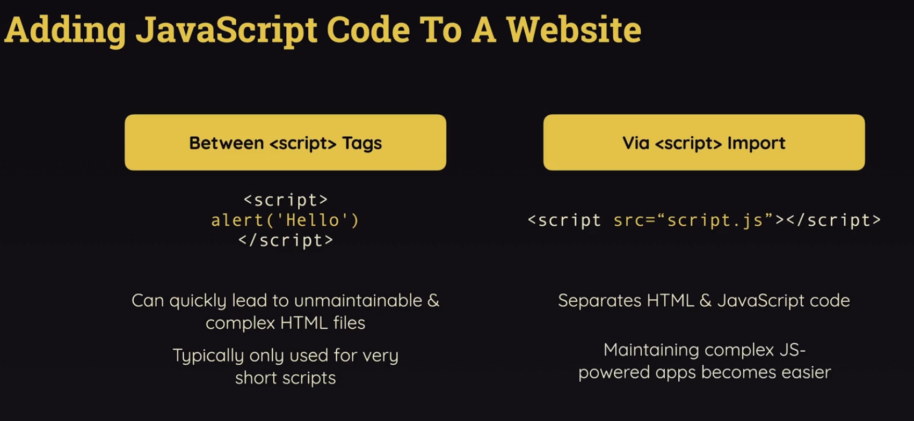
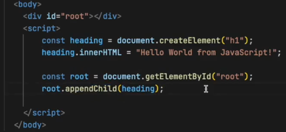
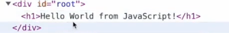

# 5.1.2 JS Code in Websites

## Treating javascript files as modules:

****

This adds a new syntax: import and export ([Import / Export](<onenote:#Import%20\%20Export&section-id={C7003A86-801F-D14A-8AD5-0047A4A32C0D}&page-id={14C3CB4E-A3DB-4439-87E4-10018177739E}&end&base-path=https://d.docs.live.net/1B496228341EAA92/Documents/React/React.one>))

We can export from util.js and import it in app.js

NOTE: When using React we will never add ** **tags in HTML files because react apps use a build process which as a part of the process injects these ** **tags for us.

## Creating Hello World Using JavaScript:

root is reference to div with id="root", and heading will become child of the root div:

|  |  |
| --- | --- |
