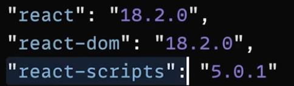
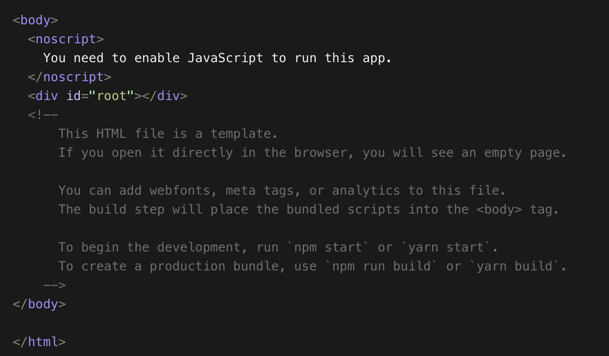
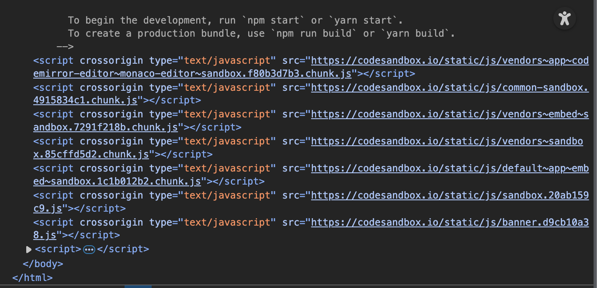
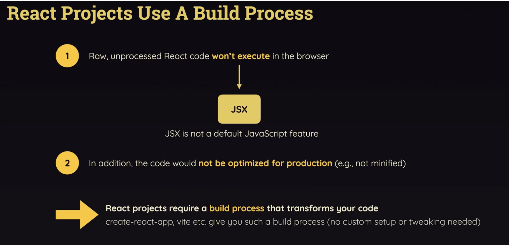

# 5.1.3 React Build Process

## REACT BUILD PROCESS:

The code we write isn't executed as it is in the browser, it is first transformed. This is actually done in the background. React build process converts the react code JSX type into code which can be understood by the browser. It also optimizes a code.

The react-scripts library injects the javascript code into the HTML code:

BEFORE:

AFTER: <script> tags injected into HTML file by build process

JSX code:

App.js

export default function App() {

const \[activeContentIndex, setActiveContentIndex\] = useState(0);

return (

<header>

<h1>React.js</h1>

i.e., using the React library for rendering the UI

</header>

<menu>

<button

className={activeContentIndex === 0 ? "active" : ""}

onClick={() => setActiveContentIndex(0)}

>

Why React?

</button>

<button

className={activeContentIndex === 1 ? "active" : ""}

onClick={() => setActiveContentIndex(1)}

>

Core Features

</button>

<button

className={activeContentIndex === 2 ? "active" : ""}

onClick={() => setActiveContentIndex(2)}

>

Related Resources

</button>

</menu>

<ul>

{content\[activeContentIndex\].map((item) => (

<li key={item}>{item}</li>

))}

</ul>

);

}

Index.js

import { StrictMode } from "react";

import { createRoot } from "react-dom/client";

import App from "./App";

const rootElement = document.getElementById("root");

const root = createRoot(rootElement);

root.render(

<StrictMode>

<App />

</StrictMode>

);

<h1> Hello Top of Root </h1>

<h1> Already present heading! </h1>

<h1> Hello Bottom of Root </h1>

If this is the root element, then render is going to replace the content in the root. For a brief moment it will be visible before it is replaced by React. Because first of all browser prints the HTML and as soon as it goes to scripts, loads react and then react to app.js script, it renders the HTML through JS code. React takes control of div:root once app.js starts executing.

However the h1 top and h1 bottom remain as it is. This is why React is called a library and not a framework. It can be applied to any single element also. It can be applied to only footer, sidebar, root etc.
