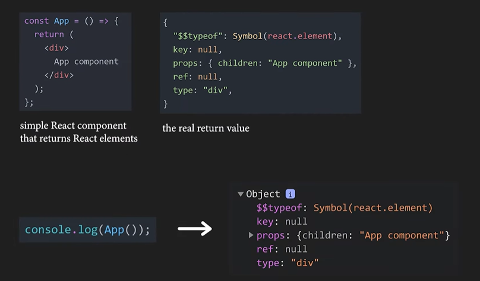
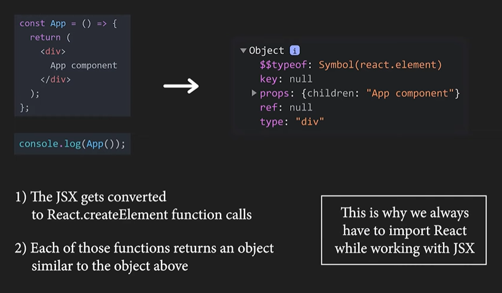
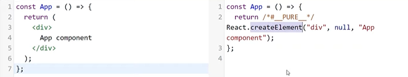
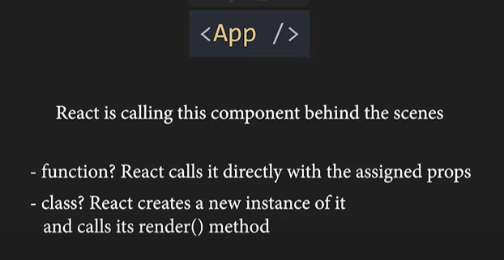

# 5.1.4 Reconcillation, Diffing

Keywords: Virtual DOM, Reconcillation, Diffing, Rendering

React component that returns React elements using JSX but the return value is actually a JS object.

JSX --> React.createElement calls --> return object

Remember: createElement(type, props, children)

