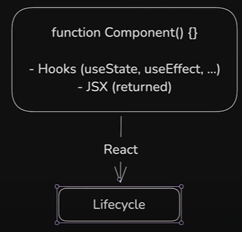
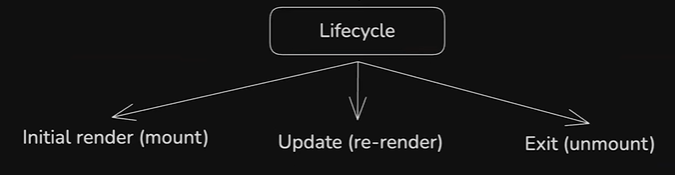
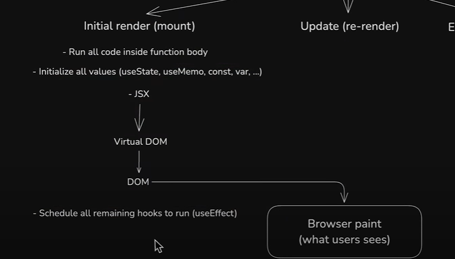

# 5.1.5 React Lifecycle

- Components are essentially JavaScript functions that get executed. Returns JSX (which converts to HTML markup)

- React puts these functions in its lifecyle and executes them. This adds extra functionality like hooks.

Three steps in lifecycle:

  1. Render, mount

  1. Update, re-render

  1. Exit, unmount

