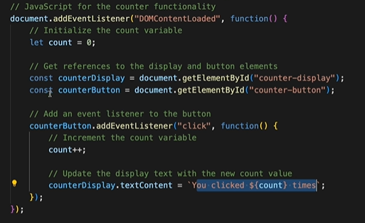

# 5.13.1 useState

When we want our component to remember some information or display it, then we can add "state" to our component using **useState **Hook from React. Enables component-local state in **function components**.

**const \[state, setState\] = useState(initialState);**

state → current state value for this render

setState → function to schedule a state update

initialState → value OR lazy initializer function

If initial computation is expensive:

**const \[value, setValue\] = useState(() => computeExpensiveValue());**

React only calls the initializer **once per mount** (not per re-render).

Updating the screen:

When we want our component to remember some information or display it, then we can add "state" to our component using **useState **Hook from React.

import { useState } from 'react';

function MyButton() {

const \[currentState, setOrUpdateCurrentState\] = useState(initValue);

}
