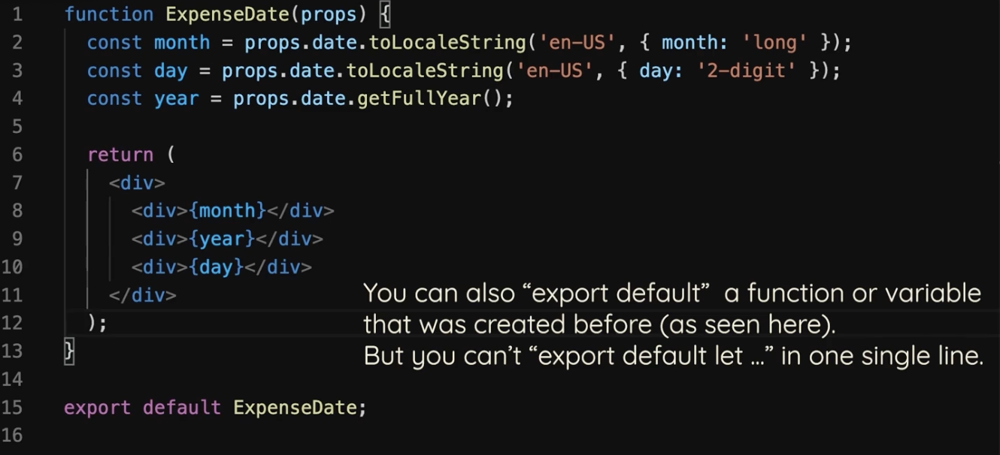

# 5.2.1 Import / Export

## IMPORT / EXPORT :

If we want apiKey variable to be available outside its file then we need to export it:

export let apiKey = "adnasdoasflak1";

To access the variable:

import { apiKey } from "./util.js";

- During the build step of a modern JavaScript project (such as React), tools like Webpack, Rollup, or Vite are used to process source files. These tools traverse ES6 module import and export statements across multiple files, then combine ("bundle") them into one or more large output files. Bundling reduces the number of HTTP requests required to load the application, as the browser fetches only a few large files instead of many small ones. Also, some browsers may not support ES6 module syntax (import export natively) so bundling ensures that the browser can run the file.

- Without Bundler (Vanilla JS): If an application does not use a build/bundling step and relies directly on ES6 modules in development, it's required to use type="module" in the <script> tag. This ensures the browser treats the script as an ES6 module and supports import/export natively.

- React Projects: Typically, React applications set up with Create React App, Vite, or a similar tool do not include type="module" in the script tags by default, because their build tools handle all bundling, compatibility, and ordering of dependencies. The user imports the output JavaScript bundle(s) as standard scripts.

DEFAULT:

This must be the default thing which must be exported by the file.

There should be only one default export. We can have as many export let as we want.

export default "defflak1";

util.js : export default "defflak1";

Apps.js : import apiKey from "./util.js";  ---> defflak1

When using default export, we can import value into any variable name that we want.

export default "defflak1";

export let apiKey = "adnasdoasflak1";

export let abc = "abc";

import { apiKey, abc} from "./util.js";

import \* as util from "./util.js";

All the things exported by util.js would be grouped into an object 'util' and we can use it using JS object notation.

console.log(util.apiKey);

console.log(util.default);

console.log(util.abc);

As keyword can be used for alias -->

import { apiKey, abc as content } from "./util.js";

console.log(content);

**Exports & Imports**

In React projects (and actually in all modern JavaScript projects), you split your code across multiple JavaScript files - so-called modules. You do this, to keep each file/ module focused and manageable.

To still access functionality in another file, you need export (to make it available) and import (to get access) statements.

You got two different types of exports: **default** (unnamed) and **named** exports:

**default** => export default ...;

**named** => export const someData = ...;

You can import **default exports** like this:

import someNameOfYourChoice from './path/to/file.js';

Surprisingly, someNameOfYourChoice is totally up to you.

**Named exports** have to be imported by their name:

import { someData } from './path/to/file.js';

A file can only contain one default and an unlimited amount of named exports. You can also mix the one default with any amount of named exports in one and the same file.

When importing **named exports**, you can also import all named exports at once with the following syntax:

import \* as upToYou from './path/to/file.js';

upToYou is - well - up to you and simply bundles all exported variables/functions in one JavaScript object. For example, if you export const someData = ... (/path/to/file.js ) you can access it on upToYou like this: upToYou.someData .
