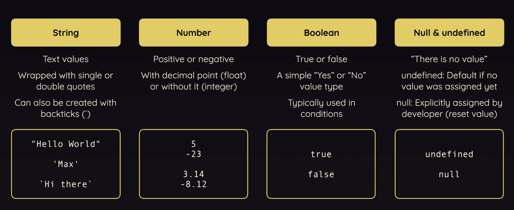
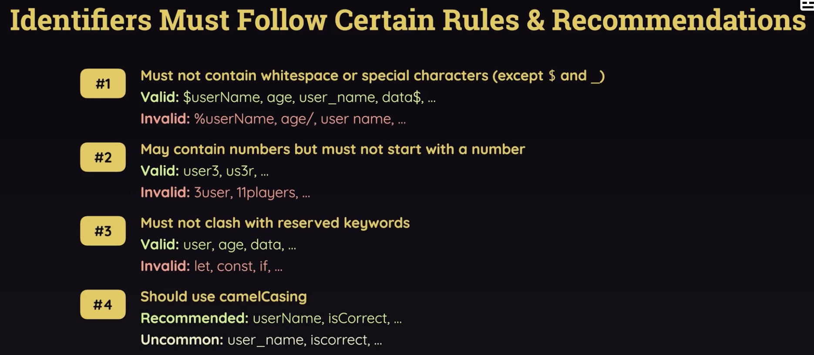
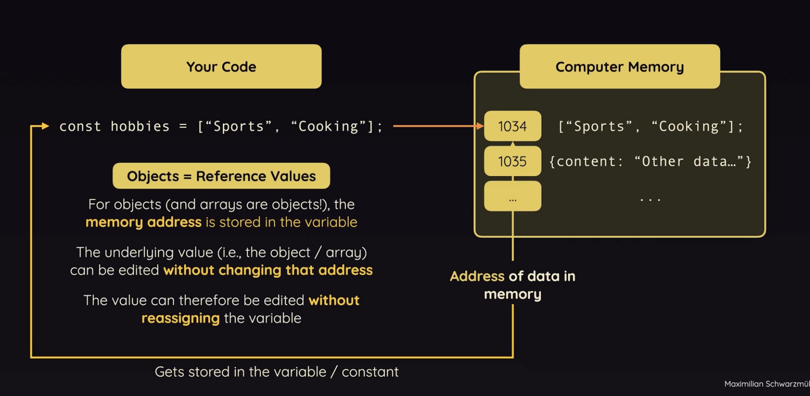

# 5.2.2 Variables

## VARIABLES:

Variable name = Variable Identifier

PRIMITIVES:

userMsg = "hello"

userMsg = userMsg.concat("!");

- Primitives can't be changed in-place. Immutable.

- You can assign a new value to a variable, but this doesn't change the original value—it just points the variable to the new value. We can't change the values, we can produce new values.

let str = "hello";

str\[0\] = "j";  // Has no effect

console.log(str); // "hello"

You cannot modify "hello" directly; any "modification" creates a new string.

Arrays and Objects - Reference Values

When we edit the array, the content of the array changes but the address of array which is stored inside of hobbies is unchanged.

