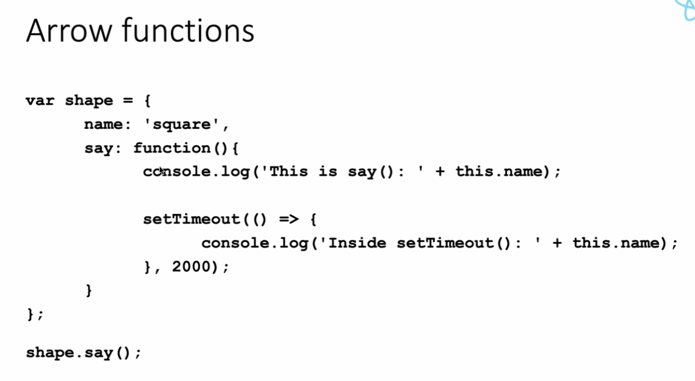

# 5.2.4 Functions

## FUNCTIONS:

Functions can be created using:

  1. Function keyword

  1. () => arrow syntax

PARAMETER                      DEFAULT VALUE OF PARAMETER

function createGreeting(userName, message = "Hello!") {

console.log(userName);

console.log(message);

return "Hi, I am " + userName + ". " + message;

}

Function is defined and then called later for use. Default value of parameter can be overridden.

Function must only have one return statement.

Functions with no return statement, implicitly return "undefined"

const greeting1 = createGreeting("Max");

console.log(greeting1);

const greeting2 = createGreeting("Manuel", "Hello, what's up?");

console.log(greeting2);

ARROW FUNCTIONS: () =>

  - When dealing with anonymous functions

  - Eg:

<button

className={activeContentIndex === 0 ? "active" : ""}

onClick={() => setActiveContentIndex(0)}

>

  - We used the arrow function syntax to define a function in the place where its needed as a value for this click listener.

  - This is an anonymous function (with no name):

| Export default function(<parameter list>) { Console.log("ello"); Return parameter\[0\]; } | Export default (<parameter list>) => { Console.log("ello"); Return parameter\[0\]; } |
| --- | --- |

**More on the Arrow Function Syntax**

When working with **Arrow Functions**, you have a couple of *"syntax shortcuts"* available.

Most importantly, you should know about the following alternatives:

**1) Omitting parameter list parentheses**

If your arrow functions takes **exactly one parameter**, you may **omit** the wrapping parentheses.

Instead of

1. (userName) => { ... }

you could write

1. userName => { ... }

**Please note: **

  - If your function takes **no parameters**, parentheses **must not be omitted** - () => { ... } is the **only correct form** in that case.

  - If your function takes **more than one parameter**, you also **must not omit** parentheses - userName, userAge => { ... } would be invalid ((userName, userAge) => { ... } is correct)!

**2) Omitting function body curly braces**

If your arrow function contains **no other logic but a ****return**** statement**, you may **omit the curly braces** and the return keyword.

Instead of

1. number => {

1. return number \* 3;

1. }

you could write

1. number => number \* 3;

The following code would be invalid:

1. number => return number \* 3; // invalid because return keyword must also be omitted!

1. number => if (number === 2) { return 5 }; // invalid because if statements can't be returned

**3) Special case: Just returning an object**

If you go for the shorter alternative explained in 2) and you're trying to return a **JavaScript object**, you may end up with the following, **invalid** code:

1. number => { age: number }; // trying to return an object

This code would be invalid because JavaScript treats the curly braces as **function body wrappers** (not as code that creates a JS object).

To *"tell"* JavaScript that an object should be created (and returned) instead, the code would need to be adjusted like this:

1. number => ({ age: number }); // wrapping the object in extra parentheses

By wrapping the object and its curly braces with an **extra pair of parentheses**, JavaScript understands that the curly braces are not there to define a function body but instead to create an object. Hence that object then gets returned.

**ES6 Arrow Functions**

Read more:  https://developer.mozilla.org/en-US/docs/Web/JavaScript/Reference/Functions/Arrow_functions

Arrow functions are a different way of creating functions in JavaScript. Besides a shorter syntax, they offer advantages when it comes to keeping the scope of the this keyword (see [here](<https://developer.mozilla.org/en-US/docs/Web/JavaScript/Reference/Functions/Arrow_functions#No_binding_of_this>)).

Arrow function syntax may look strange but it's actually simple.

function callMe(name) {

console.log(name);

}

which you could also write as:

const callMe = function(name) {

console.log(name);

}

becomes:

const callMe = (name) => {

console.log(name);

}

**Important: **

When having **no arguments**, you have to use empty parentheses in the function declaration:

const callMe = () => {

console.log('Max!');

}

When having** exactly one argument**, you may omit the parentheses:

const callMe = name => {

console.log(name);

}

When **just returning a value**, you can use the following shortcut:

const returnMe = name => name

That's equal to:

const returnMe = name => {

return name;

}

### FUNCTION PASSED AS VALUE IN FUNCTIONS:

function handleTimeout() {

console.log("Timed out!");

}

const handleTimeout2 = () => {

console.log("Timed out ... again!");

};

setTimeout(handleTimeout, 2000);

--------> don't add parentheses, we are passing function as a value (using variable used to store anonymous function), if we wrtie handleTimeout() then the return value of that function would be passed to setTimeout

setTimeout(handleTimeout2, 3000);

setTimeout(() => {

console.log("More timing out...");

}, 4000);

### FUNCTION DEFINED INSIDE OF ANOTHER FUNCTION:

function init() {

function greet() {

console.log(“Hi!“);

}

init();

### FUNCTION CALLED INSIDE OF ANOTHER FUNCTION:

Function greeter(greetFn){

greetFn();

}

Greeter(() => console.log("Hi"););

**Destructuring in Function Parameter Lists**

The destructuring syntax explained in the previous lecture can also be used in **function parameter lists**.

For example, if a function accepts a parameter that will **contain an object** it can be destructured to *"pull out"* the object properties and make them available as **locally scoped variables** (i.e., variables only available inside the function body).

Here's an example:

1. function storeOrder(order) {

1. localStorage.setItem('id', order.id);

1. localStorage.setItem('currency', order.currency);

1. }

Instead of accessing the order properties via the *"dot notation"* inside the storeOrder function body, you could use destructuring like this:

1. function storeOrder({id, currency}) { // destructuring

1. localStorage.setItem('id', id);

1. localStorage.setItem('currency', currency);

1. }

The destructuring syntax is the same as taught in the previous lecture - just without creating a constant or variable manually.

Instead, id and currency are *"pulled out"* of the incoming object (i.e., the object passed as an argument to storeOrder).

It's very important to understand, that storeOrder **still only takes one parameter** in this example! It does **not** accept two parameters. Instead, it's one single parameter - an **object** which then just is destructured internally.

The function would still be called like this:

1. storeOrder({id: 5, currency: 'USD', amount: 15.99}); // one argument / value!
