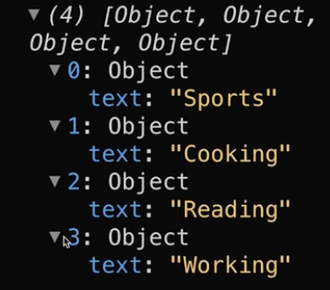

# 5.2.7 Arrays

## ARRAYS:

const hobbies = \["Sports", "Cooking", "Reading"\];

console.log(hobbies\[0\]);

Utility array methods: https://developer.mozilla.org/en-US/docs/Web/JavaScript/Reference/Global_Objects/Array

hobbies.push("Working");

console.log(hobbies);  -->. \["Sports", "Cooking", "Reading", "Working"\]

const index = hobbies.findIndex((item) => { return item === "Sports"});

const index = hobbies.findIndex((item) => item === "Sports");

console.log(index);   --> 0

(object)

const editedHobbies = hobbies.map((item) => ({ text: item }));

console.log(editedHobbies);

ARRAY TO JSX LIST COMPONENT:

<ul>

{content\[activeContentIndex\].map((item) => ( <li key={item}>{item}</li>))}

</ul>

Manipulating DOM:

const list = document.querySelector("ul");

list.remove();
