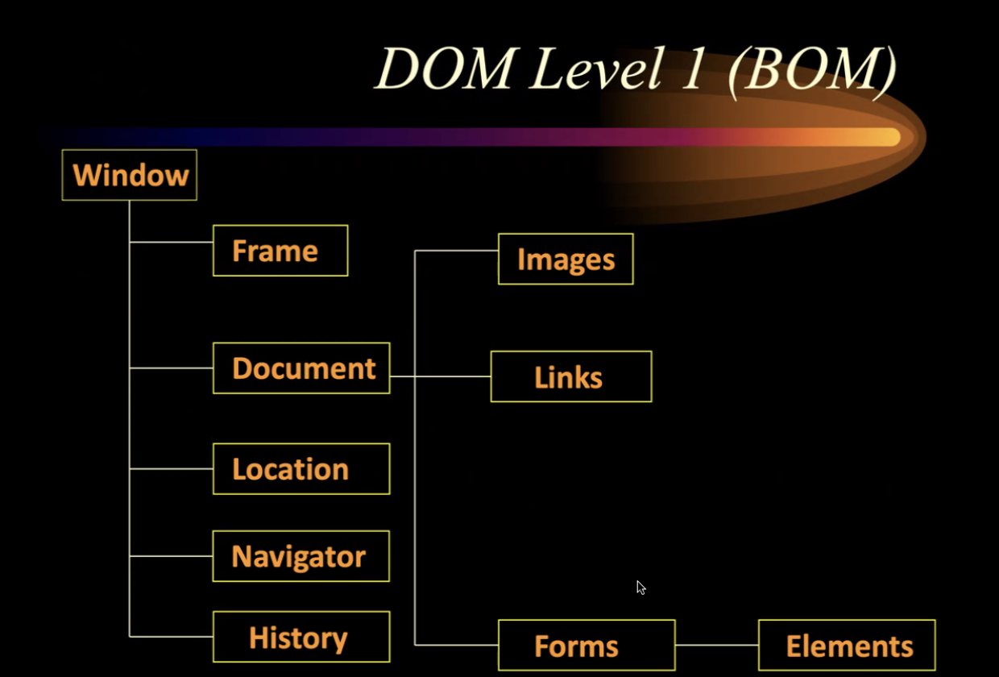
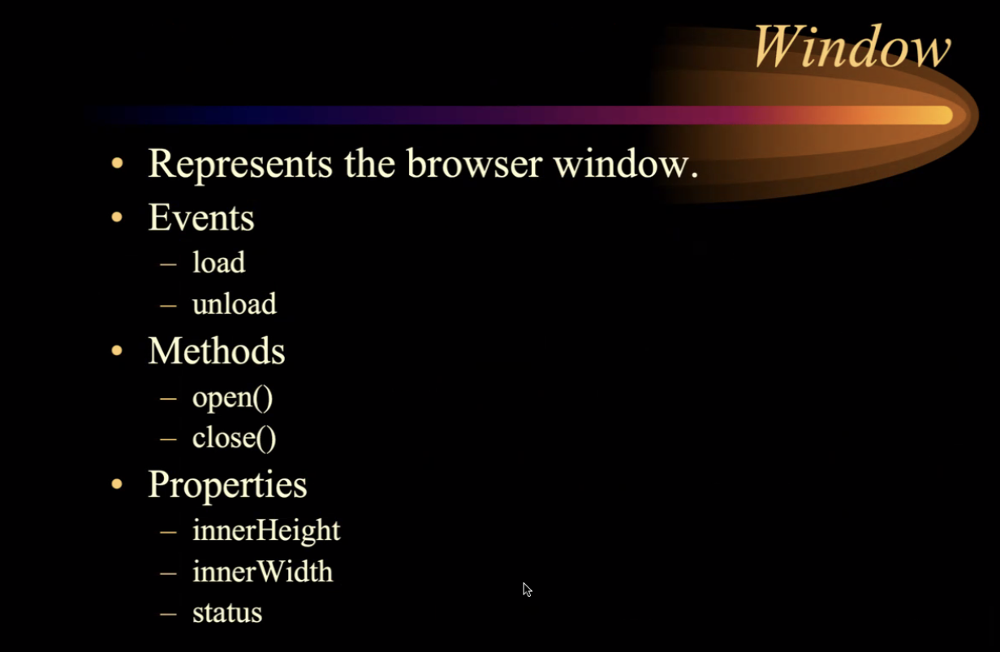
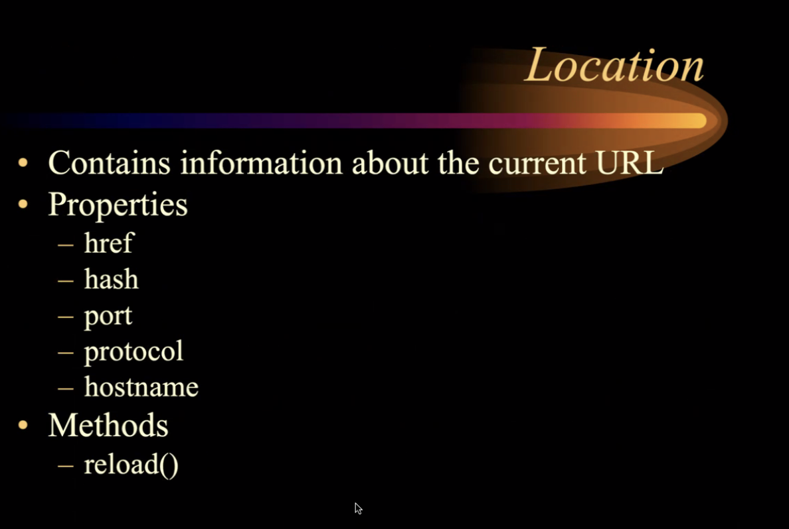
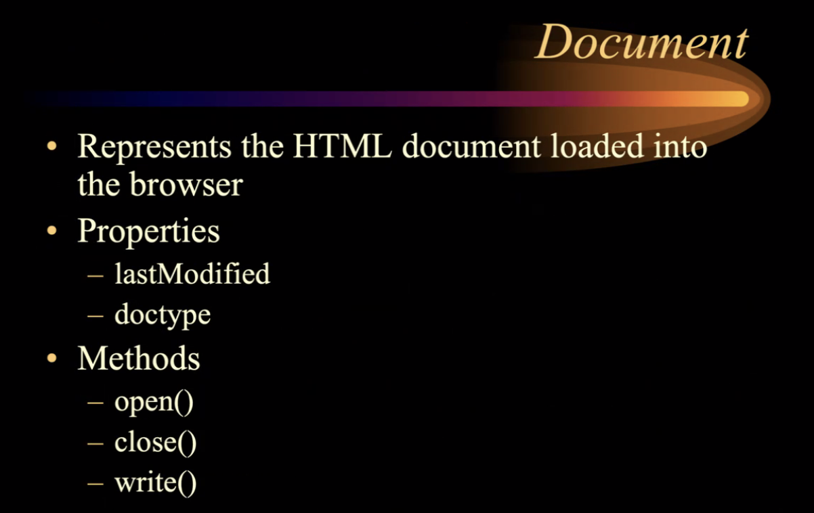
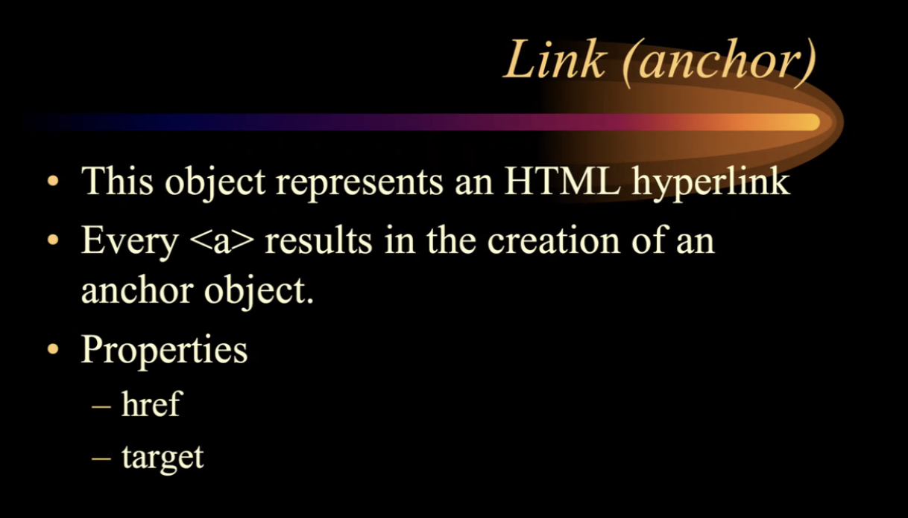
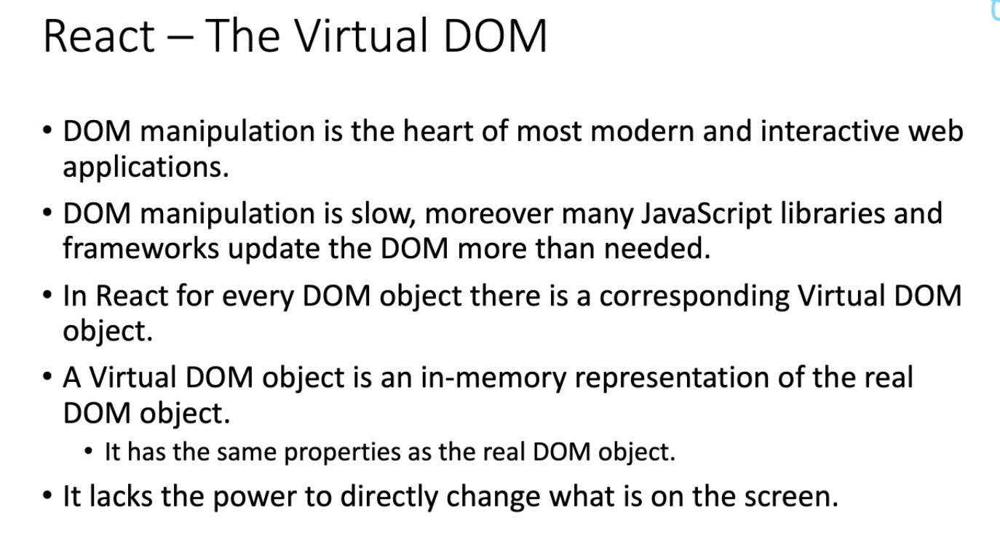
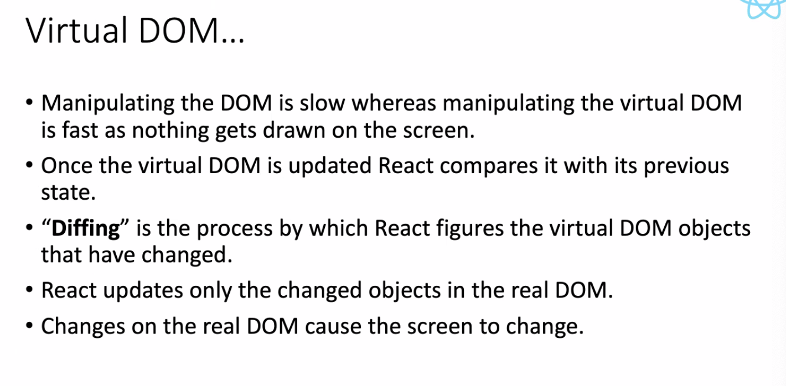

# 5.3 BOM / DOM

- Render the content, based on understanding of <h1> tags

- Every browser has a **RenderingEngine**

HTML tags for demanding user interaction/intervention:

  - <form> </form> ---> input, button etc.

  -   ---> se up a link for user to click

Need of Scripting:

  - Scripts can work in conjuction with HTML to have some logical ability: JS

  - 

  - As soon as broswer finds a script tag, it initialises a **ScriptEngine**

  - **Script block can't be nested**

<abc> Oracle World </abc>

If a browser encounters abnormal tag, the tag is ignored. The content between the tag is displayed as it is.

<html>

<head>

<title> JS Example </title>

</head>

<body>

<h1> JS Example</h1>

<form>

<input type="button" name="btn1" id="btn1" value="Click" onclick="greeting()">

</form>

</body>

</html>

6 CORE OBJECTS provided by JS language:

  - Array

<!DOCTYPE html PUBLIC "-//W3C//DTD XHTML 1.0 Transitional//EN" "http://www.w3.org/TR/xhtml1/DTD/xhtml1-transitional.dtd">

<html xmlns="http://www.w3.org/1999/xhtml" >

<head>

<title>Untitled Page</title>

</head>

<body>

<form>

<input type="button" value="Array Demo" onclick="myArray()" />

</form>

</body>

</html>

  - Date

<!DOCTYPE html PUBLIC "-//W3C//DTD XHTML 1.0 Transitional//EN" "http://www.w3.org/TR/xhtml1/DTD/xhtml1-transitional.dtd">

<html xmlns="http://www.w3.org/1999/xhtml" >

<head>

<title>Untitled Page</title>

</head>

<body>

</body>

</html>

  - Math

<!DOCTYPE html PUBLIC "-//W3C//DTD XHTML 1.0 Transitional//EN" "http://www.w3.org/TR/xhtml1/DTD/xhtml1-transitional.dtd">

<html xmlns="http://www.w3.org/1999/xhtml" >

<head>

<title>Untitled Page</title>

</head>

<body>

</body>

</html>

  - String

<!DOCTYPE html PUBLIC "-//W3C//DTD XHTML 1.0 Transitional//EN" "http://www.w3.org/TR/xhtml1/DTD/xhtml1-transitional.dtd">

<html xmlns="http://www.w3.org/1999/xhtml" >

<head>

<title>Untitled Page</title>

</head>

<body>

</body>

</html>

  - Object

<html>

<head>

<title>CreateObject Example</title>

</head>

<body>

<h2>Creating Objects directly</h2>

<form>

<input type="button" value="CreateObjects" onclick="makeObject()">

<input type="button" value="GetNames" onclick="getData()">

</form>

</body>

</html>

Document Object Model:

Series of Objects provided by browser.

Hierarchial Structure

DOM-1 = Browser Object Model

Collection of objects provided by the browser which we can programatically access.

Window = browser window

Location = has read-write properties….

DOM LEVEL 2

CHANGES MADE TO DOM-2 ARE TRANSIENT. NON-PERSISTENT.

DOM-2 IS document of DOM-1 (BOM)

DOM-2 is in-memory tree.

